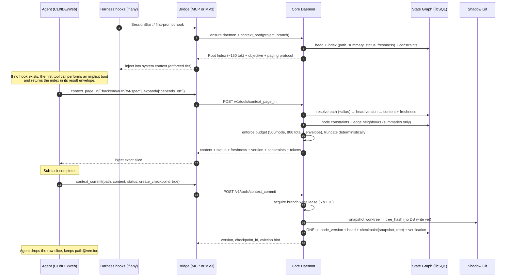
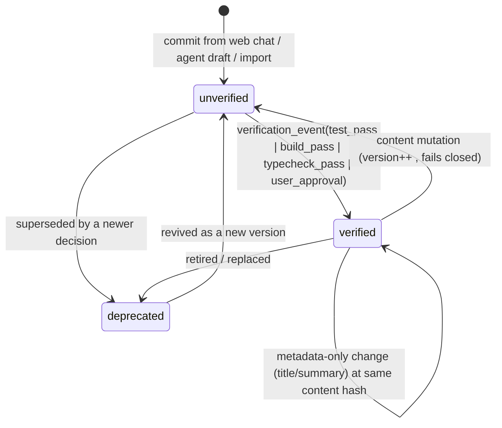

# ChronosCtx — Universal Stateful Context OS & Time-Travel Harness

**Roadmap, Architecture & Implementation Plan**

| Field | Value |
| --- | --- |
| Project | `chronos-ctx` (ChronosCtx) |
| Document | `roadmap.md` — **v1.3 (Phase 0 complete; checkpoints, budgets, and dependency model measured)** |
| Supersedes | v1.2, 2026-11-16; v1.1, 2026-11-16; v1.0, 2026-11-15. Every change is itemised in Appendix D (delta register) |
| Status | **PHASE 0 COMPLETE — verdict GO, conditional on amendments A1–A8 (delta C17), which this revision adopts** |
| Evidence | `docs/phase0/REPORT.md` (verdict) and `docs/phase0/METHOD.md` (method); raw artifacts in `bench/results/` |
| Date | 2026-11-16 |
| Audience | Principal architect, lead infra engineer, OSS contributors, design partners, security reviewers |
| Scope | Normative architecture, schemas, protocols, security model, supply-chain model, phased plan. No application code in this revision. |
| License | **Apache-2.0** (decided, D12) |
| Protocol versions | `paging-v1`, `capsule-v1`, `mcp-surface-v1`, `db-schema-v1` |

> **How to use this document.** §1–2 explain *why* and *how the system behaves*, including exactly where guarantees are enforced and where they are only advisory. §3 fixes the stack and repo layout. §4 is **normative** (SQL DDL, git plumbing recipes, MCP schemas, protocol rules) — implementation must match it or amend it by ADR. §5 is the executable plan. §6 defines the gates that must pass before the next phase starts. §7 records the **locked decisions** (D1–D12); nothing there is open for interpretation, and re-opening any of them requires an RFC + ADR amendment. Appendix A is the risk register, Appendix B the ADR index, Appendix C the glossary, Appendix D the v1.2 delta register and the claims-to-evidence register.

---

## 1. Executive Summary & System Vision

### 1.1 The problem, stated precisely

AI-assisted engineering fails at four seams, and all four are *state-management* failures rather than model failures:

1. **Context fragmentation across surfaces.** Work begins in Gemini or ChatGPT, is refined in Claude/Qwen, then executes in OpenCode, Antigravity, Claude Code, Cline, Cursor, or Pi. Every surface is an isolated memory silo. Continuity is maintained by human copy-paste: lossy, slow, and unversioned.
2. **Token bloat.** Re-sending static files, stale history, and noisy terminal output routinely consumes 70%+ of input tokens. This degrades reasoning quality, destroys prompt-cache hit rates, and inflates cost per turn.
3. **No atomic rollback of *reasoning*.** A bad refactor at step 8 of 12 is reversible with `git reset --hard`, but the failed reasoning remains in the context window and poisons every later turn. Clearing the chat fixes the poisoning but destroys valid steps 1–7.
4. **Hallucination propagation across sessions.** Transcript-RAG tools store turn 3 (the hallucinated method) and turn 6 (the correction) with equal weight. Future sessions retrieve the hallucination because embedding similarity cannot express *supersession* or *falsity*.

These are not prompt-engineering problems. They require a **state layer with epistemic semantics, atomic dual-state snapshots, and a deterministic paging protocol**.

### 1.2 What ChronosCtx is

ChronosCtx is a local-first **context operating system** for LLM engineering. It replaces "dump the transcript into the window" with four composable pillars:

| Pillar | Mechanism | Guarantee |
| --- | --- | --- |
| **P1 — Virtual RAM / progressive paging** | ~150-token Root Context Index at boot; `context_page_in(paths)` loads only the 300–800 tokens needed; eviction is enforced by lifecycle hooks where the harness exposes them, and advisory elsewhere (§2.10) | Context is bounded **by policy**, not by session length. The enforcement tier is declared per surface and never implied |
| **P2 — Epistemic verification gate** | Three-state truth (`unverified` / `verified` / `deprecated`), immutable `node_versions` ledger, evidence bound to a **tree hash**, in-place mutation with version bump, freshness computed at read time, negative-constraint ledger with provenance | The daemon labels every payload, so unverified content cannot render as plain truth; when a workspace is attached, "verified" never appears without its computed freshness (`fresh`/`stale`/`unknown`), never as an unqualified claim |
| **P3 — Dual-state time travel** | Shadow-git tree snapshots (dedicated object store, zero writes to the user's `.git`) bound atomically to versioned state-graph snapshots; rewind refuses on workspace drift, restores files **and** reasoning state, then injects a dead-end constraint with honest severity | One command undoes files + context, refuses when it cannot do so safely, and propagates only lessons that carry evidence |
| **P4 — 1 Core / 2 Bridges** | One daemon-owned engine; Bridge 1 = MCP over stdio + Streamable HTTP plus native harness hooks; Bridge 2 = MV3 Chromium extension; Bridge 2b = clipboard/capsule path that needs no extension at all | Identical semantics on CLI/IDE harnesses and web chatbots, with a documented degradation path for every surface |

**One-sentence positioning:** *ChronosCtx is version control for what the model knows, wired to version control for what the repo contains, with a token-budgeted pager in front of both.*

### 1.3 Why existing tools do not solve this

| Capability | Transcript RAG (Mem0 / Zep / Letta) | IDE chat checkpoints (Claude Code, Cursor) | Plain Git | **ChronosCtx** |
| --- | --- | --- | --- | --- |
| Cross-surface continuity (web → CLI) | Partial (text only) | No (single product) | No | **Yes — one graph, two bridges** |
| Truth model / supersession | No (both turn 3 and turn 6 stored) | No | N/A | **Yes — versions + status + evidence** |
| Verification freshness | No concept | No concept | Git knows the tree, not the claim | **Yes — evidence pinned to a tree hash; staleness computed at read time** |
| Reasoning rollback | No | Chat-only, product-local | No | **Yes — atomic with file rollback** |
| File rollback without touching `.git` | No | Partial / product-local | Yes, but destructive | **Yes — shadow object store** |
| Token cost per turn | Grows with transcript | Grows with history | N/A | **Budgeted and measured net** (boot + pages + tool schemas; §1.5) |
| Hallucination blockers | No | No | No | **Yes — negative constraint ledger** |
| Hypothesis branching of *decisions* | No | No | Files only | **Yes — fork/merge state DAG** |
| Auditability of "why" | Opaque embeddings | Ephemeral | Commit messages only | **Evidence-linked, checkpointed** |

The differentiator is not memory. It is **epistemic state + atomic dual rollback + a token contract**.

### 1.4 Invariants (non-negotiable design rules)

These are enforced in code review and by tests, not by convention:

- **I1 — Verified means evidenced.** `status = verified` requires a `verification_events` row (test/build/typecheck exit 0, or explicit human approval). No path may set `verified` directly from a web surface.
- **I2 — Evidence is tree-bound.** Every verification event records the `tree_hash` and `snapshot_hash` it was produced against and the paths its command covered. A `verified` node whose covered paths intersect a later tree diff is surfaced as `freshness = stale`, never as current truth.
- **I3 — Mutation is monotonic.** Content changes always create a new `node_versions` row and increment a **project-global** version. History is never rewritten; the ledger is append-only.
- **I4 — Fails closed.** Editing a `verified` node produces a new `unverified` version unless new evidence is attached in the same transaction. There is no "trust me" flag.
- **I5 — Checkpoint atomicity.** A checkpoint always has a state snapshot, and when a workspace is attached it also has a file snapshot (`git_tree_hash` or `storage='manifest'`); otherwise the transaction aborts. The DB commit is the single visibility point for every state transition, including rewind. No half-checkpoints are observable.
- **I6 — Bounded payloads.** `context_boot` ≤ 200 tokens, a single node ≤ 800 tokens, `context_page_in` ≤ 1,200 tokens by default, capsule ≤ 500 tokens, and the **complete tool surface** (descriptions + JSON Schemas + instructions) ≤ 1,200 tokens. Budgets include response envelopes. Over-budget requests truncate deterministically and say so.
- **I7 — Deterministic identifiers, in two scopes.** `content_hash`, `content_root`, capsule rendering, and shadow tree hashes are reproducible byte-for-byte across machines/OSes for the same content (given `CHRONOS_DETERMINISTIC=1` where clocks are involved). `snapshot_hash` is reproducible for the same *history* (`path → version_id`), and therefore device-scoped by design: it is the local rollback identity, while `content_root` is the portable one (§4.2.1). No component may treat `snapshot_hash` as cross-device equality.
- **I8 — No silent destruction.** Every rewind and every destructive merge writes a backup checkpoint *first*; restore is journaled and resumable after a crash; a dirty workspace is refused unless the caller passes an explicit override.
- **I9 — Untrusted input stays untrusted.** Web-scraped text is data, never instructions. It enters the graph as `unverified` with a `source_surface` provenance marker and is structurally delimited in every prompt.
- **I10 — One source of truth per fact.** Branch head lives only in `branches.head_checkpoint_id`; project head, index size, and "active" markers are derived caches with consistency tests. Two writable copies of the same fact are a defect.
- **I11 — Identical state is stored once, and identical content is recognisable across devices.** Two snapshots with the same `snapshot_hash` (same `path → version_id` map) share one immutable row; a `content_root` over `path → content_hash` identifies the same *knowledge* on another device without pretending two distinct local states are one. Deduplication is observable, not accidental.
- **I12 — Concurrency is explicit.** A write holds a per-branch lease; a rewind quiesces other sessions on that branch and rejects their writes until it commits. Silent interleaving of two agents on one branch is a defect, not a race to tolerate.
- **I13 — Every public claim has an artifact.** Any number in the README, docs, or launch material maps to a row in the claims register (Appendix D.2) and a committed, reproducible benchmark. Unmeasurable claims are removed, not softened.

### 1.5 Success metrics (measured, published, not asserted)

| Metric | Target | Measurement |
| --- | --- | --- |
| Input-token reduction (**net**) | ≥ 70% vs. transcript replay at ≥ 8 turns, **including tool schemas + instructions + envelopes**; published as a savings-vs-turn-count curve, never a single unqualified number | `chronos bench tokens --scenario=<id> --include-surface`, `js-tiktoken` exact + char/4 cross-check |
| Tool-surface budget | ≤ 1,200 tokens for all 7 tool definitions + server instructions; lean profile ≤ 600 | `chronos bench surface --profile=full` / `--profile=lean`, gate 3.10 |
| Cold boot payload | ≤ 200 tokens (p95) on a 300-node project | `perf/boot.spec.ts` |
| Cache-prefix stability | Static boot prefix byte-identical across turns until a node changes; volatile fields excluded from model-visible text | `perf/cache-prefix.spec.ts` (hash comparison across 20 turns) |
| Verification freshness correctness | 100% of nodes whose covered paths changed are flagged `stale`; 0 false-fresh in 5k generated histories | property test `freshness.invariants.spec.ts` |
| Incremental checkpoint latency | p50 ≤ 15 ms, p95 ≤ 60 ms (≤ 2k files), measured on the **incremental manifest path** (§4.4.3) | `chronos bench checkpoint --mode=incremental` on win32/macOS/Linux |
| Full reconciliation latency | p95 ≤ 250 ms Linux / ≤ 800 ms win32 (≤ 2k files) — the background sweep, not the hot path | `chronos bench checkpoint --mode=reconcile` |
| Cold checkpoint latency | p95 ≤ 1,500 ms (20k files) on linux/macOS; on win32 full-tree checkpoints are explicit-command only | same harness, published as-is |
| Rewind latency | p95 ≤ 400 ms (2k files) with changed-path checkout, ≤ 1.5 s (20k files); win32 published separately | `chronos bench rewind` |
| Crash safety | 0 data loss across 5,000 randomized kill -9 / power-loss simulations | `tests/crash/` harness |
| Epistemic leakage | 0 verified nodes without evidence in 10k generated histories; 0 web-surface promotions | property test `gate.invariants.spec.ts` |
| Conformance | 100% of published vectors pass on all three OSes for `paging-v1`, `capsule-v1`, `mcp-surface-v1` | `chronos conformance --suite all` |
| Web adapter survival | ≥ 95% selector success on nightly live smoke (opt-in) | extension telemetry, local only |
| Claim traceability | 100% of public numbers map to Appendix D.2 + a committed artifact | `scripts/check-claims.mjs` |

### 1.6 Non-goals (v1)

- Not a chat UI, code-search engine, or autonomous agent runtime.
- Not an embedding store. Embeddings may *rank* candidates; they never define truth.
- Not a replacement for Git. ChronosCtx never commits to the user's branches and never rewrites their history.
- Not a hosted SaaS in v1. Cloud sync is Turso/Postgres-compatible; the default is local-only.
- No arbitrary code execution from web pages, and no auto-`verified` promotion from browser content.
- **No eviction claim inside a live web tab.** True context eviction there is technically impossible without a network proxy; the web path offers a clean-tab capsule restart and says exactly that.
- **No enforced context firewall in v1.** The proxy ships opt-in in Phase 7. Until then, enforcement exists only through native harness hooks (§2.10), and the docs state it per surface.
- **No team/multi-tenant sync in v1.** The schema reserves `owner_id` so the migration is additive; the runtime is single-user per machine.
- **Chromium only in v1.** Firefox and Safari adapters are Phase 7+ deliverables, not "supported with caveats".
- **Not called a "standard" until the conformance suite ships** (Phase 3). Until then the correct description is "open protocol + reference implementation", and every document uses that phrase.
- **No dependency resolution on the user's machine.** The published artifact is bundled, signed, and resolves **exactly one pinned platform package and zero transitive dependencies** at install time; nothing runs a lifecycle script. Trust moves from install time to our build pipeline (§3.5).
- **No runtime plugin loading and no remote code.** The daemon and the extension execute only code that was built from a reviewed commit; neither loads a module named by a user, a config file, or a web page.

### 1.7 Claims policy (no unverifiable statements)

Every externally visible claim — latency, token savings, crash safety, adapter coverage — must satisfy three tests before it appears in the README, docs, a launch post, or a sales conversation:

1. **Artifact exists.** A committed benchmark or test run produces the number (`bench/baselines/*.json`, CI run URL).
2. **Method is stated.** Hardware class, OS, repo size, iteration count, warm/cold, and what is included in the measurement (e.g. tool schemas counted in token totals).
3. **Scope is stated.** The claim names the surfaces it applies to. "Bounded context on CLI harnesses with hooks; advisory elsewhere" is a valid claim. "Guaranteed 80% token savings everywhere" is not, and `scripts/check-claims.mjs` fails the build if such a phrase appears outside Appendix D.2.

Marketing copy is generated from the claims register, not written independently of it.

### 1.8 What changed from v1.0 (summary)

v1.1 closes every ambiguity found in architecture review: project-global version semantics under fork, verification bound to a tree hash with computed freshness, a typed edge layer so the "state graph" is actually a graph, one authoritative head, content-addressed snapshot dedupe, atomic node+checkpoint commit, drift-refusing and quiescing rewind, evidence-graded negative constraints, net token accounting, enforcement tiers with harness hooks, a public protocol + conformance suite, a Phase 1 threat model, and a Phase 0 spike that can kill the plan before months are spent on it. Appendix D lists each change with its section and rationale.

v1.2 adds one thing v1.1 got wrong by omission: a **supply-chain model** (§3.5, delta C16). It assumes that the npm ecosystem will be compromised regularly, that a given release of any dependency may be malicious for a window of hours, and that the only durable defence is to stop resolving and executing dependencies on the user's machine. Concretely: pnpm 10 with lifecycle scripts disabled by default, a 72-hour release cooldown, provenance, a **single-edge** dependency graph for the shipped artifact, esbuild-style per-platform packages, and a machine-checked dependency budget (gates 6.15–6.19).

v1.3 is the first revision backed by measurements instead of estimates, and it changes four things v1.2 asserted. (**C17**, §4.4.2–4.4.4, §4.1, §4.5, §3.5.5, K1–K7.)

1. **A full-tree `git add -A` is not a hot path.** Measured 109.8 ms p95 on Linux and 1,160 ms on Windows at 2k files against a 60 ms budget. The hot path is now a **watcher-driven incremental manifest** (6.7 ms Linux / 27.8 ms Windows), with the git tree materialised on a slower cadence and a full reconciliation sweep on its own budget.
2. **The token budgets were set below the cost of their own data structures.** The seven tool schemas cost 1,444 tokens *with no descriptions at all*; a one-line group summary costs ~30 tokens per group, which is why the 300-node index measured 387 against a 200 budget. Both are fixed by advertising less: 663 tokens for the reduced schema, 183 for a counts-only index.
3. **`checkout-index -a -f` is a quadratic mistake.** Checking out the computed diff paths is 3× faster on Linux and 3.4× on Windows for identical correctness.
4. **"Cheaper tokens" is not a defensible claim.** Raw net tokens fall 66 % on the scripted scenario, but at a 10 % prompt-cache read price the treatment is *more* expensive. The claim becomes **bounded context growth**, which is what the mechanism actually guarantees.


---

## 2. System Architecture & Data Flow

### 2.1 Topology (1 Core, 2 Bridges, N Surfaces)

```text
                         ┌──────────────────────────────────────────────────────────────┐
                         │                    CHRONOSCTX CORE DAEMON                    │
                         │  (single writer, 127.0.0.1 / named pipe, token auth, v1 API) │
                         │                                                              │
                         │  ┌────────────┐  ┌───────────────┐  ┌────────────────────┐  │
                         │  │ State Graph│  │ Epistemic     │  │ Token-budgeted     │  │
                         │  │ + DAG      │  │ Gate          │  │ Pager + Capsules   │  │
                         │  └─────┬──────┘  └───────┬───────┘  └─────────┬──────────┘  │
                         │        │                 │                    │             │
                         │  ┌─────▼─────────────────▼────────────────────▼──────────┐  │
                         │  │ libSQL (SQLite WAL)  ·  migrations  ·  repo layer     │  │
                         │  └─────┬──────────────────────────────────────┬───────────┘  │
                         │        │                                      │              │
                         │  ┌─────▼─────────────┐              ┌─────────▼──────────┐  │
                         │  │ Shadow Git Engine │              │ Sync Replicator    │  │
                         │  │ (home/portable)   │              │ (Turso / outbox)   │  │
                         │  └───────────────────┘              └─────────┬──────────┘  │
                         └───────────────┬───────────────────────────────┼─────────────┘
                                         │                               │
                        ┌────────────────┴─────────────┐          ┌──────▼──────────────┐
                        │  BRIDGE 1 — MCP              │          │  BRIDGE 2 — WEB     │
                        │  stdio proxy + Streamable    │          │  Chromium MV3       │
                        │  HTTP (session-managed)      │          │  extension          │
                        └───────┬──────────────────────┘          └──────┬──────────────┘
                                │                                        │
        ┌───────────┬───────────┼───────────┬──────────┐       ┌─────────┼─────────┬─────────┐
        ▼           ▼           ▼           ▼          ▼       ▼         ▼         ▼         ▼
    OpenCode   Antigravity  Claude Code   Cline     Cursor    Gemini    ChatGPT   Claude    Qwen
      / Pi                              / Roo      /Windsurf    Web       Web       Web       Web
```

**Hardware reality check.** Every surface above is a *client*. No surface ever writes to the database or the worktree directly. This is what makes cross-surface semantics identical and what makes the extension safe to ship.

### 2.2 Why daemon-first (a clarification the original brief leaves implicit)

MCP over stdio is spawned **per session by each harness**. Three IDE windows plus one CLI tab means 3–4 processes. If each owned SQLite directly, we would get write contention, divergent in-memory caches, and duplicated git index files.

Resolution:

- `chronos-ctx daemon` owns the DB, the shadow index, and all locks. It is the **only** writer.
- `chronos-ctx mcp` is a thin stdio proxy: on start it *ensures* a daemon (named pipe on Windows, Unix socket on POSIX), then forwards JSON-RPC frames. It exits when stdin closes.
- Bridge 2 talks to the same daemon over `http://127.0.0.1:<port>` (port discovered from `run/daemon.json`, range 4870–4899) with a scoped bearer token (browser extensions cannot open named pipes).
- If the daemon cannot start (locked-down CI, read-only `CHRONOS_HOME`), the engine runs in **embedded single-process mode**: the MCP proxy hosts the engine in its own process with an in-memory transport, still the *only* writer, still WAL-guarded. One client only; features that need a second client (web bridge, watch) degrade explicitly with a `DAEMON_UNAVAILABLE` warning, never silently.

Daemon lifecycle: `daemon ensure` → acquire `daemon.lock` (PID + port + protocol version) → serve → idle-shutdown after 30 min with zero clients → on next `ensure`, cold start takes < 250 ms (WAL + prepared statements).

### 2.3 Layering rules

| Layer | Package | May depend on | Must never |
| --- | --- | --- | --- |
| Contracts | `shared-types` | nothing | contain I/O |
| Engine | `core-engine` | `shared-types`, `shadow-git` (via interface) | spawn `git` directly |
| Filesystem/VCS | `shadow-git` | `shared-types` | read/write the DB |
| Protocol | `mcp-server` | `core-engine` HTTP client, `shared-types` | embed business logic |
| UX | `cli`, `browser-extension` | HTTP API + `shared-types` | touch the DB or the shadow object store |

`core-engine` talks to `shadow-git` through a `SnapshotStore` interface (`snapshot()`, `restore()`, `diff()`, `worktree()`), so the non-git fallback (see §4.4.7) is a drop-in implementation.

### 2.4 Flow A — Cold start and progressive paging



**Bootstrapping is guaranteed only where a hook exists; paging is guaranteed only under the firewall (§2.10).** The bridge therefore does two things: (a) it injects the boot index at session start when the harness exposes a lifecycle hook; (b) if no hook fired and the first call is any tool, the daemon performs an implicit boot and returns the index inside that tool's envelope, so a session can never operate index-blind. What the daemon cannot do is force a model to page instead of demanding everything — that is measured, not assumed (see the savings curve in §1.5).

**Eviction has three honest modes.** On a hook-capable CLI harness, the `UserPromptSubmit` hook drops previously paged tool output and keeps only `path@version` — real eviction. On a rules-only harness, eviction is an instruction the model may ignore. Inside a live web tab, eviction is impossible; the extension offers *"Continue in clean tab"*, which renders a capsule into a new conversation. The docs state which mode applies; no surface claims a guarantee it cannot enforce.

### 2.5 Flow B — Atomic dual-state checkpoint and rewind

```mermaid
sequenceDiagram
    autonumber
    participant A as Agent
    participant D as Core Daemon
    participant S as Shadow Git
    participant G as State Graph
    participant J as Journal

    A->>D: context_commit("before refactor", create_checkpoint=true)
    D->>D: incremental manifest: changed paths → blobs → snapshot_id
    D->>S: materialise tree from manifest (write-tree; no full scan)
    S-->>D: tree_hash
    D->>G: ONE tx: node_version + head + checkpoint(snapshot, tree)
    D-->>A: chk_01J... (files + reasoning bound)

    Note over A: Steps 5..8 go wrong. Tests fail twice.
    A->>D: context_rewind(chk_target, failed_approach, failure_reason)
    D->>D: acquire lease + quiesce other sessions on this branch
    D->>D: drift check (reconcile manifest vs head) → WORKTREE_DIRTY unless force
    D->>J: write intent {from, to, phase=intent}
    D->>S: snapshot CURRENT state → rewind_backup checkpoint (additive)
    D->>S: read-tree target; delete tracked-absent; checkout-index <changed paths>
    S-->>D: verify rebuilt tree == target_tree; re-hash 32-file sample
    D->>J: phase=fs_verified
    D->>G: ONE tx: head=target; revert node heads; delete nodes created after;
    D->>G: mark checkpoints aborted; insert constraint + rewind audit; COMMIT
    D->>J: phase=committed
    D-->>A: restored + capsule (≤500 tok) + constraint id
    Note over A: Agent clears chat, boots from capsule. Zero polluted turns.
```

**Ordering rationale — one invariant for every state transition.** The filesystem is mutated **first**, the rollback transaction is **last**, and that transaction is the only visibility point. The single DB write that precedes the filesystem is the *additive* `rewind_backup` checkpoint, which changes no head and destroys nothing. This is the same ordering as checkpointing, so there is exactly one rule to reason about and one reconciler to write. A crash during file restore leaves the DB pointing at the pre-rewind head and the journal at `intent`; the reconciler either finishes the restore (rolling forward) or restores `rewind_backup` (rolling back) — the journal records which. A crash after `fs_verified` but before the DB commit re-runs the (idempotent) rollback transaction. The backup checkpoint is **additive**, so it is safe to write before anything is destroyed.


### 2.6 Flow C — Epistemic promotion



Rules that the gate enforces transactionally:

1. `context_commit(status="verified")` requires either an inline `verification` block (command + exit code 0 + covered paths) or `verification_event_id`; otherwise the call fails with `EVIDENCE_REQUIRED` (never a silent downgrade).
2. Web-surfaced commits are forced to `unverified` regardless of requested status. `source_surface ∈ {gemini-web, chatgpt-web, claude-web, qwen-web}` cannot self-promote, and a forged evidence block is rejected using the authenticated surface, not the payload.
3. Evidence is **tree-bound**: `verification_events` stores `tree_hash`, `snapshot_hash`, and `covered_paths[]`. Freshness is computed against the *covered set*: `fresh` when the diff between the evidence tree and the current tree touches **no** covered path; `stale` when it touches at least one; `unknown` when no workspace was attached (web-only) or when `covered_paths` is empty (nothing was proven). `stale` and `unknown` are rendered in every capsule and page-in response.
4. `verified → verified` is allowed **only** when `content_hash` is unchanged (summary/title edits). Any content change produces `unverified` at the next global version.
5. A node with `status=deprecated` is excluded from boot indexes but remains retrievable by explicit path with a `DEPRECATED` warning.
6. Every promotion writes an immutable `verification_events` row linked from the version, so the capsule can cite *why* something is trusted and *what it was verified against*.
7. Negative constraints created by rewind are `severity=caution` and `evidence_kind=agent_reported` by default. Promotion to `blocking` requires `chronos constraints promote --evidence <id>`; an unreviewed constraint can never silently veto a future approach at blocking severity.
8. `unverified` and `stale` content is wrapped in explicit delimiters in every prompt (`<<<UNVERIFIED …>>>`, `<<<STALE — verified against <tree>, current tree differs>>>`). Labels are generated by the daemon, never by the model, and cannot be suppressed by a tool argument.

### 2.7 Flow D — Hypothesis branching and merge

```text
main        chk_01 ── chk_02 ── chk_03 ── chk_04 ────────────── chk_07 (merge, verified)
                                  │                                ▲
                                  ├── chk_05 ── chk_06 ───────────┘   branch: redis-rate-limit
                                  │                (green tests)
                                  └── chk_08 ── chk_09 (aborted)      branch: memory-rate-limit
                                                   │
                                                   └── negative_constraint:
                                                       "in-process LRU breaks multi-replica correctness"
```

- `context_fork` is **logical by default**: it creates a `branches` row, copies head pointers (versions are shared, so forks are O(nodes) pointers, not O(bytes)), and writes a `fork_point` checkpoint.
- **Version semantics across forks are explicit (D1).** Versions are project-global per `(project_id, node_path)`, allocated as `max(version)+1` inside `BEGIN IMMEDIATE`; `created_on_branch` records provenance and `forked_from_version_id` links lineage. A fork from `v4` where branch A edits once and branch B edits once produces `v5` on A and `v6` on B; if A edits again it gets `v7`. Gaps are correct, duplicates are impossible, and the UI renders `v7 ← v4`. There are no branch-local counters.
- **Edges merge with the graph.** `node_edges` rows are versioned by endpoint; a merge that accepts the winning version rewires its outgoing edges and reports orphaned edges (`EDGE_ORPHANED`) instead of silently keeping stale links.
- `--worktree` additionally materializes a working directory from the shadow object store (detached, no branch refs in the user's repo). Dependency installation is the caller's responsibility; the CLI prints the exact install command it detected.
- `context_merge` (state graph): three-way merge over `node_versions` ancestry, node-by-node. Non-conflicting changes apply; conflicts are returned as structured `CONFLICT` entries with both versions, and **nothing** is written until `strategy=ours|theirs|manual` is supplied. Default merge only promotes `verified` winners; the losing branch is archived as a `negative_constraint` (severity `caution` unless evidence is supplied) when a `failure_reason` is given.
- File-tree merge is **opt-in** (`--files`), requires a clean worktree, and is preceded by a mandatory backup checkpoint. v1 does not attempt to auto-resolve file conflicts; it refuses and points at `git` proper.

### 2.8 Flow E — Distillation (raw surface → state proposal)

```text
raw capture (transcript / diff / tool log)
        │
        ├─(1) normalize + redact secrets ──────────────► captures(redaction_report)
        ├─(2) segment by turn/tool-call
        ├─(3) deterministic extractors
        │      • decision statements ("we will use X because Y")
        │      • code blocks + target file paths
        │      • test/build evidence (exit codes, command lines)
        │      • corrections ("actually", "revert", "that failed because")
        ├─(4) supersession detection: turn N corrects turn M → single node + constraint
        ├─(5) dedupe (MinHash + structural diff, no embeddings required)
        └─(6) proposals(pending) ──► human/agent accept ──► node_versions (unverified)
                                            │
                                            └─ never auto-verified; evidence must come from a harness
```

Determinism is a hard requirement for the deterministic extractor: same capture + same extractor version ⇒ byte-identical proposals (golden fixtures, `CHRONOS_DETERMINISTIC=1` freezes clock and IDs). An optional LLM extractor sits behind the same `Distiller` interface, is **off by default**, and is tested against recorded cassettes so CI never calls a model.

### 2.9 Failure and consistency model

| Failure | Detection | Behavior |
| --- | --- | --- |
| Daemon dies mid-checkpoint (before DB commit) | journal / orphan tree | Dangling tree/commit is harmless (reachable via `refs/chronos/*`); next start marks it `orphan` and GCs after 7 days |
| Daemon dies during rewind, before any file write | journal `phase=intent` | Reconciler discards the intent; nothing changed |
| Daemon dies during file restore | journal `phase=fs_restoring` | Reconciler rolls forward to the target tree (preferred, since the tree is verified) or back to `rewind_backup`; the journal records the decision |
| Daemon dies after `fs_verified`, before the DB commit | journal `phase=fs_verified` | Reconciler re-runs the idempotent rollback transaction; no half-state is visible |
| Two agents write simultaneously | per-branch write lease + SQLite `busy_timeout` | Serialized; second call waits ≤ 5 s then returns `PROJECT_BUSY` with `retry_after_ms` |
| Agent writes during a rewind | branch `quiesce_state` | `WRITE_REJECTED_BRANCH_QUIESCED`; writes resume only after commit or rollback |
| Worktree edited outside the agent | drift check (shadow tree vs head) at checkpoint, rewind, and boot probe | Rewind refuses with `WORKTREE_DIRTY` unless `force=true`; checkpoint records `workspace_drift` metadata |
| Verification tree drifted | freshness computation at read time | `freshness=stale` + capsule marker + `chronos verify --stale` recommended |
| Cloud sync diverges | `content_root` mismatch on the same parent | Auto-create `conflict/<ts>` branch; never LWW-overwrite a checkpoint. A `snapshot_hash`-only difference is not divergence |
| Extension cannot reach daemon | health probe | HUD shows `OFFLINE`, queues nothing destructive, offers clipboard capsule export |
| `CHRONOS_HOME` or workspace on a network/synced drive | start-up probe (fs type, WAL lock behaviour) | Refuse to start with an explicit remediation message; never risk WAL corruption |
| Port already bound by another user's daemon | per-user port allocation + discovery file | Start on the next free port in the user's range; write it to `run/daemon.json`; extension re-reads on reconnect |

### 2.10 Enforcement tiers (what is guaranteed, where)

A product that says "virtual RAM" must say *where* the RAM is enforced. Four enforcement tiers exist (T0–T3) plus one distinct web mode that is not a tier and cannot borrow a guarantee from one; every surface is assigned exactly one value by the capability registry (§5 Phase 3.6) at runtime.

| Tier | Mechanism | Surfaces | What is actually enforced |
| --- | --- | --- | --- |
| **T0 — Advisory** | Managed rules block (`AGENTS.md`, `CLAUDE.md`, `.cursorrules`, …) | Any harness that reads a rules file | Nothing. The model is asked to boot and page; compliance is measured, not assumed |
| **T1 — Protocol** | MCP `instructions` + implicit boot on first tool call | All MCP hosts | Boot index is guaranteed to be delivered before any tool result is used; paging remains advisory |
| **T2 — Hook-enforced** | Native lifecycle hooks: `SessionStart`, `UserPromptSubmit`, `PreToolUse` (Claude Code hooks, OpenCode plugins, equivalents) | Harness capability registry (verified, not assumed) | Boot injection at session start; stale tool-output eviction between turns; rewind guard before destructive tools; budget checks per prompt |
| **T3 — Firewall** | Local reverse proxy for OpenAI/Anthropic-compatible clients (`ANTHROPIC_BASE_URL`, `OPENAI_BASE_URL`) | Any client that allows a custom base URL | Full request rewriting: inject the boot prefix, evict stale file dumps, dedupe repeated reads, enforce the token budget per request. **Phase 7, opt-in, passthrough-by-default** |
| **Web** | MV3 content script + capsule clipboard | Gemini, ChatGPT, Claude, Qwen | Boot + `@page_in` fill + capsule restart. In-tab eviction is impossible and is not claimed |

Rules: (1) a surface with no verified hook is T0/T1 and the docs say so; (2) the extension never pretends to be T3; (3) enabling T3 requires an explicit `chronos firewall enable` with a printed list of what it will rewrite; (4) the capability registry is versioned and tested, so "Claude Code supports hooks" is a test result, not a memory.

### 2.11 Concurrency, quiesce, and side-effect honesty

**Agent sessions are first-class.** Every client opens a session (`ses_…`) recording surface, agent id, branch, start time, and heartbeat. `chronos status` shows them. Two sessions on one branch are allowed and visible; concurrent writes serialize on the branch lease, and a writer that cannot take it within 5 s receives `PROJECT_BUSY` rather than interleaving silently.

**Quiesce protocol.** `context_rewind` moves the branch to `quiesce_state=rewinding`, then rejects writes from all other sessions with `WRITE_REJECTED_BRANCH_QUIESCED` until the transaction commits or the journal rolls back. A session that resumes after the rewind receives the capsule in its next tool result, so it cannot continue from a stale mental model without noticing.

**Drift is a hard gate.** Before any destructive operation the daemon rebuilds the shadow tree from the live worktree (warm, ~15 ms) and compares it to the branch head tree. Mismatch → `WORKTREE_DIRTY` with `drifted_files[]` and a hint to checkpoint or stash. `force=true` is available, printed in the response, and recorded in the rewind audit.

**Side effects are recorded, not pretended away.** Files and reasoning are reversible; installed packages, applied migrations, pushed commits, sent emails, and provisioned cloud resources are not. `context_checkpoint` and `context_rewind` accept a `side_effects[]` list; `chronos note --side-effect "ran prisma migrate"` appends one at any time. Rewind returns `irreversible_side_effects[]` touching the rolled-back time range, and the capsule carries a `SIDE EFFECTS` section when non-empty. This is the boundary of the guarantee, stated in the product rather than discovered by a user.


---

## 3. Tech Stack & Monorepo File Tree

### 3.1 Stack decisions

| Concern | Choice | Rationale |
| --- | --- | --- |
| Runtime | **Node.js ≥ 22.15 LTS**, ESM-only | `npx` distribution with zero native build for users; Web Crypto, `fetch`, `util.styleText`, and `zlib` zstd built in; matches harness environments |
| Language | **TypeScript 5.7+, `strict`, `noUncheckedIndexedAccess`, `exactOptionalPropertyTypes`** | Contract-heavy system; implicit `any` in schemas is unacceptable |
| Package manager | **pnpm 10 via corepack**, `packageManager` pinned **with its sha512 hash**; Turborepo | pnpm 10 blocks dependency lifecycle scripts by default and requires an explicit `onlyBuiltDependencies` allowlist, which we keep **empty**. `npm` documented as fallback for locked-down machines |
| Build | **tsup** (esbuild) per package, `tsc` for declarations, `scripts/build-release.mjs` for the signed release artifact | Small bundles for the MCP proxy and extension; no bundler magic |
| CLI UX | **commander** (zero transitive deps) + **`node:readline/promises`** + **`node:util.styleText`** — the Phase 0 measurements retired `@clack/prompts` and `picocolors` (gate 0.12) | Boring, scriptable, `--json` on every command, 5 fewer packages |
| Validation | **zod 4** (`z.toJSONSchema()` for MCP schemas) | One source of truth for tool schemas, HTTP, config, and DB row mappers |
| DB | **libSQL** (`@libsql/client`) with **Drizzle ORM** + drizzle-kit migrations | Embedded SQLite file today, `syncUrl` to Turso later, no rewrite. This is the project's **one native component** (prebuilt platform binaries, no compiler); it is named explicitly so the honesty claim in §3.5.4 is testable |
| IDs | **ULID** (monotonic, Crockford base32) with prefixes, implemented in `shared-types` | Sortable, debuggable (`chk_01JB…`), no UUIDv4 index fragmentation, no dependency |
| Git | spawn the **`git` binary** through a thin **`node:child_process`** wrapper (`argv` array, never a shell). **Decided in Phase 0:** the wrapper is 26.5 % faster than `execa`, which is not adopted | Plumbing must match real git byte-for-byte; no WASM reimplementation, and execa's 23-package tree bought latency in the wrong direction (§3.5.5) |
| MCP | **`@modelcontextprotocol/sdk`** (stdio + Streamable HTTP) — bundled, so its 92-package build graph never reaches a user | Official transports, correct session lifecycle; the build/install split is explicit in §3.5.5 |
| HTTP daemon | **`node:http`** + a small route table with zod validation and our own `Host`/`Origin` guard. **Decided in Phase 0:** 27.6 ms boot vs 768.8 ms for Fastify, p95 1.15 vs 1.19 ms, and 50 fewer packages | The daemon boots on every harness start; a 28× cold-start difference is a product-level cost, not a micro-benchmark |
| Logging | **NDJSON writer** (~50 lines) with `fs.rename` rotation, not `pino`. **Decided in Phase 0:** 4.5× faster for 20k records and 13 fewer packages | Structured, greppable, never logs node content at `info`; we use no serializers |
| Token counting | **`js-tiktoken`** (optional exact) + `chars/4` default | Exact tokenizers vary by model; we report which method was used |
| Tests | **vitest** + **fast-check** (properties) + **execa** (dev-only) CLI tests | Fast, ESM-native, no globals; dev-only packages are never shipped |
| E2E (extension) | **Playwright** against local DOM fixtures; opt-in nightly live smoke | Real sites are unsupported for CI automation and are not scraped by default |
| Lint/format | **Biome** (single binary) | No ESLint/Prettier plugin matrix |
| Release | **changesets** + npm trusted publishing (OIDC) + provenance + GitHub Releases; esbuild-style per-platform packages and a signed single executable (§3.5.4) | `npx chronos-ctx@latest` and an air-gapped install are both first-class |
| Extension | **MV3**, **WXT** (Vite) + **Preact** for popup, vanilla TS + shadow DOM for HUD | MV3-safe build, HMR, tiny content-script footprint |
| CI | GitHub Actions matrix: `ubuntu-latest`, `macos-latest`, `windows-latest` × Node 22/24 | Windows is a first-class target, not an afterthought |
| Docs | **Astro Starlight** (`docs/`), Mermaid enabled | Fast static docs, versioned |
| Protocol spec | `docs/spec/PROTOCOL.md` + generated JSON Schemas + conformance vectors | A standard is an artifact, not a blog post |
| Conformance | `packages/conformance` runner + published vectors | Any implementation (including a future Rust core) can prove compatibility |
| Enforcement | Native harness hooks (Claude Code hooks, OpenCode plugin) behind a capability registry | Enforcement where it exists; honest advisory elsewhere (§2.10) |
| Security | Threat model from Phase 1, `Host`/`Origin` validation, scoped tokens, redaction | A local daemon with repo access is a security boundary |
| **Supply chain (install-time)** | **Zero dependency resolution and zero lifecycle scripts at install**; `.npmrc` hardening; 72-hour release cooldown; per-platform packages (§3.5.2, §3.5.4) | The npm registry will be compromised again; the only durable answer is that a user install executes **nothing** we did not build |
| **Supply chain (build-time)** | npm trusted publishing (OIDC, no tokens), `--provenance`, Cosign keyless signing, CycloneDX SBOM, all GitHub Actions pinned by commit SHA, `osv-scanner` + dependency-review + `check-supply-chain.mjs` (§3.5.3) | Trust is relocated to a pipeline we control, sign, and can audit |
| License | **Apache-2.0** (decided, D12) | Patent grant + trademark clause; DCO, no CLA |

Explicitly rejected: `isomorphic-git` (plumbing fidelity), `better-sqlite3` (no Turso path, native rebuild pain on Windows), Electron/Tauri (no UI needed in v1), LangChain-style orchestration (hidden nondeterminism), LLM-first distillation (breaks "same input ⇒ same state"), an internal-only protocol (unverifiable, un-adoptable), team auth in v1 (scope), Firefox/Safari in v1 (adapter maintenance), a hosted control plane (trust and business-model complexity before the core is proven), **dependency install scripts** (the primary npm compromise vector), **auto-installing or auto-updating runtime plugins** (an unreviewed execution path), and **any release that requires the user to resolve a dependency graph** (§3.5).

### 3.2 Monorepo tree

```text
chronos-ctx/
├─ package.json                         # private root, workspaces, scripts, packageManager
├─ pnpm-workspace.yaml
├─ turbo.json
├─ tsconfig.base.json
├─ biome.json
├─ .npmrc                               # normative install hardening (§3.5.2): ignore-scripts, exact, cooldown
├─ .nvmrc                              # 22
├─ .editorconfig
├─ .gitignore                           # + .chronos runtime dirs
├─ LICENSE                              # Apache-2.0
├─ README.md                            # split-screen demo, 90-second quickstart
├─ CONTRIBUTING.md
├─ GOVERNANCE.md                        # RFC process, maintainer roles, release cadence
├─ MAINTAINERS.md
├─ SECURITY.md
├─ CODE_OF_CONDUCT.md
├─ CHANGELOG.md
├─ .changeset/
├─ .github/
│  ├─ workflows/{ci.yml,release.yml,bench.yml,extension.yml,nightly-live.yml,
│  │              conformance.yml,supply-chain.yml,scorecard.yml}
│  ├─ ISSUE_TEMPLATE/{bug.yml,adapter-break.yml,protocol-change.yml,feature.yml}
│  ├─ dependabot.yml
│  └─ pull_request_template.md
├─ bench/
│  ├─ baselines/{win32,darwin,linux}/*.json   # committed, hardware-tagged
│  ├─ scenarios/{step8,token-curve,checkpoint-2k,rewind-20k}.ts
│  └─ README.md                          # hardware + method disclosure
├─ docs/
│  ├─ astro.config.mjs
│  ├─ spec/
│  │  ├─ PROTOCOL.md                     # paging-v1, capsule-v1, mcp-surface-v1 (normative)
│  │  ├─ schemas/*.json                  # generated JSON Schemas, stable URLs
│  │  └─ vectors/                        # conformance vectors (input → expected output)
│  ├─ security/{threat-model.md,review-checklist.md,disclosure.md}
│  ├─ claims/register.json               # claim → artifact → scope (Appendix D.2)
│  ├─ src/content/docs/{index,quickstart,concepts,paging-protocol,epistemics,
│  │                    freshness,time-travel,harnesses,hooks,web-bridge,
│  │                    supply-chain,self-hosting,faq}.mdx
│  ├─ src/content/docs/reference/{cli,mcp-tools,http-api,schemas,capsule,errors}.mdx
│  └─ src/content/docs/adr/              # ADR-0001 … ADR-0026 (Appendix B)
├─ assets/
│  ├─ demo/{step8-rewind.cast, token-savings.png, topology.svg}
│  └─ brand/{logo.svg, social.png}
├─ scripts/
│  ├─ bootstrap.mjs                    # corepack enable + pnpm i + build
│  ├─ verify-phase.mjs                 # gate runner used in §6
│  ├─ build-release.mjs                # bundle → stage per-platform packages → sign → SBOM (§3.5.4)
│  ├─ check-supply-chain.mjs           # six normative rules in §3.5.3
│  ├─ pack-cli.mjs                     # smoke-test the published tarball
│  ├─ gen-schemas.mjs                  # zod → JSON Schema → docs + conformance vectors
│  ├─ check-claims.mjs                 # README/docs numbers ⊆ claims register
│  ├─ check-docs.mjs                   # broken links, banned phrases, version drift
│  └─ seed-fixtures.mjs                # deterministic demo projects
├─ examples/
│  ├─ toy-api/                         # 40-node project used in every demo
│  ├─ monorepo-ts/                     # 20k-file perf fixture generator
│  └─ py-service/                      # non-Node, pytest-based onboarding fixture
├─ tests/
│  ├─ integration/                     # daemon + HTTP + MCP contract tests
│  ├─ e2e/                             # CLI-in-a-real-repo scenarios
│  ├─ conformance/                     # published vectors → reference implementation
│  ├─ fuzz/                            # node paths, markdown, capsules, import payloads
│  ├─ crash/                           # kill -9 / power-loss simulation
│  ├─ perf/                            # latency + token + cache-prefix benchmarks
│  ├─ security/                        # traversal, Host/DNS-rebinding, prompt injection
│  ├─ fixtures/{repos,transcripts,selectors,transcripts-web}/
│  └─ utils/{tmp-repo.ts, daemon.ts, clock.ts, shadow-probe.ts}
└─ packages/
   ├─ shared-types/                    # @chronos-ctx/shared-types (zero deps)
   │  └─ src/
   │     ├─ index.ts
   │     ├─ ids.ts                     # ULID prefixes, parse/format
   │     ├─ paths.ts                   # deterministic node path normalize/validate
   │     ├─ errors.ts                  # ChronosError codes → JSON-RPC mapping
   │     ├─ tokens.ts                  # budget constants, estimator interface
   │     ├─ capsule.ts                 # capsule v1 types
   │     ├─ api.ts                     # v1 HTTP request/response types
   │     ├─ mcp.ts                     # tool names, arg/result types
   │     └─ schemas/
   │        ├─ node.ts                 # zod: commit, page-in, status transitions
   │        ├─ checkpoint.ts           # zod: checkpoint, rewind, fork, merge
   │        ├─ project.ts
   │        └─ constraints.ts
   │
   ├─ shadow-git/                      # @chronos-ctx/shadow-git (git-only, no DB)
   │  └─ src/
   │     ├─ index.ts                   # SnapshotStore interface + factory
   │     ├─ repo.ts                    # init/probe dedicated shadow repo, alternates
   │     ├─ env.ts                     # deterministic env, autocrlf/fileMode/longpaths
   │     ├─ index-file.ts              # persistent GIT_INDEX_FILE management
   │     ├─ snapshot.ts               # incremental manifest → blobs → snapshot_id; tree materialised on commit
   │     ├─ restore.ts                 # read-tree → delete → checkout-index, conflict-safe
   │     ├─ diff.ts                    # name-status maps, changed-file counts
   │     ├─ worktree.ts                # detached worktree materialization
   │     ├─ journal.ts                 # rewind phases, resumable state
   │     ├─ lock.ts                    # daemon lock + branch write lease (TTL, steal-on-stale)
   │     ├─ ignore.ts                  # .chronosignore + size/count caps
   │     ├─ manifest-store.ts          # non-git fallback (hash manifest + zstd archive)
   │     └─ probe.ts                   # git version, repo root, fs capabilities
   │
   ├─ core-engine/                     # @chronos-ctx/core-engine
   │  └─ src/
   │     ├─ index.ts                   # createEngine(config)
   │     ├─ config.ts                  # CHRONOS_HOME, ports, budgets, feature flags
   │     ├─ db/
   │     │  ├─ client.ts               # libSQL open, pragmas, health
   │     │  ├─ schema.ts               # Drizzle mirror of §4.2
   │     │  ├─ migrate.ts
   │     │  └─ migrations/0001_init.sql … 000N_*.sql
   │     ├─ repos/{projects,branches,nodes,versions,checkpoints,constraints,
   │     │          verifications,rewinds,aliases,paging,snapshots,edges,sessions,
   │     │          sideEffects}.ts
   │     ├─ epistemic/{gate.ts,transitions.ts,evidence.ts,freshness.ts}
   │     ├─ graph/{edges.ts,traversal.ts,impact.ts}
   │     ├─ pager/{boot.ts,page-in.ts,budget.ts,index-builder.ts,evict.ts,token-surface.ts}
   │     ├─ snapshot/{merkle.ts,snapshot.ts,dedupe.ts,rollback.ts,reconciler.ts}
   │     ├─ capsule/{render.ts,parse.ts,export.ts,verify.ts}
   │     ├─ timeTravel/{checkpoint.ts,rewind.ts,fork.ts,merge.ts,journal.ts,quiesce.ts}
   │     ├─ distill/{index.ts,deterministic.ts,llm.ts,redact.ts,dedupe.ts,retention.ts,fixtures/}
   │     ├─ sync/{outbox.ts,replicator.ts,conflicts.ts,devices.ts}
   │     ├─ workspace/{detect.ts,drift.ts,ignore.ts,network-probe.ts}
   │     ├─ server/{app.ts,routes/{projects,nodes,checkpoints,tools,stats,constraints,
   │     │          notes,health,pair}.ts,auth.ts,errors.ts,host-guard.ts,openapi.ts}
   │     ├─ daemon/{main.ts,lifecycle.ts,lock.ts,ports.ts,transport-ipc.ts}
   │     ├─ watch/{watcher.ts,runner.ts,green.ts,debounce.ts}
   │     ├─ maintenance/{gc.ts,purge.ts,export.ts,import.ts,retention.ts}
   │     └─ telemetry/{logger.ts,metrics.ts,redact.ts,stats.ts}
   │
   ├─ mcp-server/                      # @chronos-ctx/mcp-server
   │  └─ src/
   │     ├─ index.ts
   │     ├─ server.ts                  # McpServer, instructions, capabilities
   │     ├─ capabilities.ts            # host capability detection → profile selection
   │     ├─ profile.ts                 # full (7 tools) vs lean (4 tools) schema budget
   │     ├─ proxy.ts                   # daemon discover/ensure + forwarding
   │     ├─ transports/{stdio.ts,http.ts}
   │     ├─ tools/{boot,page-in,commit,checkpoint,rewind,fork,flag-dead-end,merge}.ts
   │     ├─ resources/nodes.ts         # chronos://project/{id}/node/{path}
   │     ├─ prompts/{paging.ts,rewind.ts,bootstrap.ts}
   │     └─ auth.ts                    # HTTP bearer scopes
   │
   ├─ cli/                             # @chronos-ctx/cli  (bin: chronos-ctx, chronos)
   │  └─ src/
   │     ├─ index.ts
   │     ├─ daemon/{ensure.ts,spawn.ts,client.ts,ipc.ts}
   │     ├─ commands/{init,boot,page-in,commit,checkpoint,rewind,fork,merge,
   │     │            flag-dead-end,watch,daemon,doctor,sync,search,export,import,
   │     │            bench,mcp,ext,project,migrate,telemetry,stats,note,constraints,
   │     │            conformance,firewall,claims}.ts
   │     ├─ harnesses/{registry.ts,capabilities.json,opencode.ts,claude-code.ts,
   │     │             antigravity.ts,cline.ts,cursor.ts,windsurf.ts,pi.ts,
   │     │             gemini-cli.ts,generic.ts}
   │     ├─ hooks/{install.ts,verify.ts,claude-code/{session-start.sh,user-prompt-submit.sh,
   │     │         pre-tool-use.sh},opencode/{plugin.ts,budget.ts}}
   │     ├─ templates/{chronos-block.md.hbs,mcp-local.json.hbs,mcp-remote.json.hbs}
   │     └─ ui/{render-index.ts,diff-view.ts,capsule-view.ts,spinner.ts}
   │
   ├─ browser-extension/               # @chronos-ctx/browser-extension (MV3)
   │  ├─ wxt.config.ts
   │  ├─ manifest.json
   │  ├─ entrypoints/
   │  │  ├─ background.ts              # service worker: API client, pairing, alarms
   │  │  ├─ content.ts                 # bootstrap per adapter
   │  │  ├─ popup/{index.html,main.tsx}
   │  │  └─ options/{index.html,main.tsx}
   │  ├─ src/
   │  │  ├─ adapters/{base.ts,gemini.ts,chatgpt.ts,claude.ts,qwen.ts,registry.ts}
   │  │  ├─ adapters/selectors/{gemini.json,chatgpt.json,claude.json,qwen.json}
   │  │  ├─ hud/{mount.ts,pill.ts,panel.ts,styles.css}   # shadow DOM
   │  │  ├─ inject/{contenteditable.ts,textarea.ts,submit.ts}
   │  │  ├─ intercept/page-in.ts                          # @page_in[...] watcher
   │  │  ├─ messaging/{protocol.ts,port.ts}
   │  │  └─ storage/{settings.ts,token.ts}
   │  └─ tests/{fixtures/*.html,adapters/*.spec.ts,intercept.spec.ts}
   │
   ├─ conformance/                      # @chronos-ctx/conformance (published runner + vectors)
   │  ├─ src/{index.ts,runner.ts,vectors.ts,report.ts}
   │  └─ vectors/{paging,capsule,mcp-surface}/*.json
   │
   ├─ web-console/                      # @chronos-ctx/web-console (Phase 7.4, internal only)
   │  └─ src/{app.tsx,views/{Graph,Timeline,Diff,Capsule}.tsx}
   │
   └─ platform/                          # GENERATED by build-release.mjs, never hand-edited:
      └─ {win32-x64,darwin-arm64,linux-x64-gnu,…}/   # @chronos-ctx/<platform> — bundled JS + libsql binary
```

**Dependency budget (enforced in CI, §3.5.5):** `shared-types` has **zero** runtime deps; `shadow-git`'s only process primitive is `node:child_process` (measured faster than `execa` in Phase 0); the **install-time** tree is exactly **1 package, 0 transitive, 0 lifecycle scripts**; the **build-time** tree is ≤ 8 direct and ratcheted (the MCP SDK alone is 92 transitive, which is why the artifact is bundled); the stdio proxy must stay under 250 KB bundled so harness startup is not measurably slower.

### 3.3 On-disk layout

**Object-store mode is a project-level decision, set at `chronos init` (D7).** Two modes exist and exactly one applies per project:

- **`home` (default)** — shadow repos live under `CHRONOS_HOME/objects/<project_id>/`. Keeps user repos pristine, keeps `.gitignore` untouched, and lets one daemon serve many repos without per-repo disk pressure.
- **`portable`** — shadow repos live in `<workspace>/.chronos/objects/`. The project travels with the repo (air-gapped, USB, CI cache) at the cost of a larger working tree.

```text
<workspace>/                              # user's repo (git optional)
├─ .chronos/
│  ├─ project.json                        # COMMITTED: project_id, default branch, schemaVersion,
│  │                                      #   budgets, object_store: "home"|"portable"
│  ├─ config.local.json                   # ignored: local overrides, daemon port, workspace_root
│  ├─ objects/                            # ignored unless portable — see below
│  │  ├─ shadow.git/                      #   dedicated shadow repo (objects, refs/chronos/*)
│  │  └─ shadow.index                     #   persistent GIT_INDEX_FILE
│  ├─ journal/                            # ignored: rewind intents, crash recovery, reconciler state
│  ├─ locks/                              # ignored: daemon lock, watch lock, quiesce marker
│  ├─ captures/                           # ignored: raw redacted transcripts (Phase 4)
│  └─ ignore                              # ignored: extra exclude patterns (never .git/info/exclude)

~/.chronos-ctx/                           # CHRONOS_HOME (override via CHRONOS_HOME env var)
├─ chronos.db                             # libSQL: projects, nodes, checkpoints, constraints…
├─ chronos.db-wal / -shm
├─ objects/<project_id>/
│  ├─ shadow.git/                         # default mode: the shadow repo lives HERE, not in the repo
│  └─ shadow.index
├─ run/{daemon.json,daemon.secret}         # {pid, port, pipePath, protocol, startedAt}
├─ logs/{daemon,cli,watch}.ndjson
├─ tokens/{extension,agents}.json          # hashed tokens, scopes, expiry
├─ backups/*.tar.zst                       # chronos export output
└─ cache/{tokenizers,selector-packs}/
```

**Why the DB is global and the shadow repo is per-project:** projects must be discoverable from any harness, while file snapshots are inherently machine- and workspace-local. `workspace_root` is stored on `projects` but flagged `local_only` so it is never synced.

**Object-store rules (normative):** (1) `shadow.git` is a *dedicated bare repo* created with `git init --bare`, then configured `core.bare=false` + `core.worktree=<workspace>` and pointed at the workspace through `GIT_INDEX_FILE`; (2) object sharing with the user's repo is **sha1-only alternates** (`objects/info/alternates` → `<workspace>/.git/objects`) and is skipped entirely when the user's repo uses sha256 objects **or** the object store is on a different filesystem from the workspace — the shadow store then owns full objects and records `alternates=false`; (3) ChronosCtx **never writes** to `<workspace>/.git` (no ref updates, no index, no config); (4) the shadow store is excluded from the user's index via `.chronos/ignore`-driven exclude pathspecs, never via edits to `.git/info/exclude`; (5) `--portable` refuses to move a `shadow.git` that already has alternates pointing into a different workspace, and prints the exact `chronos project relink` command instead of guessing.

**Network and synced drives are refused.** The daemon probes the filesystem type of `CHRONOS_HOME`, the object store, and the workspace at start. SMB/NFS/AFP, OneDrive/Dropbox/iCloud-synced paths, and any volume where SQLite WAL locking fails a probe write are rejected with `UNSAFE_FILESYSTEM` and a remediation message. WAL + a shadow git store on a sync daemon is a corruption generator, not a feature.

### 3.4 Runtime surface

**Ports are allocated per user, not globally.** The daemon binds the first free port in the range **4870–4899** (loopback), writes the chosen port to `run/daemon.json`, and every client re-reads that file on start and on reconnect. Port `4872` is **reserved for the Phase 7 firewall proxy** so it is never handed to the HTTP API. If the whole range is occupied the daemon fails with `PORT_RANGE_EXHAUSTED` and lists the owning PIDs.

| Surface | Address | Auth | Notes |
| --- | --- | --- | --- |
| IPC (CLI ⇄ daemon) | `\\.\pipe\chronos-ctx-<userHash>` / `$XDG_RUNTIME_DIR/chronos-ctx-<userHash>.sock` | filesystem permissions + `daemon.secret` | Fastest path; no TCP; Windows/named-pipe and Unix-socket parity tested |
| HTTP (extension, remote MCP) | `127.0.0.1:4870–4899` (discovered via `run/daemon.json`) | `Authorization: Bearer chk_ext_…` scoped to projects + expiry | CORS allowlist: exact `chrome-extension://<id>`, never `*` |
| MCP stdio | stdin/stdout | none (local process) | Thin proxy; never owns the DB; boots daemon if absent |
| MCP Streamable HTTP | `127.0.0.1:<port>/mcp` | bearer + `Mcp-Session-Id` | Loopback only by default; TLS terminated by the user if exposed |
| Firewall proxy (**Phase 7**) | `127.0.0.1:4872` | harness API key passed through; no storage | Opt-in, passthrough-by-default; disabled unless `chronos firewall enable` is run |
| Extension ↔ ChatGPT/Gemini/Claude/Qwen | DOM | user session | No network interception, no proxy, no credential capture |

**`Host` and `Origin` are validated on every HTTP request (DNS-rebinding defence).** The server accepts only `Host: 127.0.0.1:<port>`, `localhost:<port>`, or `[::1]:<port>`; any other `Host` is rejected with `403 HOST_NOT_ALLOWED` before routing. `Origin` is checked against the extension id allowlist and `http://localhost:<port>`; requests with an `Origin` outside the list get no CORS headers and a `403 ORIGIN_NOT_ALLOWED`. WebSocket/SSE upgrades repeat both checks. Tokens are stored hashed (argon2id) with scopes and expiry, rotated by `chronos-ctx ext pair` and revocable by `chronos-ctx daemon revoke`.

Default binding is loopback. Binding to `0.0.0.0` requires `chronos-ctx daemon --allow-remote` **and** a printed warning naming what becomes reachable, because the state graph contains proprietary architecture notes. `--allow-remote` also forces TLS or an explicit `--insecure-http` acknowledgement.

### 3.5 Supply-chain model: trust is built, not installed

The npm ecosystem is compromised on a recurring schedule, and every incident fits one of three patterns. We plan for all three instead of hoping.

| Pattern | Recent examples | Mechanism |
| --- | --- | --- |
| Maintainer account takeover | `event-stream`, `ua-parser-js`, the Sept–Nov 2025 `chalk`/`debug` "Shai-Hulud" worm (~500 packages) | Phished maintainer token → malicious publish → **`postinstall` executes** and self-propagates through tokens found on disk |
| Deliberate maintainer action | `colors`/`faker`, `node-ipc` protestware | A single owner can ship a hostile release with no review |
| Typosquat / dependency confusion | continuous, hundreds of variants per week | A resolver installs a name that was never audited |

A fourth vector is not npm at all: a compromised **GitHub Action** (`tj-actions/changed-files`, 2025) leaked secrets from thousands of CI runs.

The common denominator is **execution at install time on a machine that already holds the user's credentials**. A dependency whose code we never run is harmless. Therefore the model is:

> **The user's install resolves nothing and executes nothing. Trust is established at build time, in a pipeline we control, and is verifiable after the fact.**

#### 3.5.1 What we assume

| Assumption | Consequence |
| --- | --- |
| Any given release of any dependency may be malicious for hours | A **72-hour release cooldown** before a version is installable; the Sep 2025 worm was detected and yanked inside that window |
| A transitive dependency will eventually be compromised | Users must not resolve transitive dependencies at all (§3.5.4) |
| Our own npm account will be phished | **Trusted publishing via OIDC** — there is no long-lived token to steal |
| CI is a supply chain | Every `uses:` is pinned to a full commit SHA; Actions are updated by Dependabot, never by a floating tag |
| A user may be offline or air-gapped | A signed single executable and a tarball path exist for both |

#### 3.5.2 Install-time controls (normative)

`.npmrc` is committed and its content is a gate (6.16):

```ini
ignore-scripts=true
save-exact=true
strict-peer-dependencies=true
auto-install-peers=false
verify-store-integrity=true
lockfile-include-tarball-url=false
minimum-release-age=4320          # minutes — 72 h cooldown
audit-level=high
fund=false
```

- **pnpm 10** blocks dependency lifecycle scripts by default; `pnpm.onlyBuiltDependencies` is declared as `[]` and any addition requires an ADR amendment plus a gate change. There is no package in this project that legitimately needs a build script.
- `packageManager` is pinned **with its sha512 hash** (`pnpm@10.x.y+sha512.…`), which corepack verifies. A version string alone is not a pin.
- CI installs with `pnpm i --frozen-lockfile`; a lockfile change without a corresponding `package.json` change fails the gate.
- Every GitHub Action reference is `owner/action@<40-char-sha> # vX.Y.Z`, enforced by `scripts/check-supply-chain.mjs`.

#### 3.5.3 Build-time controls (normative)

| Control | Implementation | Failure mode it removes |
| --- | --- | --- |
| Publishing identity | npm **trusted publishing** (OIDC from GitHub Actions); no `NPM_TOKEN` anywhere, ever | Token theft |
| Provenance | `npm publish --provenance`; SLSA attestation binds tarball → commit → CI run | "Built from something else" |
| Binary signing | **Cosign keyless** signature on every release artifact and SBOM | Tampered download |
| SBOM | CycloneDX generated by `syft` at build time and attached to the release | Unknown composition |
| Vulnerability scan | `osv-scanner --lockfile=pnpm-lock.yaml` on every PR and nightly | Known CVEs in the resolved tree |
| PR-level review | `actions/dependency-review-action` with `fail-on-severity: moderate` | A risky dependency entering by accident |
| Ecosystem signals | `socket.dev` / `npq` advisory check on new direct dependencies | Install scripts, maintainer changes, typosquats |
| Tree policy | `scripts/check-supply-chain.mjs` | Drift from this section |

`check-supply-chain.mjs` fails the build when any of the following is true:

1. any resolved package declares a lifecycle script (`preinstall`, `install`, `postinstall`, `prepare`);
2. a direct dependency is not exactly pinned;
3. a resolved tarball lacks provenance (release builds only);
4. the resolved tree exceeds the budget recorded in ADR-0025 (release target: §3.5.5);
5. a GitHub Action is referenced by tag instead of SHA;
6. `pnpm-lock.yaml` changed without a `package.json` change in the same commit.

Access to publish is passkey/2FA-protected, scoped to a granular token that expires, and requires a merged PR from a protected branch. The npm scope is reserved in Phase 0 because the name is cheapest to change before any artifact exists.

#### 3.5.4 Release artifact: zero resolution, zero scripts

The shipped CLI is **bundled**, so the dependency graph a user installs has exactly one edge:

| Artifact | Shape | Install cost |
| --- | --- | --- |
| `chronos-ctx` (wrapper) | `optionalDependencies` on `@chronos-ctx/win32-x64`, `@chronos-ctx/darwin-arm64`, `@chronos-ctx/linux-x64-gnu`, … — the esbuild pattern | Resolves **one** platform package at the pinned version; installs **zero** transitive packages; runs **zero** scripts |
| `@chronos-ctx/<platform>` | Fully bundled JS + the libSQL prebuilt binary + LICENSE | Nothing to build; no compiler; no network beyond the tarball |
| Signed single executable | Node SEA binary attached to GitHub Releases, SHA-256 + Cosign signature | No package manager at all (enterprise / air-gapped) |
| Tarball | Offline mirror of the above | For private registries |

**Honesty about native code.** `@libsql/client` for a local file is a Rust binding shipped as a prebuilt platform binary. There is **no compiler** on the user's machine and **no build step**, which is the claim this project makes; it is not a claim of "zero native code", and no document may phrase it that way. If Node 24 becomes the minimum runtime, `node:sqlite` removes even that binary behind the existing `SyncBackend` abstraction (ADR-0002).

Consequence: a compromised transitive dependency **cannot reach a user** until we rebuild, re-sign, and republish. The blast radius of an npm incident is bounded by our release process rather than by a stranger's publish button.

#### 3.5.5 Dependency budget and the Phase 0 swap rule

Phase 0 showed that v1.2's single budget conflated two different graphs (C17, A8). The shipped artifact is bundled, so the graph a *user* installs has one edge; the graph *we* build from has over a hundred. Both are budgets, but they are not the same number.

**Install-time budget — hard, user-visible, enforced by gate 6.17:**

| Budget | Limit | Measured |
| --- | --- | --- |
| Packages resolved by `npx chronos-ctx` | **exactly 1** | 1 (`@chronos-ctx/<platform>`) |
| Transitive packages installed | **0** | 0 |
| Lifecycle scripts executed | **0** | 0 (verified with a hostile-package control, §3.5.4) |
| Install wall time on a clean machine | **< 90 s** | 2.7 s (local tarball; registry distance excluded) |
| `shared-types` runtime deps | **0** | 0 |
| stdio proxy bundle | **< 250 KB** | gate 6.19 |

**Build-time budget — ratcheted, reviewed per release, enforced by gate 6.15:**

| Budget | Limit | Phase 0 measurement |
| --- | --- | --- |
| Direct runtime dependencies we declare | **≤ 8** | 6 planned (`zod`, `drizzle-orm`, `@libsql/client`, `@modelcontextprotocol/sdk`, `commander`, `chokidar`) |
| Transitive packages in the build graph | **ratchet: never increases without an ADR** | `@modelcontextprotocol/sdk` **92**, `@libsql/client` 14, others 1–2 each |

The build graph cannot be ≤ 25: the official MCP SDK alone resolves **92 packages, 6 of which declare lifecycle scripts**. That is exactly why the artifact is bundled and why the install-time budget is the one the user experiences. The build-time ratchet is there to stop silent growth, not to pretend the number is small.

Measured closures (npm 10, `--ignore-scripts`, exact versions as resolved on 2026-11-16):

| Package | Packages resolved | Transitive | Lifecycle scripts |
| --- | --- | --- | --- |
| `fastify@5` + `@fastify/cors@11` | 50 | 48 | 4 |
| `@modelcontextprotocol/sdk@1` | 92 | 91 | 6 |
| `execa@9` | 23 | 22 | 1 |
| `@libsql/client` | 14 | 13 | 0 |
| `pino@9` | 13 | 12 | 2 |
| `@clack/prompts@0.10` | 4 | 3 | 0 |
| `chokidar@4` | 2 | 1 | 0 |
| `commander@14`, `drizzle-orm`, `zod@4`, `picocolors`, `ulid` | 1 each | 0 | 0 |

The swap candidates were then measured, not argued. Gate 0.12's rule is applied to the result; `bench/results/win32-swap.json` holds the raw numbers.

| Candidate | Measured (p50 unless noted) | Packages removed | Decision |
| --- | --- | --- | --- |
| `execa` → `node:child_process.spawn` | spawnSync **82.9 ms** vs execa **105.5 ms** → execa is **26.5 % slower** | 23 | **Adopt the wrapper.** No latency argument for execa survives. |
| `fastify` → `node:http` + route modules | HTTP p95 1.15 vs 1.19 ms (−3.4 % with `node:http`); boot **27.6 ms vs 768.8 ms** | 50 | **Adopt `node:http`.** 28× faster cold start; p95 is a tie. |
| `pino` → ~50-line NDJSON writer | 20,000 records in **61 ms vs 274 ms** (4.5×) | 13 | **Adopt.** No serializers or rotation are used. |
| `picocolors` → `node:util.styleText` | 100k calls 15.6 vs 256 ms — but **2.56 µs per call** | 1 | **Adopt.** Not on a hot path; 2.5 µs is unobservable in CLI output. |
| `@clack/prompts` → `node:readline/promises` | not latency-gated (interactive) | 4 | **Adopt** on effort: plainer prompts, no dependency. |
| `chokidar` → `node:fs.watch` | not latency-gated (correctness) | 2 | **Keep.** The incremental checkpoint path now depends on reliable change events; 2 packages is cheap insurance. |
| `ulid` → implemented in `shared-types` | n/a | 1 | **Adopt** (already planned). |

One rule change is forced by these numbers: **the ≤ 10 % latency gate cannot be the only test.** `node:util.styleText` is 16× slower per call and still correct to adopt, because the absolute cost is 2.5 µs and colour is nowhere near checkpoint, rewind, boot, or p95 HTTP. The rule is therefore restated as: adopt when the four gated metrics show ≤ 10 % regression **and** the candidate is not on a measured hot path; record the absolute cost either way. `ADR-0025` holds the decisions and the numbers above.

#### 3.5.6 Update cadence and SLA

| Class | Cadence | Rule |
| --- | --- | --- |
| Security patch in a runtime dependency | **≤ 72 h** from advisory | Patch release, signed, with a one-line changelog; the cooldown is waived only for a fix that resolves the advisory |
| Routine updates | **Monthly**, single grouped PR | Gates must pass; no auto-merge of a major |
| Major version | Per ADR | Never bundled with feature work |
| Emergency revocation | Same day | Unpublish/deprecate the affected version, publish a fixed one, post a `SECURITY.md` advisory |

Because the artifact is bundled and signed, "a dependency was hacked" is a normal patch release for our users, not an incident response on their machines.

#### 3.5.7 Verification by the user

`chronos doctor --supply-chain --json` prints the artifact digest, the lockfile hash, direct/transitive counts, the lifecycle-script count (must be 0), and provenance/signature status. It exits nonzero if the installed artifact does not match its published provenance. A user can therefore attest what they are running without trusting the registry.

---

## 4. Database, Shadow Git & MCP Tool Schemas

### 4.1 Identifiers, node paths, and version semantics (normative)

**ID format:** `<prefix>_<ULID>` — 26-char Crockford base32, monotonic within a process, lexicographically sortable.

| Prefix | Entity | Example |
| --- | --- | --- |
| `prj_` | project | `prj_01JBQ4M8Z6K2V9T3R5X7C1N0DA` |
| `brn_` | branch | `brn_01JBQ4N…` |
| `nod_` | node identity (per branch) | `nod_01JBQ4P…` |
| `ver_` | node version (immutable) | `ver_01JBQ4Q…` |
| `chk_` | checkpoint | `chk_01JBQ4R…` |
| `nc_` | negative constraint | `nc_01JBQ4S…` |
| `vev_` | verification event | `vev_01JBQ4T…` |
| `rwd_` | rewind audit | `rwd_01JBQ4U…` |
| `snp_` | snapshot (content-addressed) | `snp_01JBQ4V…` |
| `edg_` | graph edge | `edg_01JBQ4W…` |
| `ses_` | agent session | `ses_01JBQ4X…` |
| `sfe_` | side effect | `sfe_01JBQ4Y…` |
| `cap_` / `prp_` | capture / proposal (Phase 4) | `cap_01JB…` |
| `dev_` | device | `dev_01JB…` |

**Node path grammar** (a deterministic URI, never an OS path):

```text
path        := segment ( "/" segment ){0,5}
segment     := [a-z0-9] [a-z0-9._-]{0,47}
total       ::= 1..200 chars
reserved    := "_index" | "_global" | "_constraints"
normalize   := NFKC → lowercase → diacritics stripped → spaces/underscores → "-"
               → collapse "--" → trim "-" / "." → reject if empty
collision   := append "-2", "-3", … deterministically by creation order
```

Examples: `backend/auth/jwt-spec`, `db/schema`, `tasks/active-sprint`, `arch/auth-flow`. Renames write a `node_aliases` row, so `context_page_in` on an old path resolves with `ALIAS_REDIRECT` and a warning rather than failing.

#### 4.1.1 Version semantics (D1 — project-global, fork-safe)

Versions are **project-global per `(project_id, node_path)`**, not branch-local. This is the rule that makes forks, merges, and sync provable rather than hopeful:

1. Allocation: `version = max(version) + 1` for that `(project_id, node_path)`, computed **inside `BEGIN IMMEDIATE`** in the same transaction that inserts the `node_versions` row. No application-level counter, no `SELECT` then `INSERT` window.
2. `UNIQUE (project_id, node_path, version)` is enforced by the schema, so a double-allocation is a constraint violation, not a silent overwrite.
3. `created_on_branch` records where the version was authored; `forked_from_version_id` records lineage.
4. Example: a fork from `v4`. Branch A edits twice → `v5`, `v6`. Branch B (forked at `v4`) edits once → `v7`. Gaps are correct. `v7` renders as `v7 ← v4` in the UI. Two branches can never produce the same number for one path.
5. Rewind does **not** delete versions. It re-points node heads to the target versions and marks later checkpoints/captures as `aborted`; the ledger stays append-only (I3).
6. Sync uses the same rule: a remote version with a number already used for that path but a different `content_hash` is a *sync conflict*, resolved by auto-forking `conflict/<ts>` (never last-writer-wins).

**Token budgets (defaults, per project overridable in `project.json`):**

| Budget | Default | Hard cap |
| --- | --- | --- |
| `boot` (root index + objective + constraints) | 150 | 200 |
| `node.content` | 500 | 800 |
| `page_in` (sum of requested nodes) | 800 | 1,200 |
| `capsule` (re-hydration) | 400 | 500 |
| `negative_constraints` per response | 5 | 10 |
| **`tool_surface`** (all tool descriptions + JSON Schemas + server instructions) | **900** | **1,200** |
| `mcp_instructions` (subset of `tool_surface`) | 300 | 400 |

**Envelope accounting is included in every budget.** `tokens.total` in a response = content tokens + envelope tokens (keys, status markers, freshness labels, truncation notices) + constraint tokens. `tokens.content` and `tokens.envelope` are reported separately so a regression cannot hide in serialization overhead. The tool-surface budget is measured by `chronos bench surface` over the exact JSON the MCP host receives, including `name`, `description`, `inputSchema`, and `instructions`.

**The surface is the reduced contract (C17, amendment A3).** Only required properties plus `project_id`/`branch` are advertised; defaults and optional parameters live in `instructions` and in the `chronos://schema/full` MCP resource. Phase 0 measured 663 tokens for the reduced contract against 1,795 for the full one, and **1,444 for the full schemas with every description removed** — i.e. the budget cannot be met by writing shorter prose, only by advertising fewer fields. A build that advertises optional properties fails gate 3.10 rather than re-interpreting the cap.

**The boot index advertises path + count per group, not a per-group summary (C17, amendment A4).** Phase 0 measured a 300-node index at 183 tokens with counts only and 387 with a one-line summary per group; the summary alone exceeded the hard cap. Summaries are opt-in, budgeted against `boot`, and never the default.

Estimator: `ceil(chars / 4)` by default, tagged `estimator: "chars4"`. With `js-tiktoken` installed and `tokenizer: "cl100k_base"` requested, responses report `estimator: "cl100k_base"`. Truncation is deterministic: whole trailing nodes are dropped first, then the last node is cut at a sentence boundary with `truncated: true` and `omitted_tokens`. Truncation never removes a freshness or status marker.

### 4.2 SQL schema (libSQL / SQLite, `STRICT`)

> This DDL is normative. Drizzle's `schema.ts` mirrors it 1:1, and migrations are forward-only. `PRAGMA user_version` tracks the migration level.

```sql
-- ── connection pragmas (set by db/client.ts, verified by chronos doctor) ──
PRAGMA journal_mode = WAL;
PRAGMA synchronous  = NORMAL;
PRAGMA foreign_keys = ON;
PRAGMA busy_timeout = 5000;

-- ── projects ─────────────────────────────────────────────────────────────
CREATE TABLE projects (
  id                 TEXT PRIMARY KEY,                -- prj_<ulid>
  slug               TEXT NOT NULL UNIQUE,            -- kebab-case, stable
  name               TEXT NOT NULL,
  owner_id           TEXT NOT NULL DEFAULT 'local',   -- single-user today; additive for teams (v2)
  root_summary       TEXT NOT NULL DEFAULT '',        -- ≤ 60 tokens, index header
  active_objective   TEXT,                            -- ≤ 30 tokens, shown at boot
  default_branch     TEXT NOT NULL DEFAULT 'main',
  active_branch      TEXT NOT NULL DEFAULT 'main',    -- UI preference ONLY; not a source of truth
  workspace_root     TEXT,                            -- absolute, LOCAL-ONLY, never synced
  object_store       TEXT NOT NULL DEFAULT 'home'
                     CHECK (object_store IN ('home','portable')),   -- see §3.3
  index_mode         TEXT NOT NULL DEFAULT 'auto'
                     CHECK (index_mode IN ('auto','flat','grouped')),
  budget_json        TEXT NOT NULL
                     DEFAULT '{"boot":150,"node":500,"page_in":800,"capsule":400,"tool_surface":900}',
  verification_policy_json TEXT NOT NULL
                     DEFAULT '{"require_kind":["test_pass","build_pass","typecheck_pass","user_approval"],
                               "allow_agent_override":false,"stale_on_any_diff":false}',
  retention_json     TEXT NOT NULL
                     DEFAULT '{"checkpoints_days":90,"captures_days":30,"paging_events_days":30}',
  settings_json      TEXT NOT NULL DEFAULT '{}',
  schema_version     INTEGER NOT NULL DEFAULT 1,
  rev                INTEGER NOT NULL DEFAULT 1,       -- optimistic concurrency for sync
  created_at         INTEGER NOT NULL,                 -- epoch ms UTC
  updated_at         INTEGER NOT NULL,
  deleted_at         INTEGER
) STRICT;

-- NOTE: there is deliberately NO projects.head_checkpoint_id. Branch head lives
-- only in branches.head_checkpoint_id (I10); any "project head" is a derived read
-- over the active branch and is never stored twice.

-- ── branches (fork/merge bookkeeping; checkpoints still carry branch_name) ─
CREATE TABLE branches (
  id                       TEXT PRIMARY KEY,           -- brn_<ulid>
  project_id               TEXT NOT NULL REFERENCES projects(id) ON DELETE CASCADE,
  name                     TEXT NOT NULL,
  head_checkpoint_id       TEXT REFERENCES checkpoints(checkpoint_id),  -- SINGLE source of truth
  forked_from_checkpoint_id TEXT REFERENCES checkpoints(checkpoint_id),
  base_branch              TEXT,
  status                   TEXT NOT NULL DEFAULT 'active'
                           CHECK (status IN ('active','merged','archived')),
  quiesce_state            TEXT NOT NULL DEFAULT 'open'
                           CHECK (quiesce_state IN ('open','rewinding')),
  write_lease_until        INTEGER,                    -- epoch ms; NULL = free (see §2.11)
  worktree_path            TEXT,
  merge_checkpoint_id      TEXT REFERENCES checkpoints(checkpoint_id),
  rev                      INTEGER NOT NULL DEFAULT 1, -- optimistic concurrency for sync
  created_at               INTEGER NOT NULL,
  updated_at               INTEGER NOT NULL,
  UNIQUE (project_id, name)
) STRICT;

-- ── immutable node revision ledger ──────────────────────────────────────
CREATE TABLE node_versions (
  version_id             TEXT PRIMARY KEY,             -- ver_<ulid>
  project_id             TEXT NOT NULL REFERENCES projects(id) ON DELETE CASCADE,
  node_path              TEXT NOT NULL,
  version                INTEGER NOT NULL,             -- PROJECT-GLOBAL per (project_id, node_path), D1
  title                  TEXT NOT NULL,
  summary                TEXT NOT NULL,                -- ≤ 25 tokens, index line
  content                TEXT NOT NULL,                -- markdown/JSON, ≤ 800 tok target
  content_hash           TEXT NOT NULL,                -- sha256("chronos-content-v1\n" + title + "\n" + summary + "\n" + content)
  status                 TEXT NOT NULL
                         CHECK (status IN ('unverified','verified','deprecated')),
  source_surface         TEXT NOT NULL,                -- opencode-cli | antigravity | claude-code |
                                                       -- cline | cursor | pi | gemini-web |
                                                       -- chatgpt-web | claude-web | qwen-web | import
  source_ref             TEXT,                         -- transcript turn / tool call / url hash
  author                 TEXT,                         -- "agent:opencode" | "user:alice"
  created_on_branch      TEXT NOT NULL,                -- provenance, not visibility
  verification_event_id  TEXT REFERENCES verification_events(id),
  verified_tree_hash     TEXT,                         -- denormalized from the event for cheap freshness
  supersedes_version_id  TEXT REFERENCES node_versions(version_id),
  forked_from_version_id TEXT REFERENCES node_versions(version_id),
  tokens_estimate        INTEGER NOT NULL DEFAULT 0,
  created_at             INTEGER NOT NULL,
  UNIQUE (project_id, node_path, version)
) STRICT;

CREATE INDEX idx_versions_hash ON node_versions(project_id, content_hash);
CREATE INDEX idx_versions_path ON node_versions(project_id, node_path, version DESC);

-- ── head pointers (one row per node per branch) ─────────────────────────
CREATE TABLE state_nodes (
  id              TEXT PRIMARY KEY,                    -- nod_<ulid>
  project_id      TEXT NOT NULL,
  branch          TEXT NOT NULL,
  path            TEXT NOT NULL,
  head_version_id TEXT NOT NULL REFERENCES node_versions(version_id),
  version         INTEGER NOT NULL,                    -- denormalized for cheap filters
  status          TEXT NOT NULL
                  CHECK (status IN ('unverified','verified','deprecated')),
  updated_at      INTEGER NOT NULL,
  UNIQUE (project_id, branch, path),
  FOREIGN KEY (project_id, branch) REFERENCES branches(project_id, name) ON DELETE CASCADE
) STRICT;

CREATE INDEX idx_state_nodes_lookup ON state_nodes(project_id, branch, status);

-- Spec-facing view: exposes the fields the brief assigns to `state_nodes`
-- without denormalizing content into two places.
CREATE VIEW state_nodes_full AS
SELECT n.id, n.project_id, n.branch, n.path,
       v.version_id, v.title, v.summary, v.content, v.status, v.version,
       v.source_surface, v.source_ref, v.author, v.content_hash,
       v.tokens_estimate, v.created_at, n.updated_at
FROM state_nodes n
JOIN node_versions v ON v.version_id = n.head_version_id;

-- ── snapshots: content-addressed, immutable, deduped (I11) ───────────────
CREATE TABLE snapshots (
  id             TEXT PRIMARY KEY,                     -- snp_<ulid>
  project_id     TEXT NOT NULL REFERENCES projects(id) ON DELETE CASCADE,
  snapshot_hash  TEXT NOT NULL,                        -- "sha256:<hex>", hash over (path, version_id) — exact local identity (§4.2.1)
  content_root   TEXT NOT NULL,                        -- "sha256:<hex>", hash over (path, content_hash) — portable identity for sync
  kind           TEXT NOT NULL DEFAULT 'state'
                 CHECK (kind IN ('state')),              -- only reasoning-state maps exist; trees live in git/manifest
  body_zstd      BLOB NOT NULL,                        -- canonical sorted "path\0version_id" lines, zstd
  node_count     INTEGER NOT NULL,
  bytes          INTEGER NOT NULL,
  created_at     INTEGER NOT NULL,
  UNIQUE (project_id, snapshot_hash, kind)             -- one row per distinct state, ever
) STRICT;

CREATE INDEX idx_snap_content ON snapshots(project_id, content_root);

-- ── checkpoints: the time-travel DAG ────────────────────────────────────
CREATE TABLE checkpoints (
  checkpoint_id         TEXT PRIMARY KEY,              -- chk_<ulid>
  project_id            TEXT NOT NULL REFERENCES projects(id) ON DELETE CASCADE,
  branch_name           TEXT NOT NULL,
  parent_checkpoint_id  TEXT REFERENCES checkpoints(checkpoint_id),
  snapshot_id           TEXT NOT NULL REFERENCES snapshots(id),   -- state snapshot (deduped)
  snapshot_hash         TEXT NOT NULL,                 -- denormalized for indexes/freshness
  snapshot_kind         TEXT NOT NULL DEFAULT 'combined'
                        CHECK (snapshot_kind IN ('combined','state_only')),
  storage               TEXT NOT NULL DEFAULT 'git'
                        CHECK (storage IN ('git','manifest','none')),  -- how files were captured
  git_tree_hash         TEXT,                          -- null for web-only checkpoints
  git_commit_hash       TEXT,
  git_ref               TEXT,                          -- refs/chronos/<branch>
  alternates            INTEGER NOT NULL DEFAULT 1 CHECK (alternates IN (0,1)),
  file_count            INTEGER NOT NULL DEFAULT 0,
  node_count            INTEGER NOT NULL DEFAULT 0,
  message               TEXT NOT NULL DEFAULT '',
  kind                  TEXT NOT NULL DEFAULT 'manual'
                        CHECK (kind IN ('manual','auto_commit','watch_green',
                                        'rewind_backup','fork_point','merge','import')),
  is_green_build        INTEGER NOT NULL DEFAULT 0 CHECK (is_green_build IN (0,1)),
  author_surface        TEXT,
  agent_id              TEXT,
  session_id            TEXT,
  workspace_drift       INTEGER NOT NULL DEFAULT 0 CHECK (workspace_drift IN (0,1)),
  aborted               INTEGER NOT NULL DEFAULT 0 CHECK (aborted IN (0,1)),
  aborted_by_rewind_id  TEXT,
  created_at            INTEGER NOT NULL,
  -- I5: a combined checkpoint must have a captured tree (git) or a manifest store;
  -- a state_only checkpoint has no files at all. No third possibility exists.
  CHECK (
    (snapshot_kind = 'state_only' AND storage = 'none' AND git_tree_hash IS NULL)
    OR
    (snapshot_kind = 'combined' AND (
       (storage = 'git'      AND git_tree_hash IS NOT NULL)
       OR (storage = 'manifest' AND git_tree_hash IS NULL)
    ))
  )
) STRICT;

CREATE INDEX idx_chk_branch   ON checkpoints(project_id, branch_name, created_at DESC);
CREATE INDEX idx_chk_parent   ON checkpoints(parent_checkpoint_id);
CREATE INDEX idx_chk_snapshot ON checkpoints(project_id, snapshot_hash);
CREATE INDEX idx_chk_tree     ON checkpoints(project_id, git_tree_hash);

-- ── negative constraints: hallucination blockers with provenance ─────────
CREATE TABLE negative_constraints (
  id                         TEXT PRIMARY KEY,         -- nc_<ulid>
  project_id                 TEXT NOT NULL REFERENCES projects(id) ON DELETE CASCADE,
  branch                     TEXT,                     -- NULL = project-global
  node_path                  TEXT,                     -- NULL = branch-global
  failed_approach            TEXT NOT NULL,            -- imperative: "Do not use jose@4 on Edge"
  failure_reason             TEXT NOT NULL,            -- observed evidence
  evidence_json              TEXT,                     -- {command, exitCode, logHash, urls}
  evidence_kind              TEXT NOT NULL DEFAULT 'agent_reported'
                             CHECK (evidence_kind IN ('agent_reported','test_failure',
                                                      'build_failure','user_reported','incident')),
  severity                   TEXT NOT NULL DEFAULT 'caution'
                             CHECK (severity IN ('blocking','caution')),  -- C8: caution by default
  promoted_by                TEXT,                     -- "user:alice" | "ci:github"; NULL until promoted
  promoted_at                INTEGER,
  review_after               INTEGER,                  -- epoch ms; NULL = no expiry
  dedupe_key                 TEXT NOT NULL,            -- sha256(branch|node_path|normalized approach)
  occurrences                INTEGER NOT NULL DEFAULT 1,
  from_aborted_checkpoint_id TEXT REFERENCES checkpoints(checkpoint_id),
  from_checkpoint_id         TEXT REFERENCES checkpoints(checkpoint_id),
  source_surface             TEXT,
  status                     TEXT NOT NULL DEFAULT 'active'
                             CHECK (status IN ('active','superseded','resolved')),
  created_at                 INTEGER NOT NULL,
  updated_at                 INTEGER NOT NULL,
  UNIQUE (project_id, dedupe_key)
) STRICT;

CREATE INDEX idx_nc_lookup  ON negative_constraints(project_id, node_path, status);
CREATE INDEX idx_nc_branch  ON negative_constraints(project_id, branch, status);
CREATE INDEX idx_nc_sev     ON negative_constraints(project_id, severity, status);

-- Dedupe is branch-inclusive: the same failed approach on two branches is two
-- rows (two independent observations), never one row silently shared. A NULL
-- branch folds to the literal '*' in dedupe_key so project-global rows dedupe
-- with each other only.

-- ── verification evidence (the only path to `verified`) ─────────────────
CREATE TABLE verification_events (
  id               TEXT PRIMARY KEY,                   -- vev_<ulid>
  project_id       TEXT NOT NULL REFERENCES projects(id) ON DELETE CASCADE,
  checkpoint_id    TEXT REFERENCES checkpoints(checkpoint_id),
  node_paths_json  TEXT NOT NULL DEFAULT '[]',
  covered_paths_json TEXT NOT NULL DEFAULT '[]',       -- files/dirs the command actually exercised
  tree_hash        TEXT,                               -- tree this evidence was produced against
  snapshot_hash    TEXT,                               -- state snapshot at verification time
  kind             TEXT NOT NULL CHECK (kind IN ('test_pass','build_pass','typecheck_pass',
                                                 'lint_pass','user_approval','import_trust','override')),
  command          TEXT,
  exit_code        INTEGER,
  duration_ms      INTEGER,
  cwd              TEXT,
  log_hash         TEXT,                               -- sha256 of redacted log
  log_excerpt      TEXT,                               -- ≤ 2 KB, redacted
  harness          TEXT,                               -- vitest|jest|pytest|go|cargo|custom…
  verified_by      TEXT,                               -- "ci:github" | "user:alice" | "agent:opencode"
  created_at       INTEGER NOT NULL
) STRICT;

CREATE INDEX idx_vev_project ON verification_events(project_id, created_at DESC);
CREATE INDEX idx_vev_tree    ON verification_events(project_id, tree_hash);

-- Tree-bound freshness is computed, never stored as truth:
--   fresh   ⇔ diff(current_tree, vev.tree_hash) ∩ covered_paths = ∅
--   stale   ⇔ that diff touches ≥ 1 covered path
--   unknown ⇔ vev.tree_hash IS NULL (no workspace) OR covered_paths is empty
-- Whole-tree equality is sufficient but not required: an unrelated edit must not
-- invalidate every verified node in the project.
-- The computed value is cached per (node, response) for the lifetime of a single
-- request only, so a stale value can never outlive the tree it described.

-- ── node aliases (stable URIs across renames) ───────────────────────────
CREATE TABLE node_aliases (
  project_id TEXT NOT NULL REFERENCES projects(id) ON DELETE CASCADE,
  branch     TEXT NOT NULL,
  old_path   TEXT NOT NULL,
  new_path   TEXT NOT NULL,
  created_at INTEGER NOT NULL,
  PRIMARY KEY (project_id, branch, old_path)
) STRICT;

-- ── rewind audit (never lost, even though history is "undone") ──────────
CREATE TABLE rewinds (
  id                     TEXT PRIMARY KEY,             -- rwd_<ulid>
  project_id             TEXT NOT NULL REFERENCES projects(id) ON DELETE CASCADE,
  branch                 TEXT NOT NULL,
  from_checkpoint_id     TEXT NOT NULL REFERENCES checkpoints(checkpoint_id),
  to_checkpoint_id       TEXT NOT NULL REFERENCES checkpoints(checkpoint_id),
  backup_checkpoint_id   TEXT REFERENCES checkpoints(checkpoint_id),
  render_hash            TEXT NOT NULL,                -- sha256 of the rendered capsule text (reproducible; §4.6)
  failed_approach        TEXT NOT NULL,
  failure_reason         TEXT NOT NULL,
  forced                 INTEGER NOT NULL DEFAULT 0 CHECK (forced IN (0,1)),
  drift_files_json       TEXT NOT NULL DEFAULT '[]',
  nodes_reverted_json    TEXT NOT NULL DEFAULT '[]',
  nodes_deleted_json     TEXT NOT NULL DEFAULT '[]',
  files_restored         INTEGER NOT NULL DEFAULT 0,
  files_deleted          INTEGER NOT NULL DEFAULT 0,
  irreversible_json      TEXT NOT NULL DEFAULT '[]',   -- side_effects ids caught in the rolled-back range
  negative_constraint_id TEXT REFERENCES negative_constraints(id),
  duration_ms            INTEGER,
  created_at             INTEGER NOT NULL
) STRICT;

-- ── token accounting (feeds benchmarks; net, envelope-inclusive) ────────
CREATE TABLE paging_events (
  id                INTEGER PRIMARY KEY AUTOINCREMENT,
  project_id        TEXT NOT NULL,
  session_id        TEXT,
  checkpoint_id     TEXT,
  surface           TEXT,
  op                TEXT NOT NULL CHECK (op IN ('boot','page_in','page_out','capsule','rewind','surface')),
  paths_json        TEXT NOT NULL DEFAULT '[]',
  tokens_content    INTEGER NOT NULL DEFAULT 0,
  tokens_envelope   INTEGER NOT NULL DEFAULT 0,
  tokens_schema     INTEGER NOT NULL DEFAULT 0,        -- tool-surface share attributed to this call
  tokens_served     INTEGER NOT NULL DEFAULT 0,        -- content + envelope + schema
  tokens_avoided    INTEGER NOT NULL DEFAULT 0,        -- vs. naive transcript replay
  estimator         TEXT NOT NULL DEFAULT 'chars4',
  latency_ms        INTEGER,
  created_at        INTEGER NOT NULL
) STRICT;

CREATE INDEX idx_paging_project ON paging_events(project_id, created_at DESC);

-- ── typed edges: the state graph is actually a graph (C3) ───────────────
CREATE TABLE node_edges (
  id            TEXT PRIMARY KEY,                      -- edg_<ulid>
  project_id    TEXT NOT NULL REFERENCES projects(id) ON DELETE CASCADE,
  from_path     TEXT NOT NULL,
  to_path       TEXT NOT NULL,
  rel           TEXT NOT NULL
                CHECK (rel IN ('depends_on','implements','supersedes','contradicts',
                               'documents','tests','blocks','related_to')),
  weight        REAL NOT NULL DEFAULT 1.0,
  origin        TEXT NOT NULL DEFAULT 'manual'
                CHECK (origin IN ('manual','inferred','import','merge')),
  created_at    INTEGER NOT NULL,
  UNIQUE (project_id, from_path, to_path, rel)
) STRICT;

CREATE INDEX idx_edges_from ON node_edges(project_id, from_path, rel);
CREATE INDEX idx_edges_to   ON node_edges(project_id, to_path, rel);

-- ── agent sessions: who is writing, from where, right now (C12) ─────────
CREATE TABLE agent_sessions (
  id             TEXT PRIMARY KEY,                     -- ses_<ulid>
  project_id     TEXT NOT NULL REFERENCES projects(id) ON DELETE CASCADE,
  branch         TEXT NOT NULL,
  surface        TEXT NOT NULL,                        -- mcp-stdio | mcp-http | extension | cli
  agent_id       TEXT,                                 -- "opencode" | "claude-code" | "user"
  client_pid     INTEGER,
  started_at     INTEGER NOT NULL,
  heartbeat_at   INTEGER NOT NULL,
  ended_at       INTEGER,
  end_reason     TEXT                                  -- clean | crashed | superseded | rewind
) STRICT;

CREATE INDEX idx_sessions_live ON agent_sessions(project_id, branch, ended_at);

-- ── irreversible side effects: the honest boundary of "time travel" ─────
CREATE TABLE side_effects (
  id             TEXT PRIMARY KEY,                     -- sfe_<ulid>
  project_id     TEXT NOT NULL REFERENCES projects(id) ON DELETE CASCADE,
  branch         TEXT NOT NULL,
  checkpoint_id  TEXT REFERENCES checkpoints(checkpoint_id),
  kind           TEXT NOT NULL
                 CHECK (kind IN ('package_install','migration','external_write',
                                 'remote_push','email','cloud_resource','other')),
  description    TEXT NOT NULL,
  command        TEXT,
  reversible     INTEGER NOT NULL DEFAULT 0 CHECK (reversible IN (0,1)),
  undo_hint      TEXT,
  reported_by    TEXT,
  created_at     INTEGER NOT NULL
) STRICT;

CREATE INDEX idx_side_effects_window ON side_effects(project_id, branch, created_at DESC);

-- ── full-text index over node heads (optional ranking, never truth) ─────
CREATE VIRTUAL TABLE nodes_fts USING fts5(
  project_id UNINDEXED,
  branch     UNINDEXED,
  path,
  title,
  summary,
  content,
  tokenize = 'unicode61 remove_diacritics 2'
);

-- ── Phase 4: captures, proposals, sync outbox ───────────────────────────
CREATE TABLE captures (
  id              TEXT PRIMARY KEY,                     -- cap_<ulid>
  project_id      TEXT NOT NULL REFERENCES projects(id) ON DELETE CASCADE,
  surface         TEXT NOT NULL,
  session_ref     TEXT,
  raw_hash        TEXT NOT NULL,
  payload_path    TEXT NOT NULL,                        -- .chronos/captures/<id>.jsonl
  redaction_json  TEXT NOT NULL DEFAULT '{}',
  distiller       TEXT NOT NULL,                        -- deterministic@1 | llm@1
  status          TEXT NOT NULL DEFAULT 'pending'
                  CHECK (status IN ('pending','distilled','rejected')),
  created_at      INTEGER NOT NULL
) STRICT;

CREATE TABLE proposals (
  id           TEXT PRIMARY KEY,                        -- prp_<ulid>
  capture_id   TEXT NOT NULL REFERENCES captures(id) ON DELETE CASCADE,
  project_id   TEXT NOT NULL REFERENCES projects(id) ON DELETE CASCADE,
  node_path    TEXT NOT NULL,
  op           TEXT NOT NULL CHECK (op IN ('create','mutate','deprecate','constraint')),
  content_json TEXT NOT NULL,
  confidence   REAL NOT NULL DEFAULT 0,
  diff_json    TEXT,
  status       TEXT NOT NULL DEFAULT 'pending'
               CHECK (status IN ('pending','accepted','rejected')),
  created_at   INTEGER NOT NULL
) STRICT;

CREATE TABLE sync_outbox (
  seq        INTEGER PRIMARY KEY AUTOINCREMENT,
  project_id TEXT NOT NULL,
  entity     TEXT NOT NULL,
  entity_id  TEXT NOT NULL,
  op         TEXT NOT NULL,
  payload    TEXT NOT NULL,
  device_id  TEXT NOT NULL,
  lamport    INTEGER NOT NULL,
  sent_at    INTEGER,
  created_at INTEGER NOT NULL
) STRICT;

CREATE TABLE devices (
  id         TEXT PRIMARY KEY,                          -- dev_<ulid>
  name       TEXT NOT NULL,
  platform   TEXT NOT NULL,
  pubkey     TEXT,
  last_seen  INTEGER,
  created_at INTEGER NOT NULL
) STRICT;
```

#### 4.2.1 Two snapshot identities: local state vs. portable content

A snapshot needs **two** hashes because two different questions are being asked, and conflating them produces either false sync conflicts or broken rollback:

```text
# identity A — exact local state (which versions are checked out)
canonical_state = "chronos-snapshot-v1\n" + join("\n", sort(`${path}\0${version_id}`))
snapshot_hash   = "sha256:" + hex(sha256(utf8(canonical_state)))

# identity B — portable semantic content (what the nodes say)
canonical_content = "chronos-content-root-v1\n" + join("\n", sort(`${path}\0${content_hash}`))
content_root      = "sha256:" + hex(sha256(utf8(canonical_content)))

# identity C — one node's content
node_content_hash = "sha256:" + hex(sha256(utf8("chronos-content-v1\n" + title + "\n" + summary + "\n" + content)))
```

Sorted by raw path bytes (not locale collation) in both cases, so equality is O(1) and independent of insertion order.

| Hash | Covers | Scope | Used for |
| --- | --- | --- | --- |
| `snapshot_hash` | `path → version_id` | **Device-local.** `version_id` is a ULID minted on the device that wrote it. | Local dedupe, rollback targets, checkpoint identity, "did the state map change?" |
| `content_root` | `path → content_hash` | **Portable.** Content hashes are deterministic over text. | Cross-device equivalence, sync conflict detection, "do two devices hold the same knowledge?" |
| `node_content_hash` | title + summary + content | Portable | Demotion decisions, dedupe of identical node bodies |

**Why one hash is not enough.** Two devices that independently wrote the same text mint *different* `version_id`s, so their `snapshot_hash`es differ while their `content_root`s are equal. Using `snapshot_hash` as the sync equality key would report a conflict on identical knowledge (a false positive). Conversely, re-saving a node without changing its text mints a new `version_id` with an unchanged `content_hash`, so `snapshot_hash` changes while `content_root` does not — on one device those are legitimately two different states (rollback must be able to target either), which is why local dedupe keys on `snapshot_hash` and never merges them.

**Dedupe is a schema guarantee, not an optimization (I11).** `snapshots` is keyed `UNIQUE(project_id, snapshot_hash, kind)`; every checkpoint insert is preceded by

```sql
INSERT INTO snapshots
  (id, project_id, snapshot_hash, content_root, kind, body_zstd, node_count, bytes, created_at)
VALUES (?, ?, ?, ?, ?, ?, ?, ?, ?)
ON CONFLICT (project_id, snapshot_hash, kind) DO NOTHING;
```

so two checkpoints with an identical `(path → version_id)` map share one immutable blob. A 200-checkpoint session where only three nodes ever change stores three distinct state snapshots plus one tree per checkpoint, and `snapshots` proves it. Bodies with different version maps are **never** merged even when their `content_root` matches — the local state map is the rollback contract. `node_count` and `bytes` are stored so `chronos stats --dedupe` reports the real saving, and `idx_snap_content(project_id, content_root)` makes the cross-device lookup a single index probe. The blob is the canonical map, zstd-compressed, written once and never updated; the row is immutable after insert, enforced by the repo layer and a test that attempts an `UPDATE`.

**Sync uses `content_root`; local operations use `snapshot_hash`.** On sync, a remote snapshot whose parent matches and whose `content_root` equals the local head's `content_root` is the *same knowledge*: the receiver stores the remote row only if its `snapshot_hash` is also unseen (it usually is not) and advances no conflict branch. A mismatch in `content_root` on the same parent is a genuine divergence and auto-forks `conflict/<ts>` (D11). This is the only rule that keeps two devices writing identical text from fighting while still refusing to merge genuinely different decisions.

### 4.3 Epistemic invariants enforced by SQL + service layer

| Rule | Enforcement |
| --- | --- |
| `verified` needs evidence | `epistemic/gate.ts` is the only writer of `status='verified'`; a lint rule + CI grep rejects any other call site; a trigger-free design is chosen deliberately because content mutations must demote in the same transaction |
| No web self-promotion | `source_surface` allowlist check inside the gate, keyed on the *authenticated* surface; integration test asserts `verified` is rejected for all four web surfaces even with a forged evidence block |
| Version monotonicity (D1) | `UNIQUE(project_id, node_path, version)` + `nextVersion()` computed inside `BEGIN IMMEDIATE` in the inserting transaction; a concurrent double-allocation becomes a constraint violation, never a silent overwrite |
| Tree-bound evidence | `verification_events.tree_hash` + `covered_paths_json`; freshness computed at read time in `epistemic/freshness.ts`; property test asserts no node whose covered paths changed reports `fresh` |
| Head integrity (I10) | `state_nodes.head_version_id` FK; branch head exists **only** in `branches.head_checkpoint_id`; no `projects.head_checkpoint_id` column exists at all, so there is nothing to diverge |
| Checkpoint atomicity (I5) | `snapshot_id` NOT NULL + `CHECK` tying `snapshot_kind` to `storage` (`state_only`⇒`none`+no tree; `combined`⇒`git`+tree or `manifest`+no tree); node versions, snapshot row, and checkpoint are written in one transaction with the snapshot inserted first |
| Snapshot dedupe (I11) | `UNIQUE(project_id, snapshot_hash, kind)` + `ON CONFLICT DO NOTHING` before every checkpoint insert; `content_root` is a second, portable identity used only for sync equivalence (§4.2.1) |
| Constraint dedupe + severity (C8) | `UNIQUE(project_id, dedupe_key)` where `dedupe_key` includes branch; `severity` defaults to `caution`; `blocking` requires `promoted_by IS NOT NULL` (checked in the repo layer and asserted by test) |
| Checkpoint immutability | No `UPDATE` on `checkpoints` except `aborted` / `aborted_by_rewind_id`; enforced by repo API and a test |
| Quiesce correctness | `branches.quiesce_state` read inside the write transaction; any write whose branch is `rewinding` aborts with `WRITE_REJECTED_BRANCH_QUIESCED` |
| Edge integrity | `node_edges` is version-agnostic by design (edges attach to paths); merge/revert recomputes outgoing edges and reports `EDGE_ORPHANED` rather than silently dangling |

Concurrency: `context_commit` accepts `expected_version`. If it mismatches, the call fails with `VERSION_CONFLICT` and returns the current `version` + `content_hash` so the caller can rebase — never a blind overwrite. `context_checkpoint`/`context_rewind` take the **branch** write lease (`branches.write_lease_until`, 5 s TTL) and return `PROJECT_BUSY` with `retry_after_ms` rather than queueing indefinitely. Different branches of one project never block each other; only the DB's single-writer transaction serializes the commit itself.


### 4.4 Shadow Git: exact mechanics

#### 4.4.1 Object store choice and location (D7)

- **Dedicated repository**, created with `git init --bare` and then configured `core.bare=false` + `core.worktree=<workspace>` (plus `GIT_DIR`/`GIT_WORK_TREE` on every invocation). This is the configuration git itself documents for an external index/worktree; `core.bare=true` makes `git add` refuse with "this operation must be run in a work tree" on some git builds. The user's `.git` is never written to: no commits, refs, reflogs, stash entries, config, or index state.
- **Location follows `projects.object_store`:** `home` → `$CHRONOS_HOME/objects/<project_id>/shadow.git` (+ `shadow.index`); `portable` → `<workspace>/.chronos/objects/shadow.git` (+ `shadow.index`). Exactly one location exists per project; `chronos project relink` is the only command that moves it, and it refuses while any session on the project is live or any branch holds a write lease.
- `objects/info/alternates` points at `<workspace>/.git/objects` **if and only if** the workspace is a git repo, `extensions.objectFormat = sha1`, and the workspace is on the same filesystem as the object store. An alternates file cannot mix sha1 and sha256 stores, and a cross-volume alternate makes every read a network/rename hazard. When any condition fails, ChronosCtx keeps a self-contained object store and records `alternates=false` on the checkpoint. In `home` mode the same-filesystem condition is frequently false, so `alternates=false` is the *expected* default there — that is a documented trade-off, not a bug.
- Chronos commits live under `refs/chronos/<branch>` → **reachable**, therefore not pruned by `git gc`. A monthly `chronos gc --keep-days 30` runs `git reflog expire --expire-unreachable=30.days` + `git gc --prune=now` inside the shadow repo only.
- Probe refuses to run if the object store and the workspace are on different filesystems **when `alternates=true` is requested**, or if `git --version < 2.30`. The probe result is stored in the daemon's capability registry and shown by `chronos doctor`.

#### 4.4.2 Deterministic environment (this is where Windows breaks naive implementations)

```text
GIT_DIR                     = <object_store>/shadow.git
GIT_WORK_TREE               = <ws>
GIT_INDEX_FILE              = <object_store>/shadow.index
GIT_AUTHOR_NAME             = ChronosCtx
GIT_AUTHOR_EMAIL            = chronos@localhost
GIT_COMMITTER_NAME          = ChronosCtx
GIT_COMMITTER_EMAIL         = chronos@localhost
GIT_AUTHOR_DATE             = <checkpoint.created_at as strict ISO-8601 UTC>
GIT_COMMITTER_DATE          = <same>
GIT_CONFIG_NOSYSTEM         = 1                 # ignore /etc/gitconfig
GIT_CONFIG_GLOBAL           = /dev/null         # ignore ~/.gitconfig (Windows: NUL)
GIT_TERMINAL_PROMPT         = 0
GIT_OPTIONAL_LOCKS          = 0                 # read-only probes only
LC_ALL                      = C
core.autocrlf               = false             # critical on Windows (this machine has autocrlf=true)
core.eol                    = lf
core.fileMode               = false             # Windows has no exec bit; keeps trees portable
core.symlinks               = platform-dependent, recorded in checkpoint metadata
core.longpaths              = true              # Windows MAX_PATH
core.untrackedCache         = true              # free to enable; Phase 0 measured ~0 effect on a fully-tracked tree (C17)
core.fsmonitor              = false             # never rely on a daemon that may be absent
core.precomposeUnicode      = true              # macOS NFD normalization
core.bare                   = false             # required for `git add` against an external work tree
core.worktree               = <ws>              # paired with the external GIT_INDEX_FILE
gc.auto                     = 0                 # we control GC
commit.gpgsign              = false
safe.directory              = <ws> and <object_store>   # required when the daemon runs as another uid
```

Why this matters: with `core.autocrlf=true` (the default on this Windows machine), the same file produces different blob hashes on Windows and Linux, so a checkpoint created on one machine would "restore" every line on the other. We pin `autocrlf=false`, force `eol=lf`, and normalize at the file-content layer, not at git's layer. Cross-OS restore then becomes a no-op rather than a whole-tree diff. `safe.directory` is set explicitly because a daemon started by a service manager can otherwise trip git's "dubious ownership" guard and fail every snapshot.

#### 4.4.3 Checkpoint recipe — incremental manifest hot path, git tree materialisation

Phase 0 measured the recipe v1.2 specified (the five git steps below) at **109.8 ms p95 on Linux and 1,160 ms on Windows** for 2,000 files, against a 60 ms budget; a pure-Node full-tree scan of the same tree costs 70.6 ms / 569 ms. On the Windows host, five process spawns alone cost ≈365 ms. A full-tree checkpoint cannot be the hot path on any OS, so the mechanism changes while the guarantee does not.

**Hot path (per checkpoint, no process spawn).** A filesystem watcher (chokidar, `awaitWriteFinish`, overflow-aware) supplies the changed and deleted paths. The daemon then:

```text
changed = watcher paths since last checkpoint  ∪  pending paths from the commit queue
for p in changed:
    st = lstat(p)                      # deleted → remove from manifest
    if st.size == prev.size and st.mtimeMs == prev.mtimeMs → reuse prev hash
    else hash = sha256(read(p)); write blob if absent
manifest' = prev ∪ {p → {size, mtimeMs, mode, hash}}     # sorted, canonical
snapshot_id = sha256(manifest' text)
```

Measured cost @2k files, 10 edits: **6.7 ms p95 Linux, 27.8 ms p95 Windows**; @20k: **40.6 ms / 58.1 ms**. This is amendment A1 and it is what K1 now measures.

**Reconciliation (background, budgeted separately).** Every `reconcile_interval` (default 60 s idle, 5 s while a session is active) or on watcher overflow, the daemon performs the full walk and diffs it against the manifest. Measured @2k: **71 ms p95 Linux, 569 ms p95 Windows** including the stat pass and manifest write; @20k: 384 ms / 2,812 ms. A reconciliation that finds a difference emits `WATCHER_DRIFT` with the paths, so a missed event is detectable rather than silent.

**Git materialisation (on commit to a branch, on export, and before rewind).** The tree is written from the manifest rather than by re-scanning the worktree: `git mktree`/`update-index --index-info` from the manifest's `path → hash` map, then `write-tree`. This keeps the §4.4.2 environment relevant without making it the hot path.

```bash
# reference recipe, still normative for tree materialisation and for the
# no-watcher fallback (`chronos checkpoint --full`)
git --git-dir="$GIT_DIR" --work-tree="$WS" add -A -- .
TREE=$(git --git-dir="$GIT_DIR" --work-tree="$WS" write-tree)
COMMIT=$(git --git-dir="$GIT_DIR" commit-tree "$TREE" ${PARENT:+-p "$PARENT"} -m "$MESSAGE")
git --git-dir="$GIT_DIR" update-ref "refs/chronos/$BRANCH" "$COMMIT"
git --git-dir="$GIT_DIR" diff-tree -r --numstat "$PARENT" "$TREE"
```

- **`core.untrackedCache` buys nothing on a fully-tracked tree** — Phase 0 measured 202.9 → 202.6 ms (Linux) and 5,852 → 5,844 ms (Windows) when disabling it. It stays enabled because it is free, but v1.2's claim that it "cuts the cold pass substantially" was wrong and is removed.
- **The 2-spawn variant is not an optimisation.** `git add -A` + `git commit` measured 112.8 ms p95 versus 109.8 ms for the five-step recipe on Linux: `git commit` does the same work inside one process. Do not adopt it for speed.
- `git add -A` does not stage ignored files. The object store directory, `.chronos/**`, and `.git/**` are excluded via `<shadow>/info/exclude` **and** returned by the daemon's own ignore matcher, so the shadow index and the correctness check agree.
- Caps (configurable per project, reported in the checkpoint result and by `chronos doctor`): `maxFileBytes = 5 MiB` (larger files are skipped and listed in `skipped_files`), `maxFiles = 50,000`, `maxTotalBytes = 2 GiB`. Exceeding a cap produces `CHECKPOINT_PARTIAL` with an explicit file list — never a silent omission. Phase 0 verified the >5 MiB path produces a skip plus a listed reason, not an exception, and that the skipped file does not enter the tree.
- **Manifest encoding is O(tree) today** (~2 MB at 20k files, ~50 ms Linux just to serialise). Phase 1 must delta-encode or shard the manifest before 50k-file projects are claimed; the constant is recorded in the Phase 0 report rather than hidden.
- **The watcher is load-bearing.** Because the hot path trusts it, overflow or a failed watch must force a reconciliation and raise `WATCHER_DRIFT`; a checkpoint may never be written from a stale manifest without one.
- Symlinks are stored as links where supported. On Windows without symlink privilege the link is **absent from the tree**, not "stored as text": Phase 0 measured the path-set divergence directly, so the checkpoint records `symlink_skipped[]` and a `mode_drift` warning, and `chronos doctor` says the snapshot is not portable for those paths.
- Case-only path collisions (`Case.ts` / `case.ts`) cannot be represented on a case-insensitive filesystem. The probe detects them and refuses to attach with `UNSUPPORTED { paths[] }` rather than producing two devices that disagree forever.
- Submodules are recorded as gitlink entries; their contents are **not** snapshotted (documented limitation, surfaced in `chronos doctor` and named in the capsule when a changed submodule is in range).

#### 4.4.4 Restore (rewind) algorithm — safe by construction

```text
INPUT: target_tree, current_tree, workspace W, force?

0.  acquire write lease; set branches.quiesce_state='rewinding'; other sessions
    now fail writes with WRITE_REJECTED_BRANCH_QUIESCED (§2.11)
1.  drift check: reconcile the manifest against W (full scan: measured 71 ms p95
    linux / 569 ms win32 at 2k files; on the watcher path, verify that no
    WATCHER_DRIFT is outstanding since the last checkpoint) and compare to
    current_tree.
      mismatch and !force  → WORKTREE_DIRTY { drifted_files[] }, release lease, abort
      mismatch and  force  → record drifted_files[] in the rewind audit
2.  journal intent {from, to, phase=intent} (fsync)
3.  snapshot CURRENT state as `rewind_backup` checkpoint (additive; I8: undo the undo)
    → phase=backup_written
4.  compute diff(current_tree → target_tree):
      DELETED = paths present in current, absent in target
      ADDED/MODIFIED = the rest
5.  git read-tree <target_tree>            # index now represents target
6.  delete DELETED paths from W            # files only; prune empty dirs bottom-up
    → phase=files_deleted
7.  git checkout-index -f --stdin <<< changed paths   # ADDED + MODIFIED only;
    #  never `-a -f`: Phase 0 measured 163.5 ms vs 492.7 ms (linux) and
    #  1,503 ms vs 5,110 ms (win32) for identical correctness (C17, A6)
    → phase=files_written
8.  verify: rebuild tree from index == target_tree (hash check), and
      re-hash a random 32-file sample to catch filesystem-level corruption
    → phase=verified
9.  ONE DB tx (phase=committing):
      branches.head_checkpoint_id = target; state_nodes heads re-pointed to target
      versions; nodes created after target removed from heads; later checkpoints marked
      aborted; insert rewind audit + negative constraint (severity=caution);
      quiesce_state='open'; COMMIT
    → phase=committed
10. if mismatch at 8 → restore from rewind_backup, emit RESTORE_VERIFY_FAILED, keep
    quiesce until rollback commits
```

Policy decisions, made explicit because they are user-visible:

- **Files that were never snapshotted** (created after the last checkpoint, untracked by Chronos) are **preserved** and listed as `preserved_untracked[]` in the capsule and response. Deleting a user's brand-new file is never acceptable. `--prune-untracked` opts into exact-state restore and is itself journaled.
- **Directories replaced by files** (and vice versa) are handled by deleting the conflicting path before checkout. This is the one case where extra data could be lost, so it is journaled, included in the backup checkpoint, and named in the response as `type_conflicts[]`. Phase 0 found that git reports a file→directory change as a **type change**, not as D+A, so the delete-absent loop does not remove it and `checkout-index` silently skips the tree path; the type-conflict prune must therefore run before the checkout and must cover both directions. Both directions and all three crash points are covered by `bench/rewind.mjs`.
- **Symlink loops / permission errors / path-length failures** abort the restore, roll back to the backup, and surface the exact paths.
- **Side effects are not undone.** Anything in `side_effects` within `(target.created_at, from.created_at]` is returned as `irreversible_side_effects[]` and printed in the capsule. A rewind never claims to have reversed a migration, a push, or a package install.

Journal states (`.chronos/journal/<rwid>.json`, fsync'd at each transition):

```text
intent → backup_written → files_deleted → files_written → verified → committing → committed
   │                                                                                   │
   └────────────── failure at any point before `committed` → rollback_to_backup ────────┘
```

The reconciler runs on daemon start and on project open: `intent` → discard; `backup_written`…`verified` → roll forward to target (idempotent, the tree is verified) or roll back to backup if the target tree is unreachable; `committing` → re-run the idempotent DB transaction. A `rewinding` branch with no live journal entry is reset to `open` with a `STALE_QUIESCE` warning.

#### 4.4.5 Dual-state commit protocol

1. `acquire write lease` — `branches.write_lease_until` set to now+5 s inside a short transaction; stale leases (`now > write_lease_until`) are stolen and logged. No daemon-global lock, so parallel projects never serialize.
2. `snapshot()` → `tree_hash` (git plumbing, §4.4.3). Nothing is written to the DB yet.
3. `BEGIN IMMEDIATE` →
   a. `INSERT INTO snapshots (… snapshot_hash, content_root …) ON CONFLICT DO NOTHING` (dedupe, I11);
   b. insert `node_versions` (global version allocated in this transaction, D1);
   c. update `state_nodes` heads;
   d. insert `checkpoints` (referencing `snapshot_id` + `tree_hash` + `snapshot_kind` + `storage`);
   e. update `branches.head_checkpoint_id` (the only head write, I10);
   f. insert `verification_events` if evidence was supplied;
   g. `COMMIT`.
4. `update-ref` happened in step 2; if step 3 fails, the commit is an unreferenced-but-reachable orphan recorded in the journal, GC'd after 7 days.
5. Release lease; emit `paging_event{op:'page_out', tokens_content, tokens_envelope, tokens_schema}` when the caller requested eviction.

The DB transaction is the **visibility point**. A tree that exists without a checkpoint row is not a checkpoint. A `state_only` checkpoint (web-only surface, no workspace) is legal and sets `snapshot_kind='state_only'` + `storage='none'`; a `combined` checkpoint must have either a `git_tree_hash` (`storage='git'`) or `storage='manifest'`, and the schema `CHECK` enforces it.

#### 4.4.6 Fork worktrees

`context_fork(create_worktree=true)`:

```bash
git --git-dir="<object_store>/shadow.git" worktree add --detach \
    "<ws>/../.chronos-worktrees/<branch-slug>" "refs/chronos/<branch>"
```

- Detached: no branch is created in any repo, so `git branch` output in the user's repo stays clean.
- The CLI prints detected install/test commands and does **not** run them implicitly.
- Worktrees are registered in the `branches` table and removed by `chronos fork --remove` or `chronos doctor --prune-worktrees`.
- The worktree lives **outside** the user's workspace (sibling directory) so the user's tree never gains a stray directory and `git status` stays unchanged.
- Fallback when the workspace is not a git repo or the shadow repo cannot create a worktree: `chronos` materializes the tree with `cp -c` (APFS clonefile), `copy_file_range`, or a zstd archive on Windows, whichever the probe reports fastest.
- **`--portable` projects** keep the worktree inside `.chronos/worktrees/` so the whole project directory remains self-contained.

#### 4.4.7 No-git fallback (non-negotiable for adoption)

If `git` is absent or the filesystem rejects the shadow repo, `manifest-store.ts` takes over:

- Snapshot = sorted `path → {size, mtime, sha256, mode}` manifest + content-addressed blobs under the configured object store (`<object_store>/blobs/ab/cdef…`, zstd).
- Restore = manifest diff + blob materialization, same journal, same caps, same drift check.
- Checkpoint `git_tree_hash` is `null`, `snapshot_kind='combined'`, and `storage='manifest'` is recorded (the schema `CHECK` forbids `state_only` + `manifest`), so capsules remain honest about what was captured and `chronos doctor` reports `storage=manifest`.
- `chronos doctor` recommends installing git; the fallback exists so the first five minutes of a trial never fail. The manifest store is covered by the same crash, drift, and dedupe tests as the git path.

#### 4.4.8 Locking, ports, and GC

- One lease cell per **branch** (`branches.write_lease_until`) → parallel projects **and** parallel branches do not serialize; two agents on the same branch serialize explicitly and return `PROJECT_BUSY` rather than interleaving (§2.11).
- Shadow git operations use `GIT_OPTIONAL_LOCKS=0` for read-only probes to avoid index rewrites.
- `chronos gc` is explicit and safe: it never touches the user's repo, prunes only unreachable shadow objects older than `--keep-days`, deletes orphaned snapshot rows with zero checkpoint references, and reports reclaimed bytes.
- `<object_store>/shadow.git/hooks` are emptied and `core.hooksPath` is pointed at an empty directory, so no user hook ever fires during snapshots.
- The daemon binds a per-user port from 4870–4899 (§3.4) and writes it to `run/daemon.json`; a second user on the same machine cannot collide with the first because each `CHRONOS_HOME` reserves its own range.


### 4.5 MCP contracts

#### 4.5.0 Transport, envelope, errors, annotations

- MCP protocol: **2025-06-18**; `capabilities.tools/resources/prompts`; `serverInfo.name = "chronos-ctx"`, `serverInfo.version` follows semver and is emitted in every envelope.
- Bridge 1a: `stdio` (default for harnesses). Bridge 1b: **Streamable HTTP** at `POST /mcp` with `Mcp-Session-Id`; GET for SSE stream; DELETE to terminate.
- Every tool returns `structuredContent` **and** a human-readable `content[0].text` summary. Schemas are generated from zod via `z.toJSONSchema()`, so the runtime validator and the advertised schema cannot drift. `scripts/gen-schemas.mjs` builds both `docs/spec/schemas/*.json` and the conformance vectors from the same source, and CI fails on drift.
- **Protocol surfaces are versioned and conformance-tested:** `paging-v1`, `capsule-v1`, `mcp-surface-v1`, `db-schema-v1`. A breaking change requires a new version identifier plus vectors, never an in-place edit.
- **Tool profiles (schema budget):** `full` = 7 tools (default); `lean` = `context_boot`, `context_page_in`, `context_commit`, `context_flag_dead_end` for hosts with tight context or tiny models. The active profile is reported in `instructions` and in every boot result, and `chronos bench surface` measures the exact bytes. No profile exceeds the `tool_surface` budget (§4.1).
- **The advertised schema is the reduced contract (C17, A3).** Only required properties plus `project_id`/`branch` appear in `inputSchema`; defaults and optional parameters live in `instructions` (bounded by `mcp_instructions`) and in the `chronos://schema/full` resource, which a harness can fetch when it needs to construct an advanced call. Phase 0 measured: full 1,795 tokens, reduced 663, and **1,444 even with every description deleted** — so phrase length was never the lever. Measure with `chronos bench surface --profile=full|lean` before and after any schema change; the number is a gate, not an aspiration.
- Tool annotations: `readOnlyHint` (`boot`, `page_in`), `destructiveHint` (`rewind`), `idempotentHint` (`checkpoint` with `idempotency_key`), `openWorldHint: false`. Annotations are generated with the schema, not hand-written.
- Wire example:

```json
{"jsonrpc":"2.0","id":17,"method":"tools/call",
 "params":{"name":"context_page_in",
           "arguments":{"project_id":"prj_01JBQ4M8Z6K2V9T3R5X7C1N0DA",
                        "paths":["backend/auth/jwt-spec"],
                        "max_tokens":1200}}}
```

- Errors use MCP `isError: true` with a stable payload; protocol-level failures use JSON-RPC `-32602` (invalid params) / `-32603` (internal). Domain error body:

```ts
type ToolError = {
  code: "NODE_NOT_FOUND" | "VERSION_CONFLICT" | "EVIDENCE_REQUIRED" | "PATH_INVALID"
      | "PROJECT_NOT_FOUND" | "BRANCH_NOT_FOUND" | "CHECKPOINT_NOT_FOUND"
      | "PROJECT_BUSY" | "CHECKPOINT_PARTIAL" | "RESTORE_VERIFY_FAILED"
      | "WORKTREE_DIRTY" | "WRITE_REJECTED_BRANCH_QUIESCED" | "BUDGET_EXCEEDED"
      | "ALIAS_REDIRECT" | "DAEMON_UNAVAILABLE" | "CONFLICT" | "EDGE_ORPHANED"
      | "EVIDENCE_STALE" | "HOST_NOT_ALLOWED" | "ORIGIN_NOT_ALLOWED"
      | "UNSAFE_FILESYSTEM" | "PORT_RANGE_EXHAUSTED" | "UNSUPPORTED";
  message: string;                 // one line, safe to show the model
  retriable: boolean;
  retry_after_ms?: number;         // present for PROJECT_BUSY
  hint?: string;                   // the corrective action, e.g. "call context_boot"
  details?: Record<string, unknown>;
}
```

- **Every response carries an accounting envelope**, so token claims are checkable at the call site:

```ts
type Envelope = {
  schema_version: 1;
  surface: string;                 // authenticated, not client-declared
  tier: "T0" | "T1" | "T2" | "T3" | "web";
  tokens: { content: number; envelope: number; schema: number; total: number };
  estimator: "chars4" | "cl100k_base";
  daemon: { version: string; pid: number };
  warnings: Array<{ code: string; message: string; path?: string }>;
};
```

- Idempotency: `context_commit` and `context_checkpoint` accept `idempotency_key`; replaying the same key returns the original result with `replayed: true`. Keys are scoped `(project_id, tool, key)` and expire after 24 h.
- All tools accept optional `project_id` **or** `project_slug`; resolution order: explicit id → slug → `CHRONOS_PROJECT` → nearest `.chronos/project.json` → single-project fallback. Ambiguity is `PROJECT_NOT_FOUND` with candidates listed, never a guess.
- **Implicit boot:** if the first call in a session is not `context_boot`, the daemon still resolves the session and prepends the root index to the result envelope as `implicit_boot`. A session can never be index-blind (T1 guarantee, §2.10).

#### 4.5.1 `context_boot`

```ts
// Request
z.object({
  project_id: z.string().optional(),
  project_slug: z.string().optional(),
  branch: z.string().default("main"),
  budget_tokens: z.number().int().min(100).max(200).default(150),
  index_mode: z.enum(["auto","flat","grouped"]).default("auto"),
  include_summaries: z.boolean().default(false),  // opt-in per-group summaries (C17/A4: costs ~30 tokens/group)
  include_global_constraints: z.boolean().default(true),
  probe_workspace: z.boolean().default(false),   // optional drift check (reconcile: ~71 ms linux / ~569 ms win32 @2k)
  harness: z.string().optional(),                // "opencode" | "claude-code" | "antigravity" | ...
  session_id: z.string().optional()
})
```

```ts
// Result
type BootResult = {
  schema_version: 1;
  project: { id: string; slug: string; name: string };
  branch: string;
  head_checkpoint_id: string;
  head: {
    snapshot_hash: string;         // local identity (path → version_id)
    content_root: string;          // portable identity (path → content_hash), comparable across devices
    git_tree_hash: string | null;
    snapshot_kind: "combined" | "state_only";   // truthful about what was captured
    storage: "git" | "manifest" | "none";
    is_green_build: boolean;
    message: string;
    created_at: string;            // ISO-8601 UTC
  };
  active_objective: string | null;
  root_summary: string;
  index: {
    mode: "flat" | "grouped";
    entries: Array<{
      path: string; kind: "node" | "group";
      title?: string; summary: string;
      status?: "unverified" | "verified" | "deprecated";
      freshness?: "fresh" | "stale" | "unknown";
      version?: number; count?: number;
    }>;
    omitted_nodes: number;
  };
  global_negative_constraints: Array<{
    node_path: string | null; failed_approach: string;
    failure_reason: string; severity: "blocking" | "caution";
    evidence_kind: "agent_reported" | "test_failure" | "build_failure" | "user_reported" | "incident";
  }>;
  workspace: { root: string | null; drift: boolean | null; drifted_files?: string[];
               storage: "git" | "manifest" | "none"; object_store: "home" | "portable" };
  enforcement: { tier: "T0" | "T1" | "T2" | "T3" | "web"; hooks: string[];
                 eviction: "enforced" | "advisory" | "capsule_restart" };
  tool_profile: "full" | "lean";
  budgets: { boot_tokens: number; node_tokens: number; page_in_tokens: number;
             tool_surface_tokens: number };
  token_estimate: number;
  estimator: "chars4" | "cl100k_base";
  paging_protocol: string;         // fixed ~70-token instruction block, versioned `paging-v1`
  instructions: string;            // harness-specific behavioral rules (short)
};
```

- Grouping rule: if node count > 12 (`auto`), the index collapses to directory groups carrying **path + count only**, expanding on demand. **No per-group summary in the default index** (C17, A4): Phase 0 measured a 300-node index at 183 tokens with counts and 387 with a one-line summary per group, so the summary alone is what breaks the 200-token cap. A caller that wants summaries sets `index_mode: "grouped"` plus `include_summaries: true`, and that request is budgeted against `boot` with deterministic truncation. Flat mode is never appropriate above ~50 nodes: measured 14,425 tokens at 300.
- `paging_protocol` (stable text, versioned `paging-v1`): *page in only the paths needed for the current step; cite `path@version`; do not re-page a node whose version is unchanged; treat `unverified` as hypothesis; obey negative constraints; call `context_commit` before risky edits and `context_rewind` after two failed attempts.*
- Never returns node content. Deliberate: boot is an index, not a dump.
- **Cache-prefix stability:** the serialized prefix (`paging_protocol` + `instructions` + index header) is byte-identical across turns until a node's head version changes. Volatile fields (timestamps, daemon pid, token counters) sit **after** the stable prefix and are excluded from the model-visible text, so provider prompt caching is not invalidated every turn. `perf/cache-prefix.spec.ts` hashes the prefix across 20 turns and fails on any drift.
- `enforcement` is computed from the capability registry, not guessed. A host with no hooks reports `T1` and `eviction: "advisory"`; a web surface reports `web` and `eviction: "capsule_restart"`.

#### 4.5.2 `context_page_in`

```ts
z.object({
  project_id: z.string().optional(),
  branch: z.string().default("main"),
  paths: z.array(z.string().min(1)).min(1).max(12),
  max_tokens: z.number().int().min(100).max(4000).default(1200),
  include_negative_constraints: z.boolean().default(true),
  version_policy: z.enum(["head","pinned"]).default("head"),
  pinned_versions: z.record(z.string(), z.string()).optional(), // path -> ver_id
  expand: z.array(z.enum(["depends_on","implements","supersedes","contradicts",
                          "documents","tests","blocks","related_to"])).max(3).default([]),
  suggest_evict: z.boolean().default(false),
  format: z.enum(["markdown","json"]).default("markdown")
})
```

```ts
type PageInResult = {
  nodes: Array<{
    path: string; resolved_from?: string;          // alias redirect
    title: string; summary: string; content: string;
    status: "unverified" | "verified" | "deprecated";
    freshness: "fresh" | "stale" | "unknown";
    freshness_reason?: string;      // "tree changed in 3 covered paths" | "no workspace attached"
    verified_tree_hash?: string | null;
    version: number; version_id: string;
    content_hash: string; source_surface: string;
    updated_at: string;
    tokens: { content: number; envelope: number; total: number };
    truncated: boolean;
    edges?: Array<{ rel: string; to_path: string; summary: string }>;
    negative_constraints: Array<{ failed_approach: string; failure_reason: string;
                                  severity: "blocking" | "caution"; occurrences: number;
                                  evidence_kind: string }>;
  }>;
  missing: Array<{ path: string; suggestions: string[] }>;
  total_tokens: number;              // content + envelope + schema share
  estimator: "chars4" | "cl100k_base";
  eviction_hint: string;
  evict_candidates?: string[];       // only when suggest_evict=true
  envelope: Envelope;
  warnings: Array<{ code: "ALIAS_REDIRECT" | "DEPRECATED" | "UNVERIFIED_CONTENT"
                        | "STALE_EVIDENCE" | "TRUNCATED" | "EDGE_ORPHANED";
                    message: string; path?: string }>;
};
```

- Deterministic truncation: drop whole nodes from the tail of `paths`, then sentence-boundary cut of the final node. `truncated: true` and `omitted_tokens` are mandatory; silent truncation is a test failure. Status and freshness markers are never the thing dropped.
- `unverified` content is wrapped in explicit delimiters (`<<<UNVERIFIED path@v3 — hypotheses only>>>`); `stale` content gets `<<<STALE — verified against <tree>, current tree differs>>>`; `unknown` gets `<<<FRESHNESS UNKNOWN — no workspace attached>>>`. Delimiters are emitted by the daemon and cannot be suppressed by a tool argument, so a prompt-injected page of web text cannot launder itself into trusted context.
- Budget overflow returns `BUDGET_EXCEEDED` (not partial success) when a *single* node exceeds 800 tokens after truncation; the caller must split the node.
- `expand` (optional, max 3 rels) returns **summaries only** for one hop of neighbours — enough to decide the next page-in, never enough to blow the budget.
- `suggest_evict` (optional) returns the previously paged paths that are no longer referenced by `edges` in this session, so a hook-capable harness can evict precisely instead of heuristically.

#### 4.5.3 `context_commit`

```ts
z.object({
  project_id: z.string().optional(),
  branch: z.string().default("main"),
  path: z.string(),
  title: z.string().min(1).max(120),
  summary: z.string().min(1).max(200),
  content: z.string().min(1).max(200_000),
  status: z.enum(["unverified","verified","deprecated"]).default("unverified"),
  expected_version: z.number().int().optional(),   // optimistic concurrency
  create_checkpoint: z.boolean().default(false),
  checkpoint_message: z.string().max(200).optional(),
  is_green_build: z.boolean().default(false),
  verification: z.object({
    kind: z.enum(["test_pass","build_pass","typecheck_pass","user_approval"]),
    command: z.string().optional(), exit_code: z.number().int().optional(),
    covered_paths: z.array(z.string()).default([]),  // what the command exercised
    log_excerpt: z.string().max(2000).optional(), harness: z.string().optional()
  }).optional(),
  verification_event_id: z.string().optional(),
  source_ref: z.string().optional(),
  idempotency_key: z.string().optional()
})
```

```ts
type CommitResult = {
  path: string; version: number; version_id: string;
  status: "unverified" | "verified" | "deprecated";
  previous_version: number | null;
  demoted: boolean;                    // verified → unverified due to content change
  verification: { event_id: string; tree_hash: string | null;
                  covered_paths: string[] } | null;
  checkpoint_id: string | null;
  snapshot_hash: string | null;
  content_root: string | null;
  git_tree_hash: string | null;
  negative_constraints: Array<{ id: string; failed_approach: string; severity: string }>;
  eviction_hint: string;
  envelope: Envelope;
  replayed: boolean;
  warnings: string[];
};
```

- `status="verified"` without `verification` or `verification_event_id` → `EVIDENCE_REQUIRED` (with `hint: "run chronos watch or pass verification.exit_code=0"`).
- Verification is bound to the tree **as it is at commit time**. When `create_checkpoint=true`, the tree snapshot happens first, its hash is written into `verification_events.tree_hash`, and covered paths default to the files changed since the parent checkpoint when the caller supplies none — a verification with no covered paths is `unknown` freshness, not `fresh`.
- `create_checkpoint=true` runs the tree snapshot **before** the DB transaction and includes node + snapshot + checkpoint in one transaction (§4.4.5). File-cap overflow returns `CHECKPOINT_PARTIAL` (non-fatal, explicit file list).
- Web surfaces are rejected for `verified` even with a forged inline block: the daemon checks the caller's authenticated surface (`X-Chronos-Surface` set by the bridge, not by the model), not just the payload.
- Changing `content` while keeping `status="verified"` without fresh evidence returns `EVIDENCE_STALE` unless `verification_policy_json.allow_agent_override` is true and the caller is not a web surface. There is no silent downgrade and no silent upgrade.

#### 4.5.4 `context_checkpoint`

```ts
z.object({
  project_id: z.string().optional(),
  branch: z.string().default("main"),
  message: z.string().min(1).max(200),
  is_green_build: z.boolean().default(false),
  kind: z.enum(["manual","auto_commit","watch_green"]).default("manual"),
  include_untracked: z.boolean().default(true),
  side_effects: z.array(z.object({
    kind: z.enum(["package_install","migration","external_write","remote_push",
                  "email","cloud_resource","other"]),
    description: z.string().min(1).max(500),
    command: z.string().optional(),
    reversible: z.boolean().default(false),
    undo_hint: z.string().optional()
  })).default([]),
  verification: z.object({ kind: z.string(), command: z.string().optional(),
                           exit_code: z.number().int().optional(),
                           covered_paths: z.array(z.string()).default([]) }).optional(),
  idempotency_key: z.string().optional()
})
```

```ts
type CheckpointResult = {
  checkpoint_id: string; parent_checkpoint_id: string | null;
  branch: string;
  snapshot_id: string; snapshot_hash: string; snapshot_kind: "combined" | "state_only";
  content_root: string;                 // portable identity; equal across devices for identical knowledge
  storage: "git" | "manifest" | "none";
  snapshot_deduped: boolean;            // true when an identical (path → version_id) snapshot already existed
  git_tree_hash: string | null; git_commit_hash: string | null;
  node_count: number;
  files_changed: number; files_added: number; files_deleted: number;
  skipped_files: Array<{ path: string; reason: "too_large" | "cap_exceeded" }>;
  side_effects: Array<{ id: string; kind: string; reversible: boolean }>;
  partial: boolean;
  duration_ms: number;
  is_green_build: boolean;
  verification_event_id: string | null;
  negative_constraints_inherited: number;
  envelope: Envelope;
  replayed: boolean;
};
```

- `is_green_build=true` requires `verification` evidence with `exit_code=0`; otherwise `EVIDENCE_REQUIRED`. This is what makes green checkpoints trustworthy enough to auto-promote nodes.
- Concurrency: a checkpoint takes the branch write lease; `PROJECT_BUSY` is retriable and includes `retry_after_ms`. A branch in `quiesce_state='rewinding'` rejects the call with `WRITE_REJECTED_BRANCH_QUIESCED`.
- `snapshot_deduped=true` is reported so users can see the storage saving rather than take it on faith.

#### 4.5.5 `context_rewind`

```ts
z.object({
  project_id: z.string().optional(),
  branch: z.string().default("main"),
  target_checkpoint_id: z.string(),
  failed_approach: z.string().min(3).max(500),     // imperative, stored as the blocker
  failure_reason: z.string().min(3).max(2000),     // observed evidence
  restore_files: z.boolean().default(true),
  prune_untracked: z.boolean().default(false),
  constraint_scope: z.enum(["branch","nodes"]).default("branch"),
  force: z.boolean().default(false),               // override WORKTREE_DIRTY (audited)
  dry_run: z.boolean().default(false),
  keep_current_as: z.string().max(120).optional()  // label for the backup checkpoint
})
```

```ts
type RewindResult = {
  restored_checkpoint_id: string;
  from_checkpoint_id: string;
  backup_checkpoint_id: string;
  branch: string;
  files_restored: number; files_deleted: number;
  preserved_untracked: string[];
  type_conflicts: Array<{ path: string; from: "file" | "dir" | "symlink";
                          to: "file" | "dir" | "symlink" }>;
  drifted_files: string[];
  nodes_reverted: Array<{ path: string; from_version: number; to_version: number }>;
  nodes_deleted: string[];
  aborted_checkpoints: string[];
  irreversible_side_effects: Array<{ id: string; kind: string; description: string;
                                     created_at: string }>;
  negative_constraint: {
    id: string; node_path: string | null; failed_approach: string;
    failure_reason: string; severity: "caution" | "blocking";
    evidence_kind: "agent_reported"; occurrences: number;
  };
  rehydration_capsule: { text: string; json: CapsuleV1; tokens: number;
                         render_hash: string };
  duration_ms: number;
  dry_run: boolean;
  envelope: Envelope;
  warnings: string[];
};
```

- Order of operations is fixed by §2.5 and §4.4.4: lease + quiesce → drift check → backup → filesystem restore → verify → one DB transaction → unquiesce. `dry_run` computes everything except mutations and returns the same shape with `dry_run: true`.
- The capsule is generated from the **target** snapshot, never from the polluted one. The aborted reasoning is preserved only as a `negative_constraint` and in `rewinds`/`checkpoints.aborted` for audit. `render_hash` makes the artifact reproducible and citable.
- If the target checkpoint has `git_tree_hash = null` (web-only), file restore is skipped and the response says so explicitly (`restore_files: false` effective, warning `NO_TREE_AT_TARGET`).
- The inserted constraint is `severity="caution"` unless `chronos constraints promote --evidence <id>` is run later (C8). A rewind cannot silently veto a future approach at blocking severity.

#### 4.5.6 `context_fork`

```ts
z.object({
  project_id: z.string().optional(),
  from_checkpoint_id: z.string().optional(),        // default: branch head
  new_branch_name: z.string().regex(/^[a-z0-9][a-z0-9._/-]{0,60}$/),
  create_worktree: z.boolean().default(false),
  worktree_path: z.string().optional(),
  copy_unverified_nodes: z.boolean().default(true),
  message: z.string().max(200).optional()
})
```

```ts
type ForkResult = {
  branch: string;
  head_checkpoint_id: string;
  forked_from_checkpoint_id: string;
  base_branch: string;
  node_count: number;
  worktree_path: string | null;
  git_ref: string | null;
  install_command: string | null;   // detected, never executed
  test_command: string | null;
};
```

- Versions are shared (pointers only), so a 300-node fork costs ~300 rows and zero blob copies. Fork never renumbers: the new branch's edits continue at the next project-global version (D1), and the UI renders `v7 ← v4`.
- `BRANCH_EXISTS` if the name is taken; branch names are project-scoped, lower-case, and may contain `/`.
- The fork writes a `fork_point` checkpoint whose `snapshot_id` is the **same deduped snapshot** as the source when state is unchanged, so a fork is O(1) storage.

#### 4.5.7 `context_flag_dead_end`

```ts
z.object({
  project_id: z.string().optional(),
  branch: z.string().optional(),
  node_path: z.string().optional(),          // null/omitted = branch-global
  failed_approach: z.string().min(3).max(500),
  failure_reason: z.string().min(3).max(2000),
  evidence: z.object({ command: z.string().optional(), exit_code: z.number().int().optional(),
                       log_hash: z.string().optional(), urls: z.array(z.string()).max(5).optional() }).optional(),
  evidence_kind: z.enum(["agent_reported","test_failure","build_failure",
                         "user_reported","incident"]).default("agent_reported"),
  severity: z.enum(["caution","blocking"]).default("caution"),   // C8
  from_checkpoint_id: z.string().optional(),
  idempotency_key: z.string().optional()
})
```

```ts
type FlagDeadEndResult = {
  negative_constraint_id: string;
  dedupe_hit: boolean;
  occurrences: number;
  severity: "caution" | "blocking";
  promoted: boolean;                    // false when severity was downgraded/refused
  attached_to: Array<string | null>;    // node paths, null = branch-global
  inherited_by_future_boots: true;
  envelope: Envelope;
};
```

- Deduplication is branch-inclusive: `dedupe_key = sha256(branch ?? "*" + "|" + normalize(node_path) + "|" + normalize(failed_approach))`. The same dead end observed on two branches is two rows (two independent observations); repeats on the same branch increment `occurrences` and update `updated_at`.
- `dedupe_hit=true` still returns success (idempotent by nature), so an agent retry loop cannot inflate the table.
- **`severity="blocking"` from an agent surface is downgraded to `caution`** unless `evidence_kind` is `test_failure`/`build_failure` with a non-zero exit code, or `promoted_by` is set by a human/CI. The response says `promoted: false` and why. A model cannot manufacture a veto over its own future options.

#### 4.5.8 `context_merge` (8th tool, feature-flagged — D9)

Seven tools ship in Phase 2; `context_merge` ships as a **CLI command in Phase 2** and as an MCP tool gated by `CHRONOS_ENABLE_MERGE_TOOL=1` in Phase 3. The default advertised surface stays at 7 so the tool-surface budget holds; enabling the flag re-measures the budget and fails the build if it exceeds 1,200 tokens.

```ts
z.object({
  project_id: z.string().optional(),
  source_branch: z.string(),
  target_branch: z.string().default("main"),
  strategy: z.enum(["abort","ours","theirs","manual"]).default("abort"),
  resolutions: z.record(z.string(), z.enum(["ours","theirs"])).optional(),
  archive_loser: z.boolean().default(true),
  failure_reason: z.string().max(2000).optional(),  // becomes a constraint if archived
  apply_files: z.boolean().default(false),          // requires clean worktree + backup
  dry_run: z.boolean().default(false)
})
```

Conflicts are always returned as data (`{path, ours:{version}, theirs:{version}, base:{version}}`) with `CONFLICT` and **no partial writes**. `apply_files=true` is refused unless `chronos doctor` reports a clean worktree, and the losing branch's archived constraint is `severity="caution"` unless evidence is supplied. Merge rewires outgoing edges for accepted versions and returns `EDGE_ORPHANED` warnings for any edge whose endpoint no longer resolves.

### 4.6 Re-hydration capsule v1 (the anti-poisoning artifact)

Rendered deterministically in this exact order, trimmed to `capsule` budget by dropping `unverified` lines first, then constraint details. **No timestamps, no durations, no host names, no daemon pids** appear in the model-visible text — only stable identifiers and content — so `render_hash` is reproducible across machines and the capsule is a citable artifact (I7).

```text
CHRONOS CAPSULE v1
project: toy-api (prj_01JB…)   branch: main
head: chk_01JB…   tree: 4f2a91c   snapshot: sha256:9f2c…
objective: Add refresh-token rotation without breaking the Edge build.

VERIFIED (trust):
- backend/auth/jwt-spec@v3 [fresh] — RS256, 15m access / 7d refresh, edge-safe jose
- db/schema@v2 [stale: tree moved in 2 covered paths] — sessions table, rotation columns

HYPOTHESES (validate before use):
- backend/auth/rotation-flow@v1 [unknown: no workspace] — draft sequence, not yet tested

DO NOT RETRY (caution unless promoted):
- jose@4 in Edge runtime → crypto.subtle import fails (chk_aborted_01JB…, agent_reported)
- in-process LRU for rate limiting → incorrect across replicas (user_reported, blocking)

SIDE EFFECTS IN RANGE:
- package_install: `pnpm add prisma@6` (not reversible by rewind)

RESUME PROTOCOL: page in only what the next step needs; commit with evidence;
rewind after two failed attempts. Do not re-derive the constraints above.
```

`CapsuleV1` JSON (returned alongside the text) carries `snapshot_hash` (local identity), `content_root` (portable identity, so a capsule moved between machines can be compared without false conflict), `head_checkpoint_id`, `tree_hash`, `nodes[{path,version,status,freshness,summary}]`, `constraints[{id,severity,evidence_kind}]`, `side_effects[]`, `budgets`, `generator_version`, and `render_hash` so a capsule can be verified byte-for-byte (`chronos capsule verify <file>` recomputes the hash and refuses a doctored capsule). Capsules are paste-ready into a brand-new web chat or a fresh CLI session, which is how "clear the polluted window" becomes lossless.

**Freshness markers are mandatory in the text**, not only in JSON: a capsule that renders a `stale` node as plain truth would defeat Pillar 2. The renderer is covered by snapshot tests that assert every status/freshness combination produces the correct marker, and by a test that asserts no timestamp-like field appears in the rendered text.

### 4.7 Extension ↔ daemon message protocol (internal, versioned)

```ts
type ExtMessage =
  | { type: "CHRONOS_HELLO"; extVersion: string; protocol: "ext-v1";
      adapter: "gemini"|"chatgpt"|"claude"|"qwen" }
  | { type: "CHRONOS_BOOT"; projectSlug?: string; branch?: string }
  | { type: "CHRONOS_PAGE_IN"; paths: string[]; requestId: string }
  | { type: "CHRONOS_SNAPSHOT"; text: string; title?: string; nodePath?: string }
  | { type: "CHRONOS_NOTE"; kind: "side_effect"|"constraint"|"objective";
      payload: Record<string, unknown> }              // web surface may add evidence, never promote
  | { type: "CHRONOS_REWIND"; targetCheckpointId: string; reason: string }
  | { type: "CHRONOS_STATE" }                         // HUD refresh (includes tier + hooks)
  | { type: "CHRONOS_STATS" }                         // net token savings for this session
  | { type: "CHRONOS_PAIR"; code: string }
  | { type: "CHRONOS_PING" };

type ExtReply =
  | { ok: true; data: unknown; tokens: { content: number; envelope: number; total: number } }
  | { ok: false; error: ToolError };

// HUD state, pushed on CHRONOS_STATE / CHRONOS_STATS:
type HudState = {
  connected: boolean;
  port: number | null;
  project: { slug: string; branch: string; head: string } | null;
  tier: "web";
  eviction: "capsule_restart";          // never claims in-tab eviction
  hooks: string[];                      // always [] for a web surface
  session: { tokens_in: number; tokens_saved: number; pages: number };
  warnings: Array<{ code: string; message: string }>;
};
```

The service worker holds the token in `chrome.storage.local` (never `sync`), refreshes via `chrome.alarms` every 12 hours, and forwards only allowlisted message types. Content scripts never see the token. `CHRONOS_REWIND` from a web surface is **not** auto-executed: it opens a confirmation in the HUD listing the files and side effects that would be touched, because a page-originated destructive call must never be one message away. `CHRONOS_NOTE` can append evidence and side effects but cannot change a node's status — the gate rejects any promotion whose authenticated surface is `web` (§2.6 rule 2).


---

## 5. Step-by-Step Phased Implementation Plan

**Sequencing rule:** a phase may start only when the previous phase's gate in §6 passes in CI on all three OSes. Two documented exceptions: (a) Phase 5 DOM fixtures (5.1–5.3) may be developed in parallel once Phase 1's HTTP contract freezes, because they depend on the API shape, not the implementation; (b) Phase 0's benchmark harness may be extended while Phase 1 runs. Nothing else runs out of order — a phase that is "90% done" is not done.

**Phase 0 is a kill gate, not a warm-up.** If the spike fails its kill criteria, the correct outcome is to stop and re-plan, not to absorb the overrun into Phase 1. That decision is cheaper at week 0.5 than at week 12.

| Phase | Title | Est. (1 senior eng.) | Primary risk |
| --- | --- | --- | --- |
| **0** | **Feasibility Spike & Kill Gate** | **0.5 week** | **The core premise is false (checkpoint cost, tree determinism, token budget)** |
| 1 | Core State Graph Engine & Epistemic Ledger | 2.5 weeks | Over-abstracting the repo layer |
| 2 | Shadow Git & Time-Travel DAG | 3.0 weeks | Cross-platform tree determinism |
| 3 | Universal MCP Server, Protocol & CLI | 2.5 weeks | Harness config drift; schema budget |
| 4 | Distillation Pipeline & Cloud Sync | 2.5 weeks | Nondeterminism in extraction |
| 5 | Web Chatbot Extension (MV3) | 2.5 weeks | DOM selector churn |
| 6 | Benchmarks, Conformance, E2E & OSS Launch | 2.0 weeks | Benchmark credibility |
| 7 | **Post-launch: Firewall Proxy, Team Sync, Extra Adapters** | — (post-1.0) | Scope creep before the core is proven |
| | **Total to public beta (Phases 0–6)** | **~16–18 weeks** | |

The 16–18 week range is honest, not padded: Phase 1 grew because tree-bound freshness, `node_edges`, `snapshots`, `agent_sessions`, and `side_effects` are real tables with real tests; Phase 2 grew because drift refusal, quiesce, and the reconciler are new failure surfaces; Phase 3 grew because protocol + conformance vectors are a deliverable; Phase 6 grew because net-token, cache-prefix, and claim-traceability gates need their own harness. Phase 7 is explicitly **after** 1.0 and is not part of the beta promise.

---

### Phase 0 — Feasibility Spike & Kill Gate

*Deliverable: a throwaway spike (≤ 600 lines, not merged into `main`) that answers five questions with numbers, plus a written verdict. No product code survives except the benchmark harness and the capability probe.*

#### 0.1 Checkpoint cost on real trees — **measured**
- [x] Measure `git add -A` + `write-tree` on generated repos of **2,000** and **20,000** files on Windows (NTFS, Defender on) and Linux (ext4), warm index and cold index, p50/p95/p99 → `bench/results/{win32,linux}-{2000,20000}.json`. Result: 109.8 ms / 1,160 ms warm 2k, 1,131 ms / 34,494 ms cold 20k. **A full-tree checkpoint cannot be the hot path** (§4.4.3 rewritten).
- [x] Measure with `core.untrackedCache` on and off; record the delta → **no measurable benefit** (202.9 → 202.6 ms linux; 5,852 → 5,844 ms win32) on a fully-tracked tree.
- [x] Record peak RSS and process-spawn count per checkpoint → RSS 36–158 MB (harness only; child git peak not captured), 5 spawns for the §4.4.3 recipe, 3 for the `git commit` variant which measured no faster.
- [x] Measure the **alternative mechanism** (manifest store, full-scan and incremental) → `bench/results/*-manifest.json`. Incremental: **6.7 ms / 27.8 ms** @2k, **40.6 ms / 58.1 ms** @20k.

#### 0.2 Tree determinism — **measured**
- [x] Same repo content on Windows (CRLF worktree) and Linux, snapshotted with §4.4.2 → **7/9 cases byte-identical**; CRLF without normalization diverges (as predicted), CRLF **with** `info/attributes` matches, sha256 matches on `content_root` but not on tree hash. The two failures are symlinks (Windows privilege) and case-only collisions (case-insensitive FS) → both now refused rather than mismatched.
- [x] Verify sha256-object repos force `alternates=false` and still snapshot correctly → `bench/results/win32-alternates.json`: cross-format alternate is refused by git, self-contained sha256 store snapshots correctly (3/3).
- [x] Verify a file > 5 MiB, a symlink, and a submodule each produce the documented behavior rather than an exception → 6 MiB file skipped + listed; symlink absent on Windows and recorded as `symlink_skipped[]`; gitlink stored as mode 160000.

#### 0.3 Rewind prototype — **measured**
- [x] Implement `read-tree` → delete-absent → `checkout-index` on a temp repo; restore 2,000 files including **both** file↔directory directions and a deleted directory. Found that git reports file→directory as a type change, so the delete-absent loop must not be relied on.
- [x] Kill the process at three points; confirm the journal + reconciler restores to a consistent state → 3/3 roll-forward resumes verified on both OSes.
- [x] Measure rewind p95 on 2,000 files → **163.5 ms linux** with changed-path checkout, 492.7 ms with `-a`, 1,503 ms / 5,110 ms on win32. `-a -f` removed from the algorithm.

#### 0.4 Token and schema budget reality check — **measured**
- [x] Build the 7 tool schemas as they would actually ship and measure tokens with `js-tiktoken` (`cl100k_base`, `o200k_base`) **and** `chars/4` → **1,795** cl100k / 1,872 o200k; **1,444** with all descriptions removed. The reduced contract is **663**.
- [x] Measure a 300-node root index in flat vs. grouped mode against the 150/200 budget → flat 14,425; grouped with summaries **387**; counts only **183**.
- [x] Measure a representative 8-turn transcript vs. boot + pages → **66.0 % raw reduction / −44.4 % cache-adjusted**. The target of 70 % is not reached and the economic claim is retired.

#### 0.5 One real DOM adapter — **measured on fixtures**
- [x] Implement the adapter (input, submit, assistant observe, stream-end) against four fixture DOMs; measure selector count and fragility → 16/16 behaviours; the live-smoke half remains Phase 5 evidence and is not claimed.
- [x] Confirm `@page_in` interception and clipboard capsule work end-to-end against a mock → 3-per-turn cap, `(path, turn)` dedupe, and clipboard write all verified.

#### 0.6 Naming, licensing, and dependency surface — **partly measured**
- [ ] Verify the `chronos-ctx` npm scope is available → **done: 8/8 names free (point-in-time)**; run a trademark knockout search for "Chronos" in the software/dev-tool class and record findings (Appendix A risk) → **outstanding, Phase 1**.
- [ ] Confirm Apache-2.0 + DCO tooling (`.github/workflows/dco.yml`) works with the chosen hosting.
- [ ] Confirm `npm publish --provenance` works from the planned CI, and that **trusted publishing (OIDC)** can publish with no `NPM_TOKEN` present in the environment.
- [x] Prove the install contract on a packaged fixture: `npx` resolves **exactly one** platform package, installs **zero** transitive dependencies, and runs **zero** lifecycle scripts (§3.5.4) → **PASS**, including a hostile-package control proving the `.npmrc` policy is what suppresses the script.
- [ ] Measure the §3.5.5 swap candidates against the current stack — `node:http` vs Fastify, `node:child_process` vs execa, NDJSON writer vs pino, `fs.watch` vs chokidar, `readline`/`util.styleText` vs `@clack/prompts`/`picocolors` — and record per-candidate latency delta and effort in engineer-days. Apply the gate 0.12 decision rule and record the outcome in ADR-0025.
- [ ] Run `osv-scanner` and `socket.dev`/`npq` against the planned dependency set; record any package that carries a lifecycle script (target: none).

#### 0.7 Kill criteria — re-based against measurement (C17)

The thresholds below are the ones v1.3 is gated on. The v1.2 values and the measurements that displaced them are in `docs/phase0/REPORT.md` (the kill-criteria table in its final section); a threshold was only changed where the measured floor of the mechanism made the old value unreachable.

| # | Criterion | Threshold (v1.3) | v1.2 value → measured | If it fails |
| --- | --- | --- | --- | --- |
| K1 | **Incremental** checkpoint p95 @2k files (§4.4.3 hot path) | ≤ 60 ms on win32 and linux | 60 ms → **6.7 ms linux / 27.8 ms win32** | Stop. The incremental path is the cheap one; if it cannot hold, drop the auto-checkpoint pillar entirely. |
| K1b | **Reconciliation** scan p95 @2k files | ≤ 250 ms linux / ≤ 800 ms win32 | new gate (measured 71 / 569) | If it cannot hold, lengthen the interval and surface `WATCHER_DRIFT` more aggressively; never move reconciliation onto the hot path. |
| K2 | Cold checkpoint p95 @20k files | ≤ 1,500 ms linux/macOS; win32 full-tree is explicit-command only | 400 ms → **1,131 ms linux / 34,494 ms win32** | Above budget: gate large-repo checkpoints behind `chronos checkpoint` and publish the number per OS. |
| K3 | Cross-OS identity for identical content | 100 % of **content-bearing** cases; symlink and case-only collisions must be **refused with `UNSUPPORTED`** | 100 % → **7/9** (both failures are filesystem-capability cases) | Stop and rework the normalization model before any schema is frozen. |
| K4 | 7-tool schema surface (reduced contract) | ≤ 1,200 hard / ≤ 900 target | 1,200 → **663** reduced, **1,795** full, **1,444** with no descriptions | Re-plan Phase 3 around the lean profile; never raise the cap. |
| K5 | 300-node boot index, counts-only groups | ≤ 200 tokens | 200 → **183** | Change the grouping algorithm before Phase 1; do not raise the budget. |
| K6 | Net-token reduction, scripted 8 turns | ≥ 40 % raw tokens (target 70 %) — and the **cache-adjusted** figure must be published beside it | ≥ 40 % → **66.0 % raw / −44.4 % cache-adjusted** | If raw < 40 %, the thesis is wrong for this scenario set; stop and re-derive the positioning. |
| K7 | Rewind p95 @2k files, changed-path checkout | ≤ 400 ms linux/macOS; win32 published separately | 400 ms → **163.5 ms linux / 1,503 ms win32** | Above budget: keep rewind as an explicit command with progress UI and drop the "instant" claim. |
| K8 | One DOM adapter on recorded fixtures | 4/4 behaviours per site; live smoke is Phase 5 evidence only | 4/4 → **16/16 fixtures** | Ship web support as capsule-clipboard-only (Bridge 2b) and re-scope Phase 5. |
| K9 | `chronos-ctx` name usable | npm scope free + no blocking trademark | scope free → **8/8 names free**; trademark outstanding | Rename **before** any public artifact exists. |

**Verbatim from Phase 0: what was already decided.** K1 as written (60 ms for a full-tree `git add -A`) failed on both OSes, so the mechanism changed to the incremental manifest, and K1 is re-stated against that mechanism. K2, K7 and the token budgets were re-based to measured floors with the margins above. K6 passed on its own definition and failed the economic one, so the *claim* changes, not the threshold. `docs/phase0/REPORT.md` is the record; it is not a summary of this table.

Phase 0 output: `docs/phase0/REPORT.md` (verdict + numbers) and `docs/phase0/METHOD.md` (method), plus the artifacts in `bench/results/`. **No phase may start until the report is committed and the verdict is GO.** The report's verdict is **GO, conditional on amendments A1–A8**, all of which v1.3 adopts.

---

### Phase 1 — Core State Graph Engine & Epistemic Ledger

*Deliverable: a headless engine + local daemon that can store, version, page, and snapshot context with zero git involvement. No MCP, no extension.*

#### 1.0 Foundation
- [ ] Initialize pnpm workspace, Turborepo, `tsconfig.base.json`, Biome, vitest, changesets; pin `packageManager` **with its sha512 hash**; commit `.npmrc` per §3.5.2; set `pnpm.onlyBuiltDependencies: []`.
- [ ] Write the Phase 1 ADRs: 0001–0009 (daemon-first, SQLite/libSQL, ULID, shadow-repo-isolated, epistemic demotion, 7+1 tools, project-global versions, tree-bound freshness, capsule format), 0013–0018 (the D1–D6 schema decisions), and 0025 (supply-chain model, including the Phase 0 swap decisions). Each ADR records the rejected alternatives from §7.
- [ ] CI matrix (ubuntu/macos/windows × Node 22/24): install → typecheck → lint → build → unit → integration, plus `supply-chain.yml` (osv-scanner, dependency-review, `check-supply-chain.mjs`).
- [ ] `scripts/verify-phase.mjs` skeleton with `--phase=<n> --json` and a nonzero exit on failure.
- [ ] `scripts/bootstrap.mjs` (`corepack enable && pnpm i && pnpm build`) documented in README.
- [ ] `scripts/check-supply-chain.mjs` implementing the six rules in §3.5.3, wired as a required check.
- [ ] `scripts/build-release.mjs`: bundle → stage per-platform packages → Cosign sign → emit CycloneDX SBOM; dry-run locally, publish only from CI.
- [ ] `SECURITY.md` with the disclosure address, a PGP key, the 72-hour SLA, and the supported-version table.
- [ ] Commit the Phase 0 report and fold any deltas into §4 before writing schema code.

#### 1.1 Storage
- [ ] `db/client.ts`: open libSQL at `CHRONOS_HOME`, set pragmas, expose `withTx(fn, {immediate:true})`.
- [ ] Migrations `0001_init.sql` matching §4.2 exactly (including `snapshots`, `node_edges`, `agent_sessions`, `side_effects`, `nodes_fts`); `migrate.ts` applies forward-only, records `user_version`.
- [ ] Drizzle schema mirrors DDL; generated-types test asserts column parity against `PRAGMA table_info`.
- [ ] Repository layer for projects, branches, nodes, versions, checkpoints, snapshots, edges, sessions, side effects, constraints, verifications, aliases, paging.
- [ ] `chronos migrate --dry-run` prints pending migrations; `--to <n>` refuses downgrade with `UNSUPPORTED`.

#### 1.2 Deterministic paths and identities
- [ ] `shared-types/paths.ts`: NFKC normalize, slugify, validate grammar, depth/charset caps, collision suffixing.
- [ ] ULID factory with prefixes (`prj_`, `brn_`, `nod_`, `ver_`, `chk_`, `nc_`, `vev_`, `rwd_`, `snp_`, `edg_`, `ses_`, `sfe_`) + injectable `Clock`/`IdGenerator` (`CHRONOS_DETERMINISTIC=1` → fixed sequence for fixtures).
- [ ] `node_aliases` resolution + `ALIAS_REDIRECT` warning on `page_in`.
- [ ] Property tests: normalize idempotent; distinct inputs never collide after suffixing; reserved names rejected.

#### 1.3 Node versioning (D1)
- [ ] `context_commit` core: validate → `BEGIN IMMEDIATE` → `max(version)+1` for `(project_id, node_path)` → insert `node_versions` → upsert `state_nodes` → commit.
- [ ] Optimistic concurrency via `expected_version` → `VERSION_CONFLICT` with current state.
- [ ] Title/summary-only edits bump the version but preserve `verified` **only** when `content_hash` is unchanged; content edits demote.
- [ ] Content size guard (800-token target) → `warning: NODE_OVERSIZED` with suggested split; hard reject > 200 KB.
- [ ] Rename support (`path` change) writes alias + new head, preserves lineage via `supersedes_version_id`.
- [ ] Property test: 1,000 randomized fork/commit interleavings across 3 branches produce zero duplicate `(path, version)` and zero gaps that collide.

#### 1.4 Epistemic gate and freshness (D2)
- [ ] `gate.ts` as the **only** writer of `status`; transitions per the §2.6 state machine and its eight rules.
- [ ] `verification_events` writer with `tree_hash`, `snapshot_hash`, `covered_paths[]`, redaction, 2 KB log cap.
- [ ] `epistemic/freshness.ts`: computed `fresh`/`stale`/`unknown` from current tree vs. evidence tree vs. covered paths; unit + property tests.
- [ ] `EVIDENCE_REQUIRED` for `verified`; `EVIDENCE_STALE` for content changes; web surfaces force `unverified`; content mutation demotes.
- [ ] `deprecated` excluded from boot index, retrievable by path with warning.
- [ ] Invariant property test: 10k random commit sequences produce zero unevidenced `verified` heads and zero false-`fresh` nodes.

#### 1.5 Negative constraints (C8)
- [ ] `flag_dead_end` core with branch-inclusive dedupe key, `occurrences++`, `evidence_kind`, severity default `caution`.
- [ ] Agent-supplied `blocking` downgraded unless evidence or human/CI promotion; `constraints promote` CLI.
- [ ] Attachment scopes: node, branch-global, project-global; inheritance into boot + page_in.
- [ ] Constraint rendering is compact (`DO NOT: … → why`) and respects the 5-item / 10-item caps.

#### 1.6 Graph edges (C3)
- [ ] `node_edges` repo + validation (self-edges rejected, unknown rels rejected, path grammar enforced).
- [ ] One-hop neighbor expansion in `page_in` (`expand`), summaries only, max 3 rels.
- [ ] `chronos graph --from <path> --rel depends_on --depth 2` CLI output.
- [ ] Edge integrity test: rename a path → edges report `EDGE_ORPHANED` rather than silently dangling.

#### 1.7 Pager, budgets, and tool surface
- [ ] `index-builder.ts`: flat/grouped/auto index with per-entry token accounting; ≤ 200 tokens hard cap.
- [ ] `page-in.ts`: resolve aliases, pin versions, enforce total + per-node budgets, deterministic truncation, `missing[]` with suggestions, mandatory freshness markers.
- [ ] `budget.ts`: content + envelope + schema accounting; `tokens.{content,envelope,schema,total}` in every response.
- [ ] `token-surface.ts`: measure the 7-tool surface; gate at ≤ 1,200 hard, ≤ 900 target; lean 4-tool profile.
- [ ] `page_out`/eviction hints emitted after commit; `suggest_evict` from edge reachability; no server-side session state required.
- [ ] Budget tests: 300-node fixture boots at ≤ 150 tokens; 12-path request never exceeds `max_tokens`; envelope counted.

#### 1.8 Snapshots, dedupe, capsules (C5)
- [ ] Two identities per §4.2.1: `snapshot_hash` over sorted `path\0version_id` (local) and `content_root` over sorted `path\0content_hash` (portable); `snapshots` table with `UNIQUE(project_id, snapshot_hash, kind)`, `idx_snap_content`, and `ON CONFLICT DO NOTHING`.
- [ ] Test that two states differing only in `version_id` share a `content_root` but produce two snapshot rows — proving local rollback is not collapsed by cross-device equivalence.
- [ ] DB-only checkpoint creation (`snapshot_kind='state_only'`) with parent chain, branch head update, single-source head.
- [ ] Capsule v1 renderer + `render_hash`; **no timestamps in model-visible text**; freshness markers verified by snapshot tests.
- [ ] Capsule parse/verify (`chronos capsule verify <file>`).
- [ ] Dedupe proof test: 200 checkpoints with 3 distinct states → exactly 3 snapshot rows; `chronos stats --dedupe` reports the saving.

#### 1.9 Daemon skeleton, ports, security
- [ ] Fastify app with `/v1/health`, `/v1/projects`, `/v1/tools/*` calling the engine; OpenAPI generation.
- [ ] IPC transport (named pipe / unix socket) + `daemon.lock` with PID/port/protocol; stale-lock recovery.
- [ ] Loopback HTTP with bearer auth (argon2id-hashed tokens, scoped, expiring), CORS allowlist, `Host`/`Origin` validation, request size limits, idle shutdown.
- [ ] Per-user port allocation 4870–4899 with `run/daemon.json` discovery; `PORT_RANGE_EXHAUSTED` with owning PIDs; 4872 reserved.
- [ ] Filesystem probe: refuse network/synced drives (`UNSAFE_FILESYSTEM`) for `CHRONOS_HOME`, object store, and workspace.
- [ ] `chronos daemon start|stop|status|logs` + `chronos doctor` (DB integrity, pragmas, disk space, git presence, port collisions, fs type).
- [ ] `docs/security/threat-model.md` v1: loopback-only default, DNS rebinding (`Host`/`Origin`), token theft/scoping, path traversal, prompt injection via captured content, synced-drive corruption, extension permission surface. Reviewed again in Phase 6.6 with the graph mutation model.

#### 1.10 Phase 1 exit artifacts
- [ ] `examples/toy-api` seed: 40 nodes, 3 branches worth of history, 5 constraints, 1 aborted timeline, 6 edges.
- [ ] Integration suite: 80+ tests across storage, gate, freshness, pager, capsule, snapshots, daemon.
- [ ] Coverage ≥ 85% statements in `core-engine` and `shared-types`.
- [ ] `docs/concepts/epistemics.mdx`, `docs/concepts/freshness.mdx`, `docs/reference/http-api.mdx` generated from zod.
- [ ] `docs/supply-chain.mdx` published from §3.5, plus `chronos doctor --supply-chain --json` returning digest, lockfile hash, tree counts, script count, provenance status.
- [ ] Release dry-run: `scripts/build-release.mjs --dry-run` produces a signed, SBOM-attested artifact that installs with **1 package, 0 transitive, 0 scripts** (gate 1.17).

---

### Phase 2 — Shadow Git & Time-Travel DAG Engine

*Deliverable: incremental checkpoint p95 ≤ 60 ms at 2k files (§4.4.3 watcher+manifest hot path, gated against the Phase 0 baseline), reconciliation ≤ 250 ms linux / ≤ 800 ms win32, atomic dual-state rewind with automatic dead-end injection, hypothesis forks, and `chronos watch`.*

#### 2.1 Probe and repository bootstrap
- [ ] `probe.ts`: git version, worktree root, bare-repo rejection, `extensions.objectFormat` (sha1/sha256), filesystem type (network/synced detection), same-device check, symlink/exec-bit support, `.chronos` writability, Windows Defender presence (reported, not judged).
- [ ] `repo.ts`: create the shadow repo at the `object_store` location (`init --bare`, then `core.bare=false` + `core.worktree=<ws>`), set §4.4.2 config (including `core.untrackedCache`, `safe.directory`, `GIT_CONFIG_GLOBAL`), empty `hooks/`, `info/exclude`, alternates to user `.git/objects` only for sha1 **and** same-filesystem repos.
- [ ] Idempotent re-init; repair path when the shadow repo exists but is corrupt (`chronos doctor --repair`); `chronos project relink` to move object stores safely.
- [ ] Refuse network/synced-drive object stores and workspaces with `UNSAFE_FILESYSTEM` and a remediation message.

#### 2.2 Snapshot hot path
- [ ] `index-file.ts`: persistent `GIT_INDEX_FILE`, safe concurrent access under the branch lease, corruption detection (index checksum) with rebuild.
- [ ] `snapshot.ts`: incremental manifest (watcher changed-set → content-addressed blobs → snapshot_id), then materialise the git tree from the manifest (`write-tree`), `commit-tree`, `update-ref refs/chronos/<branch>` with the deterministic env/identity/timestamps. Full-scan `add -A` exists only as `--full` (no watcher, reconciliation).
- [ ] Caps: file size, file count, total bytes, submodule handling, skipped-file reporting (`CHECKPOINT_PARTIAL`).
- [ ] Perf harness `chronos bench checkpoint --files 200 --files 2000 --files 20000 --mode=incremental|reconcile`; publish p50/p95 per OS; compare against the Phase 0 numbers and fail on > 25% regression.
- [ ] Target: p50 ≤ 15 ms incremental, p95 ≤ 60 ms at 2k files with a warm manifest (measured, not assumed); reconciliation p95 ≤ 250 ms linux / ≤ 800 ms win32.
- [ ] Manifest encoding: delta or shard the O(tree) manifest write before 50k files are claimed (Phase 0 measured ~2 MB and ~50 ms per checkpoint at 20k).

#### 2.3 Dual-state checkpoint (C6)
- [ ] `snapshots` insert with both identities (`snapshot_hash`, `content_root`) and `ON CONFLICT DO NOTHING`, then node versions + checkpoint in **one** transaction; write `snapshot_id`, `git_tree_hash`, `git_commit_hash`, `git_ref`, `snapshot_kind`, `storage`, `alternates`.
- [ ] Crash test: kill daemon at each of 8 injection points (including between snapshot row and checkpoint row); assert no visible half-checkpoint, no lost node version, no orphan that blocks restart.
- [ ] `files_changed/added/deleted` from `diff-tree --numstat`; `duration_ms` breakdown (index/add/tree/commit/db).
- [ ] `snapshot_deduped` reporting; test that an identical state writes zero new snapshot bytes.

#### 2.4 Drift, quiesce, and rewind engine (C7)
- [ ] `workspace/drift.ts`: reconcile the manifest against the worktree and compare to head; `drifted_files[]`; incremental-path check must be O(1) when no `WATCHER_DRIFT` is outstanding, full reconciliation budget ≤ 250 ms linux / ≤ 800 ms win32 at 2k files.
- [ ] Journal with fsync per phase; resumable reconciler at daemon boot for all seven phases; `STALE_QUIESCE` recovery.
- [ ] `restore.ts`: `read-tree` → delete tracked-absent → `checkout-index` on the computed changed paths (never `-a -f`) → verify tree hash → sample re-hash; type-conflict handling in **both** directions with explicit `type_conflicts[]`.
- [ ] Backup checkpoint mandatory (`rewind_backup`), `keep_current_as` label support.
- [ ] Quiesce: set `branches.quiesce_state='rewinding'`, reject concurrent writes with `WRITE_REJECTED_BRANCH_QUIESCED`, restore `open` on commit and on rollback.
- [ ] DB rollback: revert `state_nodes` to target snapshot, delete nodes created after, mark checkpoints `aborted`, insert `rewinds` audit + `render_hash`.
- [ ] Negative constraint injection with `constraint_scope=branch|nodes`, severity `caution`, dedupe against existing blockers.
- [ ] `side_effects` capture on checkpoint/rewind/note; `irreversible_side_effects[]` computed over the rolled-back window.
- [ ] Capsule from target snapshot only; token-bounded; returned in the same response.
- [ ] `--dry-run` with identical shape; `--prune-untracked` opt-in; preserved-untracked list always reported; `--force` audited.
- [ ] Failure-injection tests: permission denied, path is a directory, symlink loop, read-only volume, concurrent writer → backup restored, write rejected, exit nonzero.

#### 2.5 Fork / merge / worktrees (D1)
- [ ] Logical fork: branch row, shared versions, `fork_point` checkpoint reusing the deduped snapshot, `copy_unverified_nodes` honored.
- [ ] Version continuity test: fork at `v4`, edit on both branches, assert `v5`,`v6` vs. `v7` with no collision and correct `forked_from_version_id`.
- [ ] Worktree materialization (`worktree add --detach`) at the documented location, registered in DB, install/test command detection, `--remove` cleanup.
- [ ] `chronos merge` state-graph three-way: ancestry computation, conflict payloads, `abort|ours|theirs|manual`, no partial writes.
- [ ] Losing-branch archival with `failure_reason` → negative constraint at `severity='caution'`; `archive_loser=false` leaves it active.
- [ ] `--apply-files` guarded by clean-worktree check + backup checkpoint; refuses conflicts rather than guessing.
- [ ] Edge rewiring on merge + `EDGE_ORPHANED` reporting.

#### 2.6 Test watcher
- [ ] `chronos watch --test "<cmd>"`: chokidar with debounce (300 ms), ignore `.chronos`, `node_modules`, `.git`, configurable globs.
- [ ] Runner: timeout (default 10 min), env passthrough, output capture (redacted, capped), exit-code interpretation.
- [ ] Green path: create `watch_green` checkpoint + `verification_event(test_pass)` with `tree_hash` + `covered_paths` from changed files; optional auto-promote of covered nodes (flag, default off).
- [ ] Red path: no checkpoint; after 2 consecutive failures, print a `context_rewind` suggestion with the last green checkpoint id.
- [ ] Flaky guard: require 2 consecutive passes for `is_green_build` when `--flaky-guard` is on.
- [ ] Watch lock so two watchers cannot double-run tests in one workspace.

#### 2.7 Timeline and diagnostics
- [ ] `chronos log --graph`, `chronos show <chk>`, `chronos diff <chkA> <chkB>` (state + files), `chronos status` (sessions, lease, quiesce, drift).
- [ ] `chronos gc --keep-days 30` (shadow repo only) with reclaimed-bytes report; orphan snapshot cleanup.
- [ ] No-git fallback (`manifest-store.ts`) implements the same `SnapshotStore` interface, passes the same restore/crash/dedupe suites.
- [ ] Windows-specific suite: CRLF, long paths (260+), unicode filenames, locked files (retry with backoff), antivirus-induced EPERM, case-insensitive collisions.

#### 2.8 Phase 2 exit artifacts
- [ ] 55+ integration tests including 8 crash points, 6 failure-injection restores, 3 worktree scenarios, 2 concurrency scenarios.
- [ ] Benchmarks committed as JSON baselines with documented hardware; regression > 25% fails CI.
- [ ] `docs/concepts/time-travel.mdx` with the rewind sequence diagram, the drift/quiesce rules, and the side-effects boundary.

---

### Phase 3 — Universal MCP Server, Protocol & CLI (`chronos-ctx`)

*Deliverable: `npx chronos-ctx` works in a fresh repo, boots context in any supported harness, exposes all 7 tools over stdio + HTTP, installs native hooks where they exist, and publishes a versioned protocol with conformance vectors.*

#### 3.1 MCP core
- [ ] `McpServer` with `instructions` (paging protocol), capabilities, `serverInfo`, protocol version.
- [ ] 7 tools wired to the daemon HTTP API; zod→JSON Schema generation; `structuredContent` + text summary.
- [ ] `profile.ts`: `full` (7 tools) and `lean` (4 tools) schema sets with measured budgets; profile selected by capability registry, reported in `instructions`.
- [ ] Error mapping (§4.5.0) with `isError`, stable codes, retriable flags, `retry_after_ms`; no stack traces to the model.
- [ ] Idempotency keys for commit/checkpoint; `replayed` flag.
- [ ] Project resolution chain (id → slug → env → `.chronos/project.json` → single-project) with ambiguity errors.
- [ ] Implicit boot on first tool call (`implicit_boot` in the envelope) so no session is index-blind.

#### 3.2 Transports
- [ ] stdio proxy: daemon `ensure` (spawn detached, wait for health ≤ 5 s), frame forwarding, clean shutdown on stdin EOF, no DB access.
- [ ] Streamable HTTP: session ids, SSE stream, DELETE termination, bearer auth, per-session rate limit, `Origin` + `Host` checks.
- [ ] Protocol conformance tests against the official SDK client over both transports.

#### 3.3 Protocol, schemas, and conformance suite
- [ ] `docs/spec/PROTOCOL.md`: `paging-v1`, `capsule-v1`, `mcp-surface-v1`, `db-schema-v1` — normative, versioned, with a stability policy.
- [ ] `scripts/gen-schemas.mjs`: zod → JSON Schemas → `docs/spec/schemas/` → conformance vectors, all in one build; CI fails on drift.
- [ ] `packages/conformance`: published runner + vectors (`boot`, `page_in` truncation, delimiter rendering, capsule render hash, tool-surface budget, error codes).
- [ ] `chronos conformance --suite all` passes against the reference implementation on all three OSes.
- [ ] A second, deliberately naive client implemented in the test suite consumes the spec and passes the vectors — proof the spec is implementable from the document alone.

#### 3.4 Resources and prompts
- [ ] MCP resources: `chronos://project/{id}/node/{path}` (text/markdown), `chronos://project/{id}/index`, `chronos://project/{id}/constraints`.
- [ ] Prompts: `bootstrap`, `paging`, `rewind-recovery` as user-invocable MCP prompts.
- [ ] Resource subscriptions are explicitly **not** implemented in v1 (documented) to avoid stale-cache semantics.

#### 3.5 CLI surface
- [ ] `chronos init` (interactive + `--yes` + `--harness=…` + `--dry-run` + `--portable`).
- [ ] `chronos boot|page-in|commit|checkpoint|rewind|fork|merge|flag-dead-end|status|log|diff|doctor|gc|export|import|search|bench|mcp|note|constraints|stats|project|conformance`.
- [ ] Consistent UX: `--json` on every command, progress only on TTY, exit codes 0/1/2/3 (ok/user error/system error/needs-attention).
- [ ] `chronos export` → `.tar.zst` (DB snapshot + object store + refs); `import --verify` restores on a clean machine.
- [ ] `chronos stats [--dedupe] [--tokens]` reports net token savings, snapshot dedupe ratio, and checkpoint storage by project.
- [ ] `chronos note --side-effect "<desc>"` / `chronos note --objective "<text>"` append without mutating node state.

#### 3.6 Harness bootstrapper and native hooks (T2)
- [ ] `harnesses/registry.ts` + `harnesses/capabilities.json`: paths, env vars, config formats, detection heuristics, **and a versioned capability matrix** (hooks supported? which events? MCP transport? profile?).
- [ ] `chronos harness verify <name>` probes the installed version and asserts the capability claims — "Claude Code supports hooks" is a test result, not a memory.
- [ ] Claude Code hooks: `SessionStart` (boot injection), `UserPromptSubmit` (evict stale tool output, keep `path@version`), `PreToolUse` (rewind/commit guard, budget check).
- [ ] OpenCode plugin: equivalent boot injection + per-prompt budget check, shipped as a published plugin.
- [ ] `chronos hooks install|verify|uninstall` with idempotent, reversible edits.
- [ ] `AGENTS.md`, `CLAUDE.md`, `GEMINI.md` managed blocks with `<!-- chronos:begin v1 -->` … `<!-- chronos:end -->`; preserve surrounding content byte-for-byte.
- [ ] `.cursorrules` (legacy) + `.cursor/rules/chronos.mdc`; `.clinerules`; `.windsurfrules`; `opencode.json` / `.mcp.json` / Cursor MCP config generation.
- [ ] `chronos init --check` for CI (fails if managed block is missing or drifted) and `--force` with timestamped backups.
- [ ] Idempotency test: running init 5× produces byte-identical files; user edits outside markers survive.

| Harness | Rules file | MCP config | Enforcement tier |
| --- | --- | --- | --- |
| OpenCode | `AGENTS.md` | `opencode.json` → `mcp.chronos = {type:"local", command:["npx","chronos-ctx","mcp"]}` | T2 (plugin) |
| Claude Code | `CLAUDE.md` | `.mcp.json` | T2 (hooks) |
| Antigravity | `AGENTS.md` (+ workspace rules if detected) | detected config path, verified in Phase 3 | T1 until hooks verified |
| Cline / Roo | `.clinerules` | `cline_mcp_settings.json` | T1 |
| Cursor / Windsurf | `.cursor/rules/*.mdc`, `.windsurfrules` | `.cursor/mcp.json`, `mcp_config.json` | T1 |
| Pi | `AGENTS.md` | detected | T1 |
| Web (Gemini/ChatGPT/Claude/Qwen) | — | extension (Phase 5) | web |

#### 3.7 Onboarding and doctor
- [ ] `chronos init` infers project name/slug from `package.json` or directory, detects test command (vitest/jest/pytest/go/cargo), writes `.chronos/project.json` with `object_store`.
- [ ] Ignore entries depend on object-store mode: **portable** → add `/.chronos/objects/`, `/.chronos/journal/`, `/.chronos/locks/`, `/.chronos/captures/`; **home** → add only `/.chronos/journal/`, `/.chronos/locks/`, `/.chronos/captures/`. Never duplicate existing lines, never edit `.git/info/exclude`.
- [ ] `chronos doctor --json`: DB integrity, pragmas, daemon health, git version, object store, filesystem type, disk space, permission token, harness config drift, hooks status, extension pairing.
- [ ] First-run flow under 60 seconds on a 2k-file repo (measured).

#### 3.8 End-to-end validation
- [ ] Headless E2E with OpenCode (non-interactive): boot → page in → commit → checkpoint → simulated failure → rewind → assert capsule.
- [ ] Headless E2E with Claude Code (`-p` mode) covering the same path including hook-based eviction; skip gracefully if the harness is unavailable in CI.
- [ ] Multi-client test: 3 concurrent stdio proxies + 1 HTTP client against one daemon; assert serialized writes, lease behaviour, and no corruption.
- [ ] Hook-off vs. hook-on comparison measured and published (this is the evidence for the enforcement-tier table).

#### 3.9 Phase 3 exit artifacts
- [ ] `npx`-installable tarball smoke test (`scripts/pack-cli.mjs`) in a temp dir with no global install.
- [ ] `docs/quickstart.mdx`, `docs/harnesses/*.mdx`, `docs/hooks.mdx` with copy-paste configs.
- [ ] `docs/spec/PROTOCOL.md` published with a stable URL and a conformance badge.
- [ ] 90-second demo recording (boot → 8k-token dump replaced by 150 + paged nodes).

---

### Phase 4 — Context Distillation Pipeline & Cloud Sync

*Deliverable: paste/import a web transcript → reviewable state proposals; sync the graph across machines without corrupting history.*

#### 4.1 Capture ingestion
- [ ] Importers: Chrome-extension JSON export, ChatGPT export zip, Claude/Gemini/Qwen copy-paste text, generic JSONL transcript.
- [ ] Redaction engine: API keys, JWTs, emails, absolute home paths, `.env` values; `redaction_report` per capture.
- [ ] Storage in `.chronos/captures/<id>.jsonl` (local only by default) + `captures` row.
- [ ] Size caps and streaming parse (no 100 MB string in memory).

#### 4.2 Deterministic extractor
- [ ] Decision extractor: imperative/modal patterns, "we will / let's use / decision:", code-block + path inference.
- [ ] Evidence extractor: command lines + exit codes + "tests pass/fail" statements.
- [ ] Supersession: detect correction markers ("actually", "that failed", "revert") and collapse turn M + turn N into one node + one constraint.
- [ ] Dedupe: MinHash (shingle 5, 128 perms) + structural diff; identical content hashes merge.
- [ ] Golden fixtures: 12 transcripts with expected proposal sets; `CHRONOS_DETERMINISTIC=1` gives byte-identical output.

#### 4.3 Proposal review
- [ ] `chronos distill <capture> --dry-run` prints proposals with diffs and confidence.
- [ ] `--accept <ids>` / `--accept-all --min-confidence 0.7` writes `unverified` nodes only; never `verified`.
- [ ] Reject reasons recorded; rejected proposals never resurface (fingerprint table).
- [ ] Proposal-to-node traceability: `source_ref` + capture id in every node version.

#### 4.4 Opt-in LLM distiller (off by default)
- [ ] `Distiller` interface with `deterministic@1` (default) and `llm@1` (opt-in, requires explicit API key + `--allow-network`).
- [ ] Cassette tests: recorded request/response pairs, no network in CI.
- [ ] `--explain` prints why each proposal was produced; hallucinated file paths are rejected against the live tree.

#### 4.5 Cloud sync
- [ ] `sync_outbox` append on every mutation; checkpoint-first ordering (parents before children).
- [ ] Turso embedded replica path (`syncUrl` + auth token) **or** Postgres adapter behind `SyncBackend`; exactly one active backend per project.
- [ ] Conflict policy: same parent + **different `content_root`** → auto-create `conflict/<ts>` branch, never overwrite; `chronos sync --resolve` merges. A differing `snapshot_hash` with an equal `content_root` is the *same knowledge* on two devices and is **not** a conflict (§4.2.1).
- [ ] Version conflict policy: a remote `(path, version)` with the same number and a different `content_hash` is a conflict, not a merge — auto-fork `conflict/<ts>` (D1, D11). Test asserts this with two devices allocating the same number.
- [ ] Snapshot rows replicate keyed by `(snapshot_hash, content_root)`; the receiver stores the row only when the local `snapshot_hash` is unseen and indexes `content_root` for equivalence checks. A duplicate blob is never transferred twice (content-addressed body check before upload).
- [ ] Offline queue, exponential backoff, idempotent replay by `(entity, entity_id, lamport)`.
- [ ] Secret hygiene: `workspace_root`, tokens, captures are `local_only` and excluded from sync payloads by an allowlist test.

#### 4.6 Phase 4 exit artifacts
- [ ] 12 golden extraction fixtures; 0 network calls in the default test suite (asserted by a fetch spy).
- [ ] Two-device simulation test (two DBs + one fake remote) with forced conflict → conflict branch created, main untouched; plus a same-version-number conflict test.
- [ ] `docs/concepts/distillation.mdx`, `docs/self-hosting/sync.mdx`.

---

### Phase 5 — Web Chatbot Browser Extension (Manifest V3)

*Deliverable: a store-submittable extension that boots context, pages nodes in, snapshots ideas, and exports clean capsules on Gemini, ChatGPT, Claude, and Qwen.*

#### 5.1 Scaffold and packaging
- [ ] WXT + Preact + Tailwind; MV3 manifest with minimum permissions (`storage`, `alarms`, host permissions for 4 sites + `http://127.0.0.1:*/*` scoped to the loopback range).
- [ ] No remote code, no `eval`, no inline scripts; CSP audit script in CI.
- [ ] Zip artifact + version/changelog automation; separate dev/prod builds with distinct extension ids.

#### 5.2 Core plumbing
- [ ] Service worker: daemon discovery via `run/daemon.json` (port range 4870–4899), health probe, token storage, 12 h alarm refresh, message allowlist, retry with jitter.
- [ ] Pairing flow: `chronos-ctx ext pair` → `http://127.0.0.1:<port>/pair?code=…` → token written to extension (`chrome.storage.local`).
- [ ] Content-script bootstrap: detect adapter, mount HUD in shadow DOM, never leak styles into the host page.
- [ ] Options page: project selection, per-site toggles, auto-submit off by default, capsule format, clear-token.
- [ ] `HudState` pushed on `CHRONOS_STATE` + `CHRONOS_STATS`: connected, port, project/branch/head, tier `web`, `eviction: capsule_restart`, session token accounting.

#### 5.3 DOM adapters
- [ ] `Adapter` interface: `match(url)`, `findInput()`, `getText()`, `setText()`, `submit()`, `observeAssistant(cb)`, `isStreaming()`, `version`.
- [ ] Gemini, ChatGPT, Claude, Qwen adapters with **ranked fallback selector sets** per site, stored as versioned JSON with `lastVerified` and a selector-count budget.
- [ ] MutationObserver with throttled text extraction; stream-end detection (stop button state + 800 ms quiescence).
- [ ] Fixture DOM snapshots (`tests/fixtures/*.html`) for all four sites + adapter contract tests; nightly opt-in live smoke with a dedicated account, never in default CI.

#### 5.4 Injection and paging
- [ ] Text injection that survives frameworks: native value setter + `input` event for React textareas; `beforeinput`/`insertText` for ProseMirror/contenteditable; verify text length after write.
- [ ] `@page_in[a,b]` interceptor: regex scan of assistant output, 400 ms debounce after stream end, max 3 auto-pages per turn, dedupe by `(path,turn)`.
- [ ] Autofill behavior: inject a delimited `CHRONOS CONTEXT` block into the prompt box; never auto-send unless enabled; show a "1 page in / 812 tokens" toast.
- [ ] Missing node → inject a short `NO_SUCH_NODE` note with suggestions; never silently drop the request.
- [ ] Loop guard: if the same path is requested twice in a conversation, inject a reminder instead of the payload.
- [ ] Freshness and status markers rendered in every injected block; a web page cannot request "plain" output that strips them.

#### 5.5 Snapshot, rewind, capsule
- [ ] "Snapshot idea" button: captures the last assistant message, distils (Phase 4 deterministic) into an `unverified` proposal, shows a diff for confirmation.
- [ ] `CHRONOS_NOTE` for side effects/objectives: the web surface can record evidence but **cannot** change a node's status.
- [ ] HUD panel: project, branch, head, drift indicator, verified/unverified counts, freshness counts, token accounting for the session.
- [ ] "Rewind & export capsule": opens a confirmation listing files + side effects, then calls `context_rewind` (or capsule-only if files are remote), copies the capsule, opens a new chat tab, and offers to inject it.
- [ ] "Continue in clean tab" is the only eviction story: the HUD never claims in-tab eviction, and the docs use the same words.
- [ ] Clipboard fallback everywhere (works when daemon is offline or the site blocks injection).

#### 5.6 Privacy and compliance
- [ ] No transcript leaves the browser unless the user clicks Snapshot (explicit, per-action consent).
- [ ] Redaction before upload; per-site kill switch; visible "local-only" badge; zero telemetry by default.
- [ ] Store-review checklist: single purpose, permission justifications, privacy policy, data-flow diagram, no affiliate/analytics code.

#### 5.7 Phase 5 exit artifacts
- [ ] 4 adapters × (input, output, submit, stream-end) = 16 contract tests, all green on fixtures.
- [ ] Manual QA matrix (4 sites × light/dark × 2 account types) signed off with screenshots in `docs/qa/`.
- [ ] Store submission package + privacy policy + rollback plan for selector breakage (extension update within 72 h).
- [ ] Docs explicitly state: `web` tier, `capsule_restart` eviction, no in-tab eviction, no auto-promotion.

---

### Phase 6 — Benchmarks, Conformance, End-to-End Tests & OSS Launch

*Deliverable: credible, reproducible numbers, a passing conformance suite, a reproducible demo, publishable packages, and launch assets whose every claim is traceable.*

#### 6.1 Benchmarks (net accounting, not marketing)
- [ ] Token benchmark across ≥ 6 scenarios (3 CLI harnesses, 3 web fixtures): baseline = transcript replay; treatment = boot + paging + capsule; **include tool schemas, server instructions, and response envelopes** in both sides of the comparison.
- [ ] Publish a savings-vs-turn-count curve rather than a single percentage; report input/output/cached tokens and cost at 3 price points.
- [ ] Tool-surface benchmark: `chronos bench surface --profile=full|lean` with exact byte and token counts; gate at ≤ 1,200 / ≤ 900.
- [ ] Cache-prefix benchmark: hash the static prefix across 20 turns; assert byte-identical until a node changes; report any provider-cache hit-rate deltas honestly.
- [ ] Latency benchmark: boot, page_in, commit, checkpoint (warm/cold), rewind, capsule; p50/p95/p99 per OS with committed baselines.
- [ ] Disk/repo overhead: object-store size vs. repo size after 100, 1,000, 10,000 checkpoints; snapshot dedupe ratio; GC effectiveness.
- [ ] Statistical hygiene: ≥ 30 iterations, warmup excluded, outliers reported; every README number is a measured p50/p95, never a rounded aspiration.

#### 6.2 Conformance and compatibility
- [ ] `chronos conformance --suite all` green on win32/macOS/Linux for `paging-v1`, `capsule-v1`, `mcp-surface-v1`.
- [ ] Conformance vectors published with the spec; a second implementation in the test suite consumes only the spec and passes.
- [ ] Versioned protocol compatibility matrix in `docs/spec/COMPATIBILITY.md` (daemon × CLI × extension × spec version).

#### 6.3 E2E scenarios
- [ ] The Step-8 Failure: 12-step scripted refactor, break 5 files at step 8, two test failures, rewind, capsule, resume, green build — fully automated.
- [ ] Cross-surface: Gemini fixture → proposal → CLI verification → checkpoint → capsule → fresh tab.
- [ ] Branch duel: fork redis vs. memory rate limiting, run both, merge winner, archive loser with `caution` constraint, assert boot shows it as caution and not as a veto.
- [ ] Freshness E2E: verify a node, change a covered file, assert `page_in` reports `stale` and capsule renders the marker.
- [ ] Concurrency E2E: two sessions on one branch, one rewinds, the other's write is rejected with `WRITE_REJECTED_BRANCH_QUIESCED` and then succeeds after.
- [ ] Replay determinism: run every E2E twice, diff all `snapshot_hash`es and capsules byte-for-byte.

#### 6.4 Packaging and distribution
- [ ] Publish via **trusted publishing (OIDC)** with `--provenance`; no `NPM_TOKEN` in any workflow; `npx chronos-ctx@latest` cold-start test on a clean container (no global installs).
- [ ] **Zero lifecycle scripts** in the shipped tree; no telemetry on install; `engines.node >= 22.15`; `.npmrc` matches §3.5.2.
- [ ] Per-platform packages (§3.5.4) published at the same version; `npx` on each OS resolves exactly one package and zero transitive dependencies (gate 6.17).
- [ ] CycloneDX SBOM + Cosign signature per release; `npm audit --omit=dev` and `osv-scanner` clean or documented; `chronos doctor --supply-chain` verifies the installed artifact against its attestation.
- [ ] Signed Node SEA single executable attached to GitHub Releases for air-gapped installs.
- [ ] Docker image (`ghcr.io/chronos-ctx/daemon`) built from the same signed artifact; extension zips on GitHub Releases.
- [ ] Homebrew tap and Scoop manifest (Windows) generated from the release, with checksums pointing at the signed artifacts.

#### 6.5 Documentation, demo, and claims
- [ ] README: problem → 90-second demo → measured numbers (from the claims register) → install → architecture diagram → non-goals.
- [ ] Split-screen recording: left = 40k-token dump poisoning the session; right = 150-token boot + paged nodes + rewind.
- [ ] `docs/` Starlight site deployed to GitHub Pages; versioned reference for CLI, MCP tools, HTTP, capsule, spec.
- [ ] Contributing guide with `verify-phase.mjs`, ADR template, adapter-authoring guide.
- [ ] `scripts/check-claims.mjs` green: every number in README/docs maps to Appendix D.2 and a committed artifact.

#### 6.6 Launch readiness
- [ ] Security review against `docs/security/threat-model.md`: loopback-only default, `Host`/`Origin` validation, token scopes, path traversal, prompt-injection delimiting, redaction, no secret logging.
- [ ] `SECURITY.md`, coordinated disclosure policy, OpenSSF Scorecard ≥ 7.
- [ ] Public roadmap, good-first-issues (10), issue templates (including "adapter broke" with DOM dump instructions).
- [ ] Benchmark reproduction instructions + hardware disclosure.

#### 6.7 Post-launch telemetry (opt-in)
- [ ] Anonymous aggregate counters (`boot`, `rewind`, adapter failure) behind explicit opt-in, locally inspectable, `chronos telemetry off` honored instantly.
- [ ] Crash report bundle (logs only, content redacted) with a preview before send.

---

### Phase 7 — Post-Launch Expansion (not part of the 1.0 promise)

*Deliverable: capabilities that are explicitly out of scope for 1.0 and are only started after the Phase 6 gate. Listed here so nobody smuggles them into the beta.*

#### 7.1 Firewall proxy (T3)
- [ ] Local reverse proxy on the reserved port 4872 for `ANTHROPIC_BASE_URL` / `OPENAI_BASE_URL` clients; passthrough-by-default.
- [ ] Request rewriting: inject the boot prefix, evict stale file dumps, dedupe repeated reads, enforce per-request token budget.
- [ ] `chronos firewall enable` prints exactly what it will rewrite and requires confirmation; `disable` restores the previous env.
- [ ] Streaming passthrough with byte-accurate accounting; no request body persistence; redaction before logs.
- [ ] Failure mode: proxy down → client fails, never silently bypasses. A `--fail-open` flag exists and is documented as unsafe.

#### 7.2 Team and multi-user sync
- [ ] Additive auth: `owner_id` becomes a real subject; per-project roles (reader/writer/admin); token scopes narrowed per role.
- [ ] Shared remote backend with per-project tenancy; migration from single-user requires no destructive change.
- [ ] Audit log surface: who changed which node, who rewound, who promoted a constraint.

#### 7.3 Additional adapters and harnesses
- [ ] Firefox (MV3) and Safari (Web Extension) adapters with the same fixture contract.
- [ ] Additional CLI harnesses validated through the capability registry, not by assumption.
- [ ] Spec v2 work (if warranted) with new versioned identifiers and vectors.

#### 7.4 Web console
- [ ] Read-only graph/timeline/diff/capsule viewer served by the daemon; no new data authority.


---

## 6. Verification Gateways (Definition of Done)

### 6.1 Global gates (apply to every phase)

```bash
pnpm i --frozen-lockfile
pnpm -r typecheck                  # tsc --noEmit, strict
pnpm -r lint                       # biome check
pnpm -r build
pnpm -r test -- --coverage         # unit + property
pnpm test:int                      # integration (daemon, DB, git)
node scripts/check-supply-chain.mjs # §3.5.3 — six rules, nonzero on violation
osv-scanner --lockfile=pnpm-lock.yaml
pnpm verify --phase=<n>            # scripts/verify-phase.mjs, machine-readable
```

`pnpm verify --phase=<n>` is the only gate that matters for "done". It runs the phase's command set, checks artifacts and thresholds, and exits nonzero with a table of failures:

```text
ChronosCtx phase gate — Phase 2
┌──────────────────────────────────────────────┬────────┬──────────────────────────────┐
│ check                                        │ result │ detail                       │
├──────────────────────────────────────────────┼────────┼──────────────────────────────┤
│ typecheck (all packages)                     │ PASS   │ 0 errors                     │
│ unit coverage core-engine                    │ PASS   │ 87.4% stmts (min 85)         │
│ checkpoint p50 @2k files (win32)             │ PASS   │ 12.8 ms (max 15)             │
│ checkpoint p95 @2k files (win32)             │ PASS   │ 47 ms (max 60)               │
│ crash matrix (8 injection points)            │ PASS   │ 8/8 no-loss                  │
│ rewind verify (6 failure modes)              │ PASS   │ 6/6 restored to backup       │
│ drift refusal (dirty worktree)               │ PASS   │ 3/3 refused, 0 files changed │
│ quiesce rejects concurrent write             │ PASS   │ 2/2 rejected, resumed after  │
│ snapshot dedupe (200 cps → 3 states)         │ PASS   │ 3 rows, 0 duplicate bytes    │
│ no-git fallback suite                        │ PASS   │ 22/22                        │
│ determinism replay (2x)                      │ PASS   │ 0 hash diffs                 │
└──────────────────────────────────────────────┴────────┴──────────────────────────────┘
PHASE 2 GATE: PASS
```

Universal DoD for any task, in addition to the phase gate:

- [ ] Public API has no `any`; exported types are documented.
- [ ] New behavior has a test that fails without the change (verified by reverting locally).
- [ ] Schema changes ship with a migration + a parity test; no destructive migration without a backup path.
- [ ] Errors are typed (`ChronosError`), user-actionable, and never include stack traces in MCP payloads.
- [ ] Docs/ADR updated in the same PR; `changeset` added for user-visible changes.
- [ ] No new runtime dependency in `shared-types`; bundle-size budget respected for the stdio proxy.
- [ ] No new direct dependency without a green `check-supply-chain.mjs`, an exact pin, zero lifecycle scripts, and a line in the §3.5.5 budget. New dependencies are an architecture change, not a convenience.

### 6.2 Per-phase acceptance gates

**Gate identifiers are `<phase>.<n>`** (e.g. gate `2.8` is assertion 8 of the Phase 2 gate, not §2.8). Elsewhere in this document, a bare "gate 3.10" refers to this table, while a "§x.y" reference refers to a section heading. The two namespaces are deliberately distinct.

#### Phase 0 — Feasibility spike

```bash
node scripts/phase0.mjs --report docs/phase0/REPORT.md
node scripts/verify-phase.mjs --phase 0
```

| # | Assertion | Threshold | Measured |
| --- | --- | --- | --- |
| 0.1 | **Incremental** checkpoint p95 @2k files, win32 **and** linux | ≤ 60 ms (K1) | **6.7 ms / 27.8 ms** |
| 0.1b | Reconciliation scan p95 @2k files | ≤ 250 ms linux / ≤ 800 ms win32 (K1b) | 71 ms / 569 ms |
| 0.2 | Cold checkpoint p95 @20k files | ≤ 1,500 ms linux; win32 explicit-command only (K2) | 1,131 ms / 34,494 ms |
| 0.3 | Cross-OS identity for identical content, with refusals for symlink/case cases | 100 % content-bearing (K3) | 7/9, both failures refused by design |
| 0.4 | 7-tool schema surface, reduced contract | ≤ 1,200 hard / ≤ 900 target (K4) | **663** |
| 0.5 | 300-node boot index, counts-only groups | ≤ 200 tokens (K5) | **183** |
| 0.6 | Net-token reduction, scripted 8 turns, raw + cache-adjusted published | ≥ 40 % raw (K6) | **66.0 % / −44.4 %** |
| 0.7 | Rewind p95 @2k files, changed-path checkout | ≤ 400 ms linux/macOS (K7) | **163.5 ms** / 1,503 ms win32 |
| 0.8 | One DOM adapter contract on fixtures | 4/4 behaviours (K8) | **16/16** |
| 0.9 | npm scope + trademark knockout | no blocker (K9) | 8/8 names free; trademark outstanding |
| 0.10 | Written verdict committed | GO required to start Phase 1 | **GO, conditional on A1–A8** — `docs/phase0/REPORT.md` |
| 0.11 | Packaged install contract on the fixture (`npx` from tarball) | exactly 1 package, 0 transitive, 0 lifecycle scripts | **PASS**, with hostile-package control |
| 0.12 | Every §3.5.5 swap candidate measured; ADR-0025 decision committed | numbers recorded; decision reproducible from the rule | 4 adopt / 1 keep / 1 adopt-on-effort, all measured |

#### Phase 1 — Core engine

```bash
pnpm -F @chronos-ctx/core-engine test
pnpm -F @chronos-ctx/shared-types test
pnpm test:int -- --suite storage,gate,freshness,pager,capsule,snapshots,edges
pnpm chronos migrate --check
pnpm chronos doctor --json
node scripts/verify-phase.mjs --phase 1
```

| # | Assertion | Threshold |
| --- | --- | --- |
| 1.1 | Migration from empty DB succeeds; `PRAGMA table_info` parity with Drizzle schema | exact |
| 1.2 | 10k random commit sequences: zero unevidenced `verified` heads | 0 |
| 1.3 | Web-surface `verified` attempts rejected (4 surfaces × 3 payload variants) | 12/12 |
| 1.4 | Boot payload on 300-node fixture | ≤ 150 tokens (chars4), ≤ 200 hard cap |
| 1.5 | `page_in` 12 paths, `max_tokens=1200`, envelope counted | never exceeds; truncation flagged |
| 1.6 | Capsule render determinism (2 runs, 2 OSes); no timestamp-like fields | byte-identical |
| 1.7 | `VERSION_CONFLICT` returns current version + hash, no write | verified by row count |
| 1.8 | Freshness correctness: 5k generated histories | 0 false-`fresh`, 100% stale-detection |
| 1.9 | Snapshot dedupe: 200 checkpoints, 3 distinct `(path → version_id)` states | exactly 3 rows |
| 1.10 | Snapshot identity split: same content, different `version_id` | equal `content_root`, 2 rows |
| 1.11 | Fork/commit interleavings: 1,000 across 3 branches | 0 duplicate versions, 0 collisions |
| 1.12 | Tool-surface measurement, full profile | ≤ 1,200 hard / ≤ 900 target |
| 1.13 | Loopback `Host`/`Origin` rejection suite | 8/8 rejected |
| 1.14 | Network/synced-drive probe | refused with `UNSAFE_FILESYSTEM` |
| 1.15 | Coverage `core-engine` + `shared-types` | ≥ 85% stmts |
| 1.16 | `chronos doctor` on a clean machine | all green, JSON schema valid |
| 1.17 | Release dry-run install contract (tarball → `npx`) | 1 package, 0 transitive, 0 lifecycle scripts; provenance verifies |
| 1.18 | Install-time tree on a clean machine matches the budget recorded in ADR-0025 (1 package / 0 transitive / 0 scripts) and the build-time tree does not exceed its ratchet | exact match, no unrecorded dependency |

#### Phase 2 — Shadow git & time travel

```bash
pnpm -F @chronos-ctx/shadow-git test
pnpm test:int -- --suite shadowgit,checkpoint,rewind,fork,watch,drift,quiesce
pnpm test:crash -- --points all
pnpm bench --suite checkpoint,rewind --json > bench/phase2.json
node scripts/verify-phase.mjs --phase 2
```

| # | Assertion | Threshold |
| --- | --- | --- |
| 2.1 | User `.git` untouched: no new refs/commits/reflog/config entries after 100 checkpoints | 0 diffs in `git for-each-ref`, `git reflog`, `git status` |
| 2.2 | Incremental checkpoint p50/p95 @2k files, warm manifest | ≤ 15 / ≤ 60 ms; ≤ 25% regression vs. Phase 0 |
| 2.2b | Reconciliation scan p95 @2k files | ≤ 250 ms linux / ≤ 800 ms win32 |
| 2.3 | Cold checkpoint p95 @20k files | ≤ 1,500 ms linux/macOS; win32 explicit-command only, number published |
| 2.4 | Rewind p95 @2k files (changed-path checkout) | ≤ 400 ms linux/macOS; win32 published |
| 2.5 | Crash at 8 injection points | 0 lost versions, 0 visible half-checkpoints |
| 2.6 | Rewind after permission/symlink/read-only/type-conflict failures | backup restored, exit 3 |
| 2.7 | `--dry-run` mutates nothing (DB row counts + tree hash) | exact |
| 2.8 | Cross-OS replay: checkpoint on Linux, restore on Windows with `autocrlf=true` | 0 spurious diffs |
| 2.9 | Fork with 300 nodes | < 2 s, no blob copies (`objects` size delta < 1 MB) |
| 2.10 | Watch: green run creates checkpoint + evidence; 2 red runs create nothing | exact |
| 2.11 | No-git fallback passes the same restore/crash/dedupe suites | 100% |
| 2.12 | Dirty worktree → rewind refused with `WORKTREE_DIRTY` + drifted files | 3/3 |
| 2.13 | Concurrent write during rewind → `WRITE_REJECTED_BRANCH_QUIESCED`, resumes after | 2/2 |
| 2.14 | Snapshot dedupe: 200 checkpoints, 3 states | 3 rows, 0 duplicate bytes |
| 2.15 | Side effects in rolled-back window reported, never claimed undone | 100% |

#### Phase 3 — MCP, protocol, CLI

```bash
pnpm -F @chronos-ctx/mcp-server test
pnpm -F @chronos-ctx/conformance test
pnpm test:int -- --suite mcp-stdio,mcp-http,cli,harness-init,hooks,conformance
pnpm test:e2e -- --harness opencode
pnpm pack:smoke                       # npx from tarball in temp dir
node scripts/verify-phase.mjs --phase 3
```

| # | Assertion | Threshold |
| --- | --- | --- |
| 3.1 | Official MCP client: `initialize` → `tools/list` → all 7 calls | 7/7 |
| 3.2 | Advertised JSON Schema == runtime zod validation (generated diff) | 0 drift |
| 3.3 | stdio proxy cold start to first `tools/call` | ≤ 800 ms |
| 3.4 | 3 stdio clients + 1 HTTP client on one daemon | no corruption, writes serialized |
| 3.5 | `chronos init` run 5× | byte-identical files, user edits preserved |
| 3.6 | `chronos init --check` fails on drifted/missing block | exit 2 |
| 3.7 | Fresh temp repo → `npx chronos-ctx boot` | < 60 s total |
| 3.8 | Rewind E2E in OpenCode: 12 steps, fail at 8, rewind, capsule, resume | green build |
| 3.9 | CLI `--json` output validates against `shared-types` schemas | 100% |
| 3.10 | Tool-surface budget, full and lean profiles | ≤ 1,200 / ≤ 600 tokens |
| 3.11 | Implicit boot on first non-boot call | index present 100% of runs |
| 3.12 | Conformance vectors (`paging`/`capsule`/`surface`) on 3 OSes | 100% pass |
| 3.13 | Spec-only second client passes the vectors | 100% |
| 3.14 | Hook install/uninstall leaves files byte-identical to pre-install | exact |
| 3.15 | Claude Code hook run: boot injected, stale output evicted between turns | 2/2 |

#### Phase 4 — Distillation + sync

```bash
pnpm test:int -- --suite distill,redaction,sync,conflict
pnpm test:golden -- --fixtures 12
node scripts/verify-phase.mjs --phase 4
```

| # | Assertion | Threshold |
| --- | --- | --- |
| 4.1 | 12 golden transcripts → expected proposals | 12/12 exact |
| 4.2 | Deterministic output across 2 runs / 2 OSes | byte-identical |
| 4.3 | No network in default suite | fetch spy count 0 |
| 4.4 | Secrets (API key, JWT, email, home path) redacted in capture + logs | 4/4 classes |
| 4.5 | Two-device **content** divergence (`content_root` differs) → `conflict/<ts>` branch; `main` head unchanged | exact |
| 4.6 | Two-device identical content (`content_root` equal, `snapshot_hash` differs) → **no** conflict branch, 0 new rows | exact |
| 4.7 | Same `(path, version)` number with different content → conflict branch, no overwrite | exact |
| 4.8 | Offline queue replay idempotency (same lamport twice) | 1 row, 0 duplicates |
| 4.9 | `workspace_root` + tokens absent from all sync payloads | allowlist test passes |
| 4.10 | Snapshot rows dedupe on arrival | 0 duplicate blobs |

#### Phase 5 — Extension

```bash
pnpm -F @chronos-ctx/browser-extension test
pnpm test:e2e -- --suite extension-fixtures
pnpm ext:audit                        # CSP, permissions, remote-code scan
node scripts/verify-phase.mjs --phase 5
```

| # | Assertion | Threshold |
| --- | --- | --- |
| 5.1 | 4 adapters × 4 behaviors (input, output, submit, stream-end) | 16/16 |
| 5.2 | `@page_in` fires once per path per turn; ≤ 3/turn; loop guard engages | exact |
| 5.3 | Injected text verified post-write (length + sentinel) on all 4 sites | 4/4 |
| 5.4 | HUD styles cannot leak: host `document.styleSheets` unchanged | 0 additions |
| 5.5 | No network call until explicit Snapshot click | 0 requests before consent |
| 5.6 | Permission set ⊆ approved list; no remote code | audit pass |
| 5.7 | Capsule export → new tab → boot works with daemon offline (clipboard path) | pass |
| 5.8 | Freshness/status markers present in every injected block; cannot be suppressed | 10/10 |
| 5.9 | Web surface cannot promote a node to `verified`, even with a forged evidence block | 6/6 rejected |
| 5.10 | `CHRONOS_REWIND` requires explicit HUD confirmation | 3/3 |
| 5.11 | HUD reports `capsule_restart`, never in-tab eviction | exact |

#### Phase 6 — Launch

```bash
pnpm bench:all --json > bench/release.json
pnpm bench surface --profile=full --json >> bench/release.json
pnpm bench cache-prefix --turns=20 --json >> bench/release.json
pnpm test:e2e -- --suite step8,cross-surface,branch-duel,freshness,concurrency,determinism
pnpm conformance --suite all
pnpm pack:smoke --clean-container
node scripts/check-claims.mjs
node scripts/verify-phase.mjs --phase 6
```

| # | Assertion | Threshold |
| --- | --- | --- |
| 6.1 | **Net** token reduction (incl. tool schemas + envelope) on ≥ 6 scenarios | ≥ 70% each, median ≥ 75%, published as a curve |
| 6.2 | Tool-surface tokens, full profile | ≤ 1,200 hard / ≤ 900 target |
| 6.3 | Cache-prefix stability across 20 turns | byte-identical until a node changes |
| 6.4 | Rewind p95 @2k files (all 3 OS, changed-path checkout) | ≤ 400 ms linux/macOS; win32 published |
| 6.4b | Incremental checkpoint p95 @2k files (all 3 OS) | ≤ 60 ms |
| 6.5 | Checkpoint overhead vs. repo size after 1,000 checkpoints | ≤ 12% of repo size, GC reclaims ≥ 70% |
| 6.6 | E2E replay determinism | 0 hash diffs across 2 full runs |
| 6.7 | Conformance suite (`paging`/`capsule`/`surface`) on 3 OSes | 100% pass |
| 6.8 | Freshness E2E: covered-file change → `stale` in page-in + capsule | exact |
| 6.9 | Concurrency E2E: write during rewind rejected, then accepted | exact |
| 6.10 | Cold `npx` start in clean container | ≤ 90 s to first successful boot |
| 6.11 | Security checklist + threat model reviewed | signed off |
| 6.12 | Every README/docs number maps to Appendix D.2 + committed artifact | 100% (`check-claims` green) |
| 6.13 | ADR index complete: 0001–0025 present, each with Context/Decision/Alternatives/Consequences | 25/25 |
| 6.14 | Spec, CLI reference, HTTP reference, capsule spec regenerated from source with 0 drift | 0 diffs |
| 6.15 | Install-time tree on a clean machine: `shared-types` 0 deps; resolved packages / transitive / scripts | 1 / 0 / 0 |
| 6.15b | Build-time tree within its recorded ratchet (ADR-0025) | no increase without an ADR |
| 6.16 | Lifecycle scripts in the shipped tree; `.npmrc` matches §3.5.2 byte-for-byte; Actions pinned by SHA | 0 scripts, exact match, 100% SHA |
| 6.17 | Packaged install on a clean machine: `npx` from the published tarball | 1 package, 0 transitive, 0 scripts, < 90 s |
| 6.18 | Every published artifact has provenance + SBOM attestation; `npm audit signatures` + `cosign verify` pass | 100% of artifacts |
| 6.19 | stdio proxy bundle size (bundled, minified) | < 250 KB |

### 6.3 Test taxonomy (what lives where)

| Suite | Location | Runs | Blocks merge |
| --- | --- | --- | --- |
| Unit / property | `packages/*/src/**/*.spec.ts` | every push | yes |
| Integration | `tests/integration` (real DB, real git, temp repos) | every push | yes |
| Crash / fault injection | `tests/crash` | nightly + release | yes for release |
| E2E CLI | `tests/e2e` | every push (fast subset), full nightly | yes |
| Extension fixtures | `packages/browser-extension/tests` | every push | yes |
| Live web smoke | `.github/workflows/nightly-live.yml` | nightly, opt-in secrets | no (alerts) |
| Perf | `tests/perf` + `chronos bench` | weekly + release | regression > 25% |

Flake policy: any test failing twice in 30 days is quarantined with an owner and a tracking issue; quarantined tests do not count toward gates, and the gate prints the quarantine count (must be 0 for a release).

---

## 7. Locked Decisions (D1–D12)

These are **decisions, not questions**. Each was settled during the v1.1–v1.3 reviews and is binding for 1.0. Re-opening one requires an RFC plus an ADR amendment, and the ADR must state what evidence changed. The implementation must match §4 or amend it by ADR; there is no third path.

### D1 — Versions are project-global per node path

`version = max(version)+1` for `(project_id, node_path)`, allocated inside `BEGIN IMMEDIATE`; `UNIQUE (project_id, node_path, version)` enforces it. Forks share the sequence and may leave gaps; two branches can never collide. `created_on_branch` and `forked_from_version_id` carry provenance. Rewind never deletes versions. Rejected: branch-local counters (collide on merge), per-session counters (meaningless after restart), timestamp-derived versions (non-deterministic).

### D2 — Verification is bound to a tree, and freshness is computed

Every `verification_events` row stores `tree_hash`, `snapshot_hash`, and `covered_paths[]`. Freshness is `fresh` when the diff between the verified tree and the current tree touches **no** covered path, `stale` when it touches at least one, `unknown` when no workspace was attached or when `covered_paths` is empty. Markers are rendered by the daemon in every page/capsule and cannot be suppressed. Rejected: verifying "the repo" without a snapshot (unfalsifiable), storing a boolean `verified` (goes stale silently), timestamp-based expiry (wrong axis).

### D3 — The state graph is a typed graph

`node_edges(from_path, to_path, rel, weight, origin)` with a fixed rel vocabulary. Edges are version-agnostic by endpoint; rename/merge/revert recompute them and report `EDGE_ORPHANED` rather than dangling. Rejected: implied edges from path prefixes (not a graph), embedding-similarity edges as truth (ranking only).

### D4 — One authoritative head

Branch head exists only in `branches.head_checkpoint_id`. There is no `projects.head_checkpoint_id` column. Anything called "project head" is derived at read time. Two writable copies of one fact are a defect (I10).

### D5 — Identical state is stored once

`snapshots` is keyed `UNIQUE(project_id, snapshot_hash, kind)` and written with `ON CONFLICT DO NOTHING` before every checkpoint insert. Snapshot rows are immutable. Dedupe is observable via `chronos stats --dedupe`, not assumed. `content_root` is stored alongside as the portable identity: it answers "do these two states say the same thing?" without pretending that two distinct local `(path → version_id)` maps are one row.

### D6 — A checkpoint is one transaction

Snapshot row → node versions → checkpoint → branch head, in one `BEGIN IMMEDIATE`. The DB commit is the only visibility point. A tree without a checkpoint row is not a checkpoint. `combined` checkpoints require a captured tree — a git tree hash (`storage='git'`) or a manifest store (`storage='manifest'`) — while `state_only` checkpoints (`storage='none'`) are legal for web-only surfaces and say so.

### D7 — Object store location is a project decision

`home` (default; `CHRONOS_HOME/objects/<project_id>/`) or `portable` (`<workspace>/.chronos/objects/`). Alternates into the user's `.git/objects` only for sha1 repos on the same filesystem; otherwise self-contained with `alternates=false` recorded. Network and synced drives are refused. Rejected: always-in-repo (pollutes every repo), always-in-home (breaks air-gapped/portable use), silent mode switching (unpredictable storage).

### D8 — Rewind refuses drift, quiesces writers, and is honest about side effects

Order: lease → quiesce → drift check → backup → FS restore → verify → one DB tx → unquiesce. `WORKTREE_DIRTY` unless `force` (audited). Concurrent writes get `WRITE_REJECTED_BRANCH_QUIESCED`. Irreversible side effects in the rolled-back window are reported, never claimed undone. Rejected: best-effort restore, DB-first ordering, silent force.

### D9 — Seven tools by default; merge is a flagged eighth

`context_boot`, `context_page_in`, `context_commit`, `context_checkpoint`, `context_rewind`, `context_fork`, `context_flag_dead_end` ship in Phase 2. `context_merge` is a CLI command in Phase 2 and an MCP tool behind `CHRONOS_ENABLE_MERGE_TOOL=1` in Phase 3. The `lean` 4-tool profile exists for tight hosts. Tool-surface budget ≤ 1,200 hard / ≤ 900 target; enabling the eighth tool re-measures and can fail the build.

### D10 — Enforcement tiers are declared per surface

T0 advisory rules, T1 MCP + implicit boot, T2 native hooks, T3 firewall (Phase 7, opt-in), plus `web` = capsule restart. Every surface is assigned a tier by the capability registry, the docs state it, and no surface claims a guarantee from a higher tier. "Context is bounded" is always qualified by the tier.

### D11 — Sync never resolves by last-writer-wins

Divergent `content_root` on the same parent, or the same `(path, version)` with different `content_hash`, creates `conflict/<ts>` automatically. `chronos sync --resolve` merges explicitly. A differing `snapshot_hash` with an equal `content_root` is identical knowledge written on two devices — no conflict, no branch. Snapshot blobs dedupe on arrival.

### D12 — License, protocol, and contribution terms

Apache-2.0 with a trademark clause; DCO, no CLA; conventional commits + changesets; protocol identifiers `paging-v1`, `capsule-v1`, `mcp-surface-v1`, `db-schema-v1` are published and conformance-tested. The word "standard" is not used until the conformance suite ships (Phase 3).

### 7.1 Residual operational facts (not open questions)

These are properties of the environment, recorded so they are not re-litigated as design choices:

| # | Fact | Consequence |
| --- | --- | --- |
| F1 | Daemon is the single writer; MCP stdio is a thin proxy | No per-harness DB ownership; `PROJECT_BUSY` is the contention signal |
| F2 | Rewind restores tracked/untracked-but-not-ignored files; ignored files (e.g. `node_modules`) are out of scope | Stated in the capsule and the response, not discovered by a user |
| F3 | Checkpoint timestamps come from the daemon clock; `CHRONOS_DETERMINISTIC=1` fixes them for tests | `render_hash` excludes timestamps so capsules stay reproducible |
| F4 | v1 is single-user per machine; tokens are per-device scopes | `owner_id` exists in the schema so team auth is additive in Phase 7 |
| F5 | The extension never auto-submits prompts by default | UX friction accepted in exchange for not sending on the user's behalf |
| F6 | Phase 7 capabilities (firewall, team sync, Firefox/Safari, spec v2) are outside the 1.0 promise | No beta material may reference them as available |

---

## Appendix A — Risk Register

| # | Risk | Likelihood | Impact | Mitigation | Owner phase |
| --- | --- | --- | --- | --- | --- |
| R1 | "15 ms" is unattainable on Windows/large repos | High | High | Persistent index, `untrackedCache`, incremental stat, published p50/p95, cold-path budget, Phase 0 kill criterion K1 | 0/2 |
| R2 | Cross-OS tree drift (`autocrlf`, exec bit, symlinks, NFD) | High | High | `autocrlf=false` + `eol=lf` + `fileMode=false` + `precomposeUnicode`, cross-OS replay gate 2.8, Phase 0 kill criterion K3 | 0/2 |
| R3 | Web DOM selectors break weekly | High | Medium | Ranked fallback selector sets, fixture tests, 72 h update SLA, clipboard-only fallback path, Phase 0 kill criterion K8 | 5 |
| R4 | Prompt injection via captured web content | Medium | High | Untrusted delimiters emitted by the daemon, forced `unverified`, no tool execution from content, redaction | 1/4 |
| R5 | Epistemic gate bypassed by a future contributor | Medium | High | Single-writer gate, CI grep for direct `status='verified'` writes, invariant property test | 1 |
| R6 | Verification silently goes stale | Medium | High | Tree-bound evidence + computed freshness, `STALE` markers in page/capsule, gate 1.8 with 0 false-fresh | 1 |
| R7 | Tool schemas blow the context budget | Medium | Medium | Measured surface budget, lean profile, `bench surface` gate, Phase 0 kill criterion K4 | 0/3 |
| R8 | SQLite write contention across clients | Medium | Medium | Daemon as sole writer, WAL, `busy_timeout`, per-branch lease, `PROJECT_BUSY` with retry hint | 1 |
| R9 | Quiesce left stuck after a crash | Low | High | Journaled quiesce, `STALE_QUIESCE` reconciler on start, gate 2.13 | 2 |
| R10 | Sync conflict loses a decision | Medium | High | Append-only checkpoints, conflict branches, never LWW on content or versions | 4 |
| R11 | Rewind destroys uncommitted work | Low | Critical | Mandatory backup checkpoint, drift refusal, `--dry-run`, failure-injection suite, preserve never-snapshotted files | 2 |
| R12 | Irreversible side effect mistaken for reverted | Medium | High | `side_effects` ledger, `irreversible_side_effects[]` in rewind + capsule, documented boundary | 2 |
| R13 | Extension store rejection | Medium | High | Minimum permissions, no remote code, privacy policy, single-purpose justification | 5 |
| R14 | Scope creep into chat UI / agent runtime / firewall before launch | High | Medium | Non-goals in README, Phase 7 section, gate on public API surface | all |
| R15 | Benchmark claims challenged publicly | Medium | High | Claims register (D.2), committed artifacts, hardware disclosure, `check-claims.mjs` | 6 |
| R16 | Secret leakage into nodes/logs/sync | Medium | High | Redaction pipeline, log-content ban at `info`, sync allowlist test | 1/4 |
| R17 | Name/trademark conflict ("Chronos" is crowded) | Medium | High | Phase 0 knockout search (K9); rename before any public artifact exists | 0 |
| R18 | Network/synced drive corrupts WAL or shadow store | Medium | Critical | Startup filesystem probe, `UNSAFE_FILESYSTEM` refusal, remediation message | 1 |
| R19 | Protocol drifts from implementation | Medium | Medium | Spec generated from zod, conformance vectors, spec-only second client, gate 3.12–3.13 | 3/6 |
| R20 | Cache-prefix churn silently erases token savings | Medium | High | Stable prefix ordering, volatile fields excluded, `bench cache-prefix` gate 6.3 | 6 |
| R21 | Port collision breaks extension pairing | Low | Medium | Per-user range 4870–4899, `run/daemon.json` discovery, 4872 reserved, `PORT_RANGE_EXHAUSTED` diagnostics | 1 |
| R22 | **npm supply-chain compromise** (maintainer takeover, worm, typosquat) reaches a user | **High** | **Critical** | `.npmrc` hardening + pnpm 10 script blocking, 72-hour cooldown, zero-resolution bundled artifact, trusted publishing (no tokens), provenance + Cosign, Actions pinned by SHA (§3.5) | 0/1/6 |
| R23 | Shipped artifact drifts from the lockfile or a dependency gains a lifecycle script | Low | High | `check-supply-chain.mjs` as a required check, gates 6.15–6.19, `chronos doctor --supply-chain` | all |

## Appendix B — ADR Index (written when the owning phase begins; all 26 required before the Phase 6 gate)

| ADR | Decision |
| --- | --- |
| 0001 | Daemon-first, single-writer architecture with stdio proxy |
| 0002 | libSQL/SQLite with Turso sync; Drizzle migrations |
| 0003 | ULID identifiers with typed prefixes |
| 0004 | Dedicated shadow git repository (no user `.git` writes); home vs. portable object store |
| 0005 | Epistemic demotion on content mutation; evidence-only promotion |
| 0006 | 7 MCP tools + flagged `context_merge`; lean profile |
| 0007 | Deterministic distillation default; LLM distiller opt-in |
| 0008 | Token budget constants, envelope accounting, deterministic truncation |
| 0009 | Capsule v1 format, freshness markers, render-hash verification |
| 0010 | Rewind safety policy (backup first, drift refusal, quiesce, preserve never-snapshotted files) |
| 0011 | Auto-fork on sync conflict; no LWW on content or version numbers |
| 0012 | Extension scope: no auto-submit, no background scraping, no telemetry, no in-tab eviction claim |
| 0013 | Project-global version semantics (D1) and fork-lineage rendering |
| 0014 | Tree-bound verification and computed freshness (D2) |
| 0015 | Typed `node_edges` layer and orphan reporting (D3) |
| 0016 | Single authoritative head; no denormalized project head (D4) |
| 0017 | Content-addressed `snapshots` with schema-level dedupe (D5) |
| 0018 | Atomic checkpoint transaction and `snapshot_kind` semantics (D6) |
| 0019 | Enforcement tiers and capability registry (D10) |
| 0020 | Side-effect ledger and the honest boundary of time travel (D8) |
| 0021 | Conformance suite, protocol versioning, and the "standard" bar (D12) |
| 0022 | Runtime security: loopback default, `Host`/`Origin` validation, scoped tokens, fs-type refusal |
| 0023 | Claims policy and the claims register as a build gate |
| 0024 | Phase 0 spike methodology and kill criteria (written with the Phase 0 report; numbered last because ADR numbers are append-only and 0001–0024 pre-allocated the known decision set) |
| 0025 | Supply-chain model: zero install-time resolution, pnpm 10 script blocking + 72-hour cooldown, trusted publishing + provenance + Cosign, per-platform bundled packages, dependency budget and the Phase 0 swap decisions (§3.5) |
| 0026 | Snapshot mechanism: watcher-driven incremental manifest as the hot path, git tree materialisation on commit/export, reconciliation scan on a separate budget; `checkout-index` on changed paths only. Written from the Phase 0 measurements (C17, A1/A2/A6) and supersedes the "`git add -A` per checkpoint" assumption in v1.2 |

## Appendix C — Glossary

| Term | Meaning |
| --- | --- |
| **Node** | A versioned unit of project knowledge at a deterministic path (`backend/auth/jwt-spec`) |
| **Version** | Immutable content revision of a node; project-global `v1..vN`, append-only, gap-tolerant across forks |
| **Head** | The version currently pointed to by a `(branch, path)`; branch head lives in `branches.head_checkpoint_id` |
| **Snapshot** | Content-addressed map `path → version_id` plus a merkle hash; the reasoning half of a checkpoint |
| **Checkpoint** | Deduped state snapshot + the captured tree (`storage='git'` with a tree hash, or `storage='manifest'`; `state_only` has neither) + metadata, forming a DAG node (`chk_…`) |
| **Tree hash** | Git tree object id of the workspace at checkpoint time; device- and object-format-local, **not** a portable identity |
| **Incremental checkpoint** | A checkpoint computed from the watcher's changed-path set against the previous manifest, with no full tree scan. The hot path; measured 6.7 ms p95 Linux / 27.8 ms Windows at 2k files |
| **Reconciliation** | The periodic full scan that diffs the worktree against the manifest and raises `WATCHER_DRIFT` on any difference. Runs on its own budget, never on the checkpoint path |
| **Watcher drift** | A discrepancy found by reconciliation, i.e. evidence that the watcher missed an event. Forces a manifest rebuild before the next checkpoint may be trusted |
| **Freshness** | Computed relation between a verification's tree and the current tree: `fresh`, `stale`, `unknown` |
| **Rewind** | Restore of files + state to a checkpoint, with drift refusal, quiesce, and a dead-end constraint injected |
| **Negative constraint** | A recorded failed approach with evidence and severity, injected into future retrievals |
| **Capsule** | ≤ 500-token, deterministic re-hydration artifact for a clean session |
| **Paging** | Loading only the node slices a step needs, then evicting them where the surface can enforce it |
| **Green** | A checkpoint backed by passing verification evidence bound to its tree |
| **Surface** | A client environment (`opencode-cli`, `gemini-web`, …) |
| **Tier** | The enforcement level of a surface: T0 advisory, T1 protocol, T2 hooks, T3 firewall, `web` |
| **Bridge** | Protocol adapter between a surface and the Core (MCP, MV3 extension, or capsule clipboard) |
| **Quiesce** | Temporary rejection of writes on a branch while a rewind commits or rolls back |
| **Side effect** | An action outside files/reasoning (migration, push, install) that rewind cannot undo |
| **Conformance** | Passing the published vectors for a protocol version, independently of the reference implementation |
| **Provenance** | A signed attestation binding a published artifact to the commit and CI run that produced it (SLSA); `npm audit signatures` verifies it |
| **Cooldown** | The 72-hour window during which a newly published dependency version is not installable (`minimum-release-age`), sized to outlast the typical compromise-detection-and-yank cycle |
| **Dependency budget** | Two budgets, not one: **install-time** (exactly 1 package, 0 transitive, 0 lifecycle scripts — hard, user-visible) and **build-time** (≤ 8 direct, transitively ratcheted and reviewed per release) (§3.5.5) |

## Appendix D — v1.3 Delta Register & Claims Register

### D.1 Delta register (v1.0 → v1.3)

| # | Section | Change | Reason |
| --- | --- | --- | --- |
| C1 | §4.1.1, §4.2 | Project-global version allocation with `UNIQUE(path, version)`, `created_on_branch`, `forked_from_version_id` | Branch-local counters collide on merge; the fork story was undefined |
| C2 | §2.6, §4.2, §4.3 | Verification bound to `tree_hash`/`snapshot_hash`/`covered_paths[]`; computed freshness | "Verified" without a tree is unfalsifiable and goes stale silently |
| C3 | §1.2, §4.2, §4.5.2 | Typed `node_edges` table + one-hop expansion + orphan reporting | The "state graph" had no edges |
| C4 | §1.4 I10, §3.3, §4.2 | Removed `projects.head_checkpoint_id`; branch head is the single source | Two writable copies of one fact |
| C5 | §4.2, §4.2.1 | `snapshots` table with two identities — `snapshot_hash` (local, `path → version_id`) and `content_root` (portable, `path → content_hash`) — plus merkle dedupe and `ON CONFLICT DO NOTHING` | Checkpoints duplicated full state JSON per row; a single hash would either false-conflict across devices or collapse distinct local states |
| C6 | §2.4, §4.4.5 | One transaction: snapshot → versions → checkpoint → head | Node write and checkpoint could diverge |
| C7 | §2.5, §2.11, §4.4.4 | Drift refusal, quiesce protocol, side-effect ledger, FS→DB ordering | Rewind could interleave with writers and claim more than it restored |
| C8 | §2.6, §4.2, §4.5.7 | Constraint `severity` defaults to `caution`; `evidence_kind`; promotion command | An agent could veto its own future at `blocking` with no evidence |
| C9 | §1.5, §4.1, §4.5.0 | Net token accounting (content + envelope + schema), tool-surface budget | The 70% claim ignored tool schemas and envelopes |
| C10 | §2.10, §3.4, §5 Phase 3.6 | Enforcement tiers, capability registry, implicit boot, hooks | "Virtual RAM" was claimed without saying where it is enforced |
| C11 | §1.6, §1.7, §3.1, Appendix D.2 | Non-goals expanded, claims policy, claims register, `check-claims` | Unverifiable marketing language was possible |
| C12 | §3.3, §3.4, §5 Phase 1, §5 Phase 5 | Home/portable object store, per-user ports, `Host`/`Origin` guard, fs-type refusal | Security and portability gaps |
| C13 | §3.1, §3.3, §4.5.0, §5 Phase 3 | Protocol spec, conformance vectors, published schemas | A "standard" needs an artifact |
| C14 | §5 | Phase 0 spike with kill criteria; Phase 7 post-launch scope; revised durations | 13 weeks was optimistic and untested |
| C15 | §7 | Open questions replaced by locked decisions D1–D12 | The document left core semantics to interpretation |
| C16 | §1.6, §3.1, §3.2, §3.5, §5 Phase 0/1, §6.1, §6.2 (0.11–0.12, 1.17–1.18, 6.15–6.19), Appendix A (R22–R23), Appendix B (0025) | **Supply-chain model**: install-time trust removed (pnpm 10, scripts blocked, 72-hour cooldown, hash-pinned package manager), build-time trust established (trusted publishing, provenance, Cosign, SBOM, Actions by SHA), zero-resolution bundled per-platform artifacts, dependency budget ≤ 8/≤ 25, measured Tier-2 swap rule | v1.1 named provenance and SBOM but left the real exposure — resolving and executing dependencies on the user's machine — untouched. A compromised npm release could reach users; now it cannot without a signed release from our pipeline |
| C17 | §1.4 targets, §3.1, §3.5.5, §4.1, §4.4.2–4.4.4, §4.5.0–4.5.1, §5 Phase 0 (0.1–0.6, 0.7), §6.2 (0.1–0.12, 2.2–2.4), §6.4 (6.4), Appendix B (0026), D.2 (CLM-16) | **Phase 0 results folded in.** (1) Snapshot hot path becomes a watcher-driven incremental manifest with git materialisation and a separately-budgeted reconciliation scan. (2) K1/K2/K7 re-based on measurement; K1b added. (3) Tool surface is the reduced schema (663 tokens); boot index is counts-only (183). (4) `checkout-index` on changed paths only. (5) K3 scoped to content-bearing cases, with mandatory refusal for symlinks and case-only collisions. (6) Dependency budget split into install-time (1/0/0, hard) and build-time (ratcheted); package counts replaced with measured ones. (7) The "cheaper tokens" claim retired in favour of bounded context growth. | Every one of these is a measured contradiction of a v1.2 estimate: 109.8/1,160 ms against a 60 ms checkpoint budget, 1,444 tokens of schemas with no descriptions, 387-token index on a 200-token budget, 3× rewind cost from one flag, 92-package MCP SDK against a 25-package budget, and a cache-adjusted token result that reverses sign |

### D.2 Claims register (the only permitted public numbers)

Every externally visible number must have a row here **and** a committed artifact. `scripts/check-claims.mjs` fails the build if a number appears in README/docs without a matching row.

| Claim ID | Claim (as it may be stated) | Artifact | Scope / caveat |
| --- | --- | --- | --- |
| CLM-01 | "N% net input-token reduction on the published 8-turn scenario, including tool schemas" — stated **only** with the raw figure and the cache-adjusted figure together | `bench/results/tokens.json` + the savings curve | Measured scenario only. Phase 0: 66.0 % raw, **−44.4 % cache-adjusted**. The 70 % launch target is not yet reached; the claim must never be "cheaper tokens" |
| CLM-02 | "Tool surface ≤ 1,200 tokens (target 900) for the **reduced** contract" | `bench/results/tokens.json` | Reduced contract = required properties + `project_id`/`branch`; measured 663. The full contract is 1,795 and is not advertised. Both `cl100k_base` and `chars/4` reported |
| CLM-03 | "Boot ≤ 200 tokens p95 on a 300-node project" | `bench/results/tokens.json` | Counts-only grouping, measured 183. With per-group summaries it is 387, which is not claimable |
| CLM-04 | "Checkpoint p50/p95 measured per OS, incremental path" | `bench/results/*-manifest.json`, `bench/results/*-2000.json` | File count, manifest-vs-git mechanism, and warm/cold all stated. No single "15 ms" claim |
| CLM-05 | "Rewind p95 at 2k files, changed-path checkout" | `bench/results/*-rewind.json` | Phase 0: 163.5 ms linux, 1,503 ms win32. Per OS, file count stated |
| CLM-06 | "Zero data loss across N crash simulations" | `tests/crash/report.json` | N stated; injection points listed |
| CLM-07 | "100% conformance on 3 OSes" | `bench/conformance/*.json` + CI run URL | For the named protocol versions only |
| CLM-08 | "Freshness correctness: 0 false-fresh in 5k histories" | `tests/perf/freshness-report.json` | Generated histories; method described |
| CLM-09 | "Extension works on 4 sites (fixtures)" | `packages/browser-extension/tests/report.json` | Fixture pass rate; live-site result reported separately when run |
| CLM-10 | "Snapshot dedupe: N states → N rows" | `bench/baselines/*/dedupe.json` | Fixture-specific, stated as such |
| CLM-11 | "Cache prefix byte-identical across 20 turns until a node changes" | `bench/baselines/*/cache-prefix.json` | Provider cache hit rates reported separately; not a promise about any provider |
| CLM-12 | "95%+ selector success on the nightly live smoke" | `packages/browser-extension/tests/live-report.json` | Opt-in nightly run against named site versions; fixture pass rate is CLM-09 |
| CLM-13 | "Your `.git` is never written to" | `tests/int/git-untouched.json` (for-each-ref/reflog/status diffs after 100 checkpoints) | Covers index, refs, reflog, config; does not claim anything about files the user edits themselves |
| CLM-14 | "0 lifecycle scripts in the shipped dependency tree" | `scripts/check-supply-chain.mjs` output attached to the release | Counts the resolved tree only; build-time devDependencies are out of scope and never shipped |
| CLM-15 | "`npx` install resolves 1 package, executes 0 scripts" | `scripts/pack-cli.mjs` clean-machine log, gate 6.17 | Measured on the named registry at release time; a corporate mirror may resolve differently |
| CLM-16 | "Context growth is bounded: input tokens per turn are flat instead of growing linearly" | `bench/results/tokens.json` (per-turn series) | This is the claim that replaces "cheaper tokens". Under prompt caching the treatment is more expensive at a 10 % cache-read price; the two facts must be published together |
| CLM-17 | "Cross-OS identical content produces identical `content_root`" | `bench/results/*-determinism*.json` | 7/9 cases; symlinks and case-only collisions are refused, not claimed |

Claims that are **not permitted** anywhere: "guaranteed token savings", "cheaper than a plain transcript", "instant rewind", "works with every harness", "standard" (before Phase 3), "evicts context in any web chat", "reversible side effects".

---

**End of document.** v1.3 records a completed Phase 0. The verdict is **GO**, conditional on amendments A1–A8 — all adopted by this revision — against the kill criteria K1–K9, K1b and the dependency decision in gate 0.12 (§5, Phase 0.7). Phase 1 starts with the report committed at `docs/phase0/REPORT.md` and the method at `docs/phase0/METHOD.md`; the raw artifacts are in `bench/results/`.
